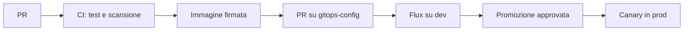

# Piano DevOps in 8 settimane – Lab guidati per Windows e Git Bash (4 ore/giorno)

## Come usare il piano

Il piano dura 8 settimane (l'ultima di 3 giorni), per 152 ore totali, e costruisce una piattaforma DevOps completa in locale (Docker e Kubernetes) e su GitHub partendo da un'app minuscola. Ogni giorno spiega prima la teoria che serve, poi ti guida passo per passo, poi ti chiede di verificare e di rompere qualcosa di proposito: è così che si impara a diagnosticare.

**Ritmo giornaliero (4 ore)**

1. Ora 1: leggi la "Teoria in breve" del giorno e controlla i prerequisiti.
2. Ore 2-3: esegui i passi nell'ordine, senza saltarne nessuno.
3. Ora 4: verifica il risultato, provoca un guasto, scrivi il README del lab e fai commit.

**Regole fisse**

- Per note, Terraform e script usa il repository `devops-lab` su GitHub, con una cartella per lab (`lab01-ci`, `lab03-terraform`, ...) e un README per cartella.
- Nel README scrivi: architettura in 5 righe, comandi usati, errori incontrati e come li hai risolti. Rileggendolo tra un mese ti ricorderai tutto.
- A fine sessione ferma cluster e container che non usi (`kind delete cluster`, `docker stop`): liberano RAM e CPU del PC.
- Mai segreti nei repository: né password, né token, né chiavi private.

**Repository usati nel percorso:** `devops-lab` (note, Terraform, script), `lab01-app` (app e pipeline), `gitops-config` (chart Helm e configurazione di Flux), `lab09-iis` (app .NET per IIS).

**Come leggere i passi.** Ogni passo ha un titolo in grassetto, una breve spiegazione di cosa fa e perché, i comandi e il risultato atteso. Dove vedi `<utente>`, `<univoco>` o simili, sostituisci con il tuo valore (senza le parentesi angolari). Se un risultato è diverso da quello atteso, fermati e leggi "Se qualcosa non va" prima di proseguire: gli errori non si accumulano bene.

**Dove si eseguono i comandi**

| Blocco di codice | Dove lo esegui | Esempio |
| --- | --- | --- |
| `bash` | Git Bash sul tuo PC Windows | `terraform plan` |
| `powershell` | PowerShell (setup iniziale e VM Windows della settimana 5) | `winget install ...` |
| `hcl`, `yaml`, `python`, `csharp`, `groovy`, `dockerfile` | File da creare con VS Code | `main.tf`, `ci.yml` |

**Una nota sui tempi.** Alcuni giorni (soprattutto Settimana 4 giorno 4 e Settimana 6 giorno 4) possono richiedere più di 4 ore. Se succede, finisci il giorno dopo e sposta in avanti il resto: è meglio capire che correre.

## Settimana 0: preparare Windows e Git Bash (una volta sola, 3-4 ore)

Prima di cominciare serve un ambiente di lavoro affidabile. Gran parte dei problemi che incontrerai non dipende dai tool DevOps ma da come Windows e Git Bash li eseguono: per questo questa settimana è la più importante.

### Teoria in breve

**Cos'è Git Bash.** È una shell Bash che arriva con Git per Windows e si appoggia su MSYS2, un livello che imita i comandi Unix (`ls`, `sed`, `curl`, `ssh`). Non è Linux e non è una macchina virtuale: i programmi che lanci (`az`, `terraform`, `kubectl`) restano programmi Windows. Da qui nascono le differenze qui sotto.

**Perché Docker, Kubernetes e le pipeline sono "Linux".** Quasi tutto il software DevOps gira su Linux: i container condividono il kernel Linux e i runner delle pipeline sono per lo più Ubuntu. Su Windows Docker Desktop usa WSL2, cioè un vero kernel Linux in una macchina virtuale leggera. Per questo i file che scrivi (script, YAML, Dockerfile) devono avere fine riga Linux (LF) e non Windows (CRLF).

**Le differenze da conoscere**

| Problema | Sintomo | Soluzione |
| --- | --- | --- |
| Conversione automatica dei percorsi | Argomenti come `/mnt/...` o `/var/run/docker.sock` diventano `C:/Program Files/Git/...` | `export MSYS_NO_PATHCONV=1` (lo mettiamo in `~/.bashrc`) |
| Terminali interattivi | `the input device is not a TTY` con `-it` | Anteponi `winpty` al comando |
| Fine riga CRLF | `\r: command not found`, YAML o Dockerfile che falliscono | `core.autocrlf input` e `.gitattributes` |
| `sudo` non esiste | `sudo: command not found` | Installa con winget o scoop |
| `python3` non esiste | Si apre il Microsoft Store | Usa `python` |
| Ambiente virtuale Python | `.venv/bin/activate` non esiste | Usa `source .venv/Scripts/activate` |

### Passo 1 – Controlla i requisiti

Servono Windows 10 o 11 a 64 bit, almeno 8 GB di RAM (meglio 16 GB), 40 GB liberi e la virtualizzazione attiva nel BIOS/UEFI. La virtualizzazione serve a Docker e WSL2. Per sapere se è attiva apri Gestione attività → **Prestazioni** → **CPU** e leggi *Virtualizzazione: Abilitato*.

Abilita WSL2 (PowerShell come amministratore) e riavvia:

```powershell
wsl --install
```

### Passo 2 – Installa gli strumenti principali con winget

`winget` è il gestore di pacchetti di Windows: scarica e installa i programmi da riga di comando, così il risultato è ripetibile. Apri PowerShell e lancia:

```powershell
winget install --id Git.Git -e
winget install --id Microsoft.VisualStudioCode -e
winget install --id Docker.DockerDesktop -e
winget install --id Microsoft.PowerShell -e
winget install --id Python.Python.3.12 -e
winget install --id Microsoft.DotNet.SDK.8 -e
winget install --id Hashicorp.Terraform -e
winget install --id Kubernetes.kubectl -e
winget install --id Helm.Helm -e
winget install --id Kubernetes.kind -e
```

Se un identificativo non viene trovato, cerca con `winget search <nome>` e usa quello che compare. Alla fine **chiudi e riapri** tutti i terminali, altrimenti il PATH non si aggiorna.

Avvia Docker Desktop, accetta le condizioni e in **Settings** → **General** controlla che sia attivo *Use the WSL 2 based engine*.

**Risorse per Docker.** In Docker Desktop → **Settings** → **Resources** assegna almeno 6 GB di RAM e 4 CPU (se il PC ha 16 GB). Da settimana 3 ci girerà un cluster Kubernetes con più nodi; se il PC ha solo 8 GB useremo un cluster più piccolo e lo indicheremo.

### Passo 3 – Installa gli altri strumenti con Scoop

Scoop è un secondo gestore di pacchetti che installa nel tuo profilo, senza permessi di amministratore. Lo usiamo per i tool meno diffusi.

```powershell
Set-ExecutionPolicy -ExecutionPolicy RemoteSigned -Scope CurrentUser
irm get.scoop.sh | iex
scoop install flux sops age tflint cosign
```

Se un pacchetto non si trova usa `scoop search <nome>`; in alternativa scarica l'eseguibile dalla pagina *Releases* del progetto su GitHub e mettilo in una cartella inclusa nel PATH.

### Passo 4 – Configura Git

Queste impostazioni dicono chi sei e, soprattutto, evitano che Git trasformi i fine riga dei tuoi file in CRLF.

```bash
git config --global user.name "Nome Cognome"
git config --global user.email "tua@email"
git config --global init.defaultBranch main
git config --global core.autocrlf input
```

`core.autocrlf input` converte CRLF in LF al commit e non tocca altro. In ogni repository nuovo aggiungerai anche un file `.gitattributes` con `* text=auto eol=lf`, che fa lo stesso per tutti i collaboratori.

### Passo 5 – Configura Git Bash

Apri Git Bash e aggiungi questa riga al file di avvio della shell.

```bash
cat >> ~/.bashrc <<'EOF'
# --- lab DevOps ---
export MSYS_NO_PATHCONV=1
EOF
source ~/.bashrc
```

La riga impedisce a Git Bash di "correggere" i percorsi che passi ai programmi (per esempio `/mnt/secrets` o `/var/run/docker.sock`): senza, molti comandi di Docker e Kubernetes darebbero errori incomprensibili.

### Passo 6 – Imposta il terminale di VS Code

Apri VS Code → premi `Ctrl+Shift+P` → scrivi `Terminal: Select Default Profile` → scegli **Git Bash**. Da ora il terminale integrato è Git Bash e puoi editare e lanciare comandi nello stesso posto. Installa anche le estensioni *HashiCorp Terraform*, *YAML*, *Docker* e *Kubernetes* dal pannello Estensioni.

### Passo 7 – Controlla che tutto funzioni

In un nuovo Git Bash esegui:

```bash
git --version
docker version --format '{{.Server.Version}}'
python --version
dotnet --version
terraform version | head -1
kubectl version --client | head -1
helm version --short
kind version
flux --version
sops --version | head -1
age --version
tflint --version | head -1
cosign version | head -3
```

Atteso: nessun `command not found`. Se un comando manca, quel pacchetto non è installato o il terminale non è stato riaperto.

### Passo 8 – Crea gli account

Servono un account **GitHub** e un account **GitLab** (gratuiti). Più avanti ti servirà un account **Red Hat** gratuito per OpenShift (facoltativo).

### Passo 9 – Installa Ubuntu su WSL2

Servirà nella settimana 2 per il bonus WireGuard della settimana 2 (facoltativo).

```powershell
wsl --install -d Ubuntu
```

Al primo avvio crea utente e password Linux. Verifica con `wsl -l -v`: la versione deve essere 2.

**Verifica finale della settimana 0:** tutti i comandi del passo 7 rispondono e Docker Desktop è in esecuzione (`docker run --rm hello-world` stampa il messaggio di benvenuto).

## Calendario

| Settimana | Lab | Risultato finale |
| --- | --- | --- |
| 0 | Setup | Windows, Git Bash, Docker e account pronti |
| 1 | 1-2 | Pipeline su 3 tool, registry, scansione e firma immagini |
| 2 | 3-4 | Infrastruttura come codice con Terraform e reti Docker hub-spoke |
| 3 | 5 | Cluster Kubernetes locale (kind) con chart Helm, ingress e NetworkPolicy |
| 4 | 6-8 | GitOps con Flux, segreti cifrati con SOPS, app su OpenShift |
| 5 | 9-11 | Rilascio IIS con rollback, runbook, script cross-platform |
| 6 | 12-13 | Monitoring e flusso di release end-to-end con canary |
| 7 | 14-18 | SBOM e governance, Elasticsearch, Lens, Ansible AWX, Conjur |
| 8 (3 giorni) | 19-20 | SonarQube, Dependency-Track e cancelli di qualità in Jenkins |

## Settimana 1: CI/CD multi-tool e supply chain (Lab 1-2)

Al termine hai la stessa pipeline su GitHub Actions, GitLab CI e Jenkins, più un registry con immagini scansionate e firmate.

**Repository della settimana:** `lab01-app` (nuovo repo GitHub pubblico con app, Dockerfile e workflow). Appunti e README restano in `devops-lab`.

**Teoria della settimana.** *Integrazione continua (CI)* significa che ogni modifica al codice viene compilata e testata automaticamente: i problemi emergono in minuti, non a fine progetto. *Consegna continua (CD)* estende l'idea: ogni modifica che supera i test è pronta per essere rilasciata, con un clic o in automatico. Una *pipeline* è la sequenza di questi passi, descritta in un file di testo (di solito YAML) che sta nel repository insieme al codice: così è versionata, rivedibile e ripetibile. I tool cambiano (GitHub Actions, GitLab CI, Jenkins) ma i concetti sono gli stessi: un *trigger* (cosa avvia la pipeline), dei *job* (blocchi di lavoro che girano su una macchina chiamata *runner* o *agent*), degli *step* (comandi dentro un job), degli *artefatti* (file prodotti) e dei *segreti* (valori sensibili iniettati a runtime). Farai la stessa pipeline tre volte per imparare a riconoscere i concetti dietro le sintassi.

### Giorno 1: app di esempio e regole di repository

**Obiettivo:** un'app con test, lint e Dockerfile, protetta da regole sul branch `main`.

**Teoria in breve.**

- **Test e lint.** I test verificano che il comportamento sia giusto (`pytest`); il lint (`ruff`) controlla stile ed errori banali senza eseguire il codice. Entrambi sono veloci e sono il primo cancello della pipeline.
- **Immagine container.** Un'immagine è un pacchetto immutabile con app e dipendenze; un Dockerfile è la ricetta, eseguita a strati (*layer*): copiare prima `requirements.txt` e installare le dipendenze permette a Docker di riusare quel layer finché le dipendenze non cambiano. Girare come utente non-root riduce i danni se l'app viene compromessa.
- **Branch protection.** Impedisce di scrivere direttamente su `main`: ogni modifica passa da una *pull request* (PR) e dai controlli automatici. È la regola base di ogni flusso serio.
- **Conventional Commits.** Convenzione per i messaggi (`feat:`, `fix:`, `ci:`...). Serve alle macchine: domani un tool leggerà i messaggi per decidere il numero di versione.

**Passo 1 – Crea il repository.** Su GitHub: **New repository** → nome `lab01-app` → **Public** → spunta **Add a README** → **Create repository**. Poi clonalo con Git Bash (al primo `git push` si aprirà il browser per autorizzare Git Credential Manager: accetta).

```bash
cd ~
git clone https://github.com/<utente>/lab01-app.git
cd lab01-app
```

**Passo 2 – Imposta i fine riga e gli esclusi.** Questi file dicono a Git di usare sempre fine riga Linux (LF) e a Docker di non copiare nell'immagine file inutili.

```bash
printf "* text=auto eol=lf\n" > .gitattributes
printf ".venv/\n__pycache__/\n.pytest_cache/\n.ruff_cache/\n" > .gitignore
printf ".venv\n.git\n__pycache__\n.pytest_cache\n" > .dockerignore
```

**Passo 3 – Crea cartelle e ambiente virtuale.** L'ambiente virtuale isola le librerie del progetto da quelle del sistema. In Git Bash su Windows lo script di attivazione sta in `Scripts`, non in `bin`.

```bash
mkdir -p app tests
touch app/__init__.py tests/__init__.py
python -m venv .venv
source .venv/Scripts/activate
```

Atteso: il prompt inizia con `(.venv)`. I due file `__init__.py` rendono `app` e `tests` pacchetti Python importabili da `pytest`.

**Passo 4 – Installa le dipendenze.** `fastapi` è il framework web, `uvicorn` il server, `httpx` serve al client di test.

```bash
printf "fastapi\nuvicorn\nhttpx\n" > requirements.txt
pip install -r requirements.txt pytest ruff
```

**Passo 5 – Scrivi app e test.** L'app espone un solo endpoint `/health`, che le piattaforme usano per sapere se il servizio è vivo; il test lo chiama come farebbe un client vero.

```bash
cat > app/main.py <<'EOF'
from fastapi import FastAPI

app = FastAPI()


@app.get("/health")
def health():
    return {"status": "ok"}
EOF

cat > tests/test_health.py <<'EOF'
from fastapi.testclient import TestClient

from app.main import app


def test_health():
    assert TestClient(app).get("/health").json() == {"status": "ok"}
EOF
```

**Passo 6 – Esegui test e lint.**

```bash
pytest -q
ruff check .
```

Atteso: `1 passed` e `All checks passed!`.

**Passo 7 – Scrivi il Dockerfile e provalo.** Le righe sono in ordine di frequenza di modifica (dipendenze prima, codice dopo) per sfruttare la cache dei layer.

```dockerfile
FROM python:3.12-slim
WORKDIR /srv
COPY requirements.txt .
RUN pip install --no-cache-dir -r requirements.txt
COPY app ./app
RUN useradd -u 10001 appuser
USER 10001
EXPOSE 8000
CMD ["uvicorn", "app.main:app", "--host", "0.0.0.0", "--port", "8000"]
```

```bash
docker build -t lab01 .
docker run -d --rm --name lab01 -p 8000:8000 lab01
curl http://localhost:8000/health
docker stop lab01
```

Atteso: `{"status":"ok"}`. `-p 8000:8000` collega la porta 8000 del tuo PC a quella del container; `--rm` lo elimina quando si ferma.

**Passo 8 – Primo commit con Conventional Commits.**

```bash
git add .
git commit -m "feat: add health endpoint and Dockerfile"
git push origin main
```

**Passo 9 – Proteggi `main`.** Su GitHub: repo → **Settings** → **Branches** → **Add branch ruleset** (o *Add classic branch protection rule*) → pattern `main` → attiva **Require a pull request before merging**. Lascia 0 approvazioni richieste: da solo non puoi approvare la tua PR. Gli status check obbligatori li aggiungi domani.

**Verifica:** `pytest` e `ruff` passano, l'immagine risponde su `/health`, un push diretto su `main` viene rifiutato.

**Se qualcosa non va:** `ModuleNotFoundError: app` → controlla i file `__init__.py` e lancia `pytest` dalla radice. `Cannot connect to the Docker daemon` → avvia Docker Desktop. `python: command not found` → riapri Git Bash dopo l'installazione.

### Giorno 2: GitHub Actions e GitLab CI

**Obiettivo:** la stessa pipeline (lint, test, build) su due piattaforme.

**Teoria in breve.**

- **GitHub Actions.** Un *workflow* è un file in `.github/workflows/`. Parte su un *evento* (`pull_request`, `push`). Contiene *job* che girano in parallelo su un *runner* (una macchina virtuale pulita a ogni esecuzione). Con `needs` dici che un job aspetta un altro. Con `strategy.matrix` ripeti lo stesso job con valori diversi (qui due versioni di Python): così scopri problemi di compatibilità senza duplicare codice.
- **Status check.** Ogni job è un controllo con nome; il branch protection può richiedere che i controlli scelti siano verdi prima del merge.
- **GitLab CI.** Il file si chiama `.gitlab-ci.yml`. Invece dei job paralleli per default, ragiona per *stage* in sequenza (`test`, poi `build`); i job dello stesso stage girano in parallelo. Un job gira in un container (`image:`); `services:` avvia container di supporto. Per costruire immagini Docker dentro un job serve *docker-in-docker* (dind): un demone Docker avviato come servizio.

**Passo 1 – Crea un branch di lavoro.** Non si lavora mai direttamente su `main`: un branch isola la modifica finché non è approvata.

```bash
git switch -c ci/add-workflow
mkdir -p .github/workflows
```

**Passo 2 – Scrivi `.github/workflows/ci.yml`.** Il job `test` gira due volte (Python 3.11 e 3.12); `build` parte solo se `test` è verde.

```yaml
name: ci
on:
  pull_request:
  push:
    branches: [main]
jobs:
  test:
    runs-on: ubuntu-latest
    strategy:
      matrix:
        python: ["3.11", "3.12"]
    steps:
      - uses: actions/checkout@v4
      - uses: actions/setup-python@v5
        with:
          python-version: ${{ matrix.python }}
          cache: pip
      - run: pip install -r requirements.txt pytest ruff
      - run: ruff check .
      - run: pytest -q
  build:
    needs: test
    runs-on: ubuntu-latest
    steps:
      - uses: actions/checkout@v4
      - run: docker build -t lab01:${{ github.sha }} .
```

**Passo 3 – Pubblica e apri la pull request.**

```bash
git add .github
git commit -m "ci: add GitHub Actions workflow"
git push -u origin ci/add-workflow
```

Su GitHub clicca **Compare & pull request** → **Create pull request**.

**Passo 4 – Osserva la pipeline.** Nella PR, sezione **Checks**, e nella tab **Actions**. Atteso: due job `test (3.11)` e `test (3.12)`, poi `build`, tutti verdi. Apri un job e leggi i log di ogni step: imparare a leggerli è metà del mestiere.

**Passo 5 – Rendi i check obbligatori.** **Settings** → **Branches** → modifica la regola su `main` → **Require status checks to pass** → cerca e aggiungi `test (3.11)`, `test (3.12)` e `build` → **Save**. Poi fai **Merge** della PR.

**Passo 6 – Rompi un test di proposito.** Vuoi vedere il cancello chiudersi.

```bash
git switch main && git pull
git switch -c fix/break-test
sed -i 's/"ok"}$/"ko"}/' tests/test_health.py
git commit -am "test: break on purpose"
git push -u origin fix/break-test
```

Apri la PR: il check diventa rosso e il merge è bloccato. Poi chiudi la PR senza fare merge.

**Passo 7 – Replica su GitLab.** Crea un account su gitlab.com → **New project** → **Create blank project** → nome `lab01-app`, visibilità Public, senza README. Poi aggiungi un secondo *remote* (un secondo indirizzo a cui spedire lo stesso codice):

```bash
git switch main && git pull
git remote add gitlab https://gitlab.com/<utente>/lab01-app.git
git push gitlab main
```

**Passo 8 – Scrivi `.gitlab-ci.yml`** nella radice, committa e pubblica su entrambi i remote.

```yaml
stages: [test, build]

test:
  stage: test
  image: python:3.12-slim
  script:
    - pip install -r requirements.txt pytest ruff
    - ruff check .
    - pytest -q

build:
  stage: build
  image: docker:27
  services: [docker:27-dind]
  variables:
    DOCKER_TLS_CERTDIR: "/certs"
  script:
    - docker build -t $CI_REGISTRY_IMAGE:$CI_COMMIT_SHORT_SHA .
```

```bash
git switch -c ci/gitlab && git add .gitlab-ci.yml
git commit -m "ci: add GitLab pipeline"
git push gitlab ci/gitlab:main
git push origin ci/gitlab
```

Su GitLab vai in **Build** → **Pipelines**. Atteso: stage `test` e `build` verdi.

**Verifica:** stessa pipeline verde su GitHub e GitLab; una PR con test rotto non si può unire.

**Se qualcosa non va:** GitLab può chiedere la verifica dell'account per usare i runner condivisi: completala dal messaggio nella pipeline. Se `build` fallisce con `Cannot connect to the Docker daemon`, controlla la riga `DOCKER_TLS_CERTDIR`. Se Git ti segnala `LF will be replaced by CRLF`, controlla `git config core.autocrlf` (deve essere `input`).

### Giorno 3: Jenkins in profondità

**Obiettivo:** un Jenkins locale con pipeline dichiarativa, report dei test, parametri, credenziali e pipeline per ogni branch.

**Teoria in breve.**

- **Controller e agent.** Jenkins è un server che installi e gestisci tu: il *controller* orchestra, gli *agent* eseguono i job. È più manutenzione di un servizio gestito ma anche il più flessibile, e lo trovi ancora in moltissime aziende.
- **Pipeline dichiarativa.** Il file `Jenkinsfile` sta nel repository e ha una struttura fissa: `pipeline { agent; options; parameters; environment; stages { stage { steps } }; post }`. `post` esegue azioni a fine esecuzione (per esempio pubblicare i report anche se i test falliscono).
- **Credenziali.** Jenkins ha un archivio cifrato dei segreti. Nel `Jenkinsfile` li richiami per nome (`withCredentials`) e Jenkins ne maschera il valore nei log: il segreto non sta mai nel repository.
- **Plugin.** Report dei test (`junit`), archiviazione degli artefatti, collegamento a GitHub: tutto passa da plugin. Quelli "suggeriti" all'installazione bastano.
- **Multibranch.** Una pipeline *multibranch* scansiona il repository e crea da sola un job per ogni branch che contiene un `Jenkinsfile`. Non avendo un indirizzo pubblico, il tuo Jenkins locale non può ricevere *webhook* da GitHub: controlla invece i cambiamenti a intervalli regolari (*polling*).

**Passo 1 – Costruisci un Jenkins con Docker e Python.** L'immagine ufficiale di Jenkins non contiene né Python né il client Docker, quindi ne creiamo una nostra. Lavora in una cartella fuori dal repo.

```bash
mkdir -p ~/jenkins-lab && cd ~/jenkins-lab
cat > Dockerfile.jenkins <<'EOF'
FROM jenkins/jenkins:lts-jdk17
USER root
RUN apt-get update \
 && apt-get install -y docker.io python3 python3-pip python3-venv \
 && rm -rf /var/lib/apt/lists/*
EOF

docker build -t jenkins-lab -f Dockerfile.jenkins .
docker run -d --name jenkins -u root -p 8080:8080 -p 50000:50000 \
  -v jenkins_home:/var/jenkins_home \
  -v /var/run/docker.sock:/var/run/docker.sock jenkins-lab
docker exec jenkins cat /var/jenkins_home/secrets/initialAdminPassword
```

Il volume `jenkins_home` conserva la configurazione; montare `docker.sock` permette a Jenkins di usare il Docker del tuo PC per costruire immagini. L'ultimo comando stampa la password iniziale.

**Passo 2 – Configura Jenkins.** Apri `http://localhost:8080`, incolla la password, scegli **Install suggested plugins** e crea l'utente amministratore.

**Passo 3 – Scrivi il `Jenkinsfile`** nella radice di `lab01-app`. Esegue lint e test con report JUnit, costruisce l'immagine solo se il parametro lo chiede e usa una credenziale.

```groovy
pipeline {
  agent any
  options { timestamps() }
  parameters {
    booleanParam(name: 'BUILD_IMAGE', defaultValue: true, description: 'Costruisci anche l immagine Docker')
  }
  environment {
    IMAGE = "lab01:${BUILD_NUMBER}"
  }
  stages {
    stage('Test') {
      steps {
        sh '''
          python3 -m venv .venv
          . .venv/bin/activate
          pip install -r requirements.txt pytest ruff
          ruff check .
          pytest -q --junitxml=report.xml
        '''
      }
      post {
        always { junit 'report.xml' }
      }
    }
    stage('Build') {
      when { expression { params.BUILD_IMAGE } }
      steps {
        sh 'docker build -t $IMAGE .'
      }
    }
    stage('Credenziale di prova') {
      steps {
        withCredentials([string(credentialsId: 'lab-token', variable: 'TOKEN')]) {
          sh 'echo "Il token è lungo ${#TOKEN} caratteri"; echo "Valore: $TOKEN"'
        }
      }
    }
  }
  post {
    success { echo 'Pipeline completata' }
    failure { echo 'Pipeline fallita: guarda i report dei test' }
  }
}
```

```bash
cd ~/lab01-app
git switch main && git pull
git switch -c ci/jenkins && git add Jenkinsfile
git commit -m "ci: add Jenkinsfile" && git push -u origin ci/jenkins
```

**Passo 4 – Crea la credenziale.** Jenkins → **Manage Jenkins** → **Credentials** → **System** → **Global credentials** → **Add Credentials** → *Kind* **Secret text** → *Secret* un valore qualsiasi → *ID* `lab-token` → **Create**.

**Passo 5 – Crea il job.** **New Item** → nome `lab01` → **Pipeline** → **OK** → sezione Pipeline: **Pipeline script from SCM** → SCM **Git** → URL del repo GitHub → branch `*/ci/jenkins` → Script Path `Jenkinsfile` → **Save**. Poi **Build with Parameters** → **Build**.

Atteso: stage `Test`, `Build` e `Credenziale di prova` verdi nella *Stage View*; nella pagina del build compare il grafico dei test. Nel log dell'ultimo stage il valore del token appare come `****`: Jenkins ha mascherato il segreto.

**Passo 6 – Prova il parametro.** Rilancia con **BUILD\_IMAGE** disattivato: lo stage `Build` viene saltato.

**Passo 7 – Pipeline per ogni branch (multibranch).** **New Item** → nome `lab01-multi` → **Multibranch Pipeline** → *Branch Sources* → **GitHub** → URL del repository (pubblico) → *Scan Multibranch Pipeline Triggers* → spunta **Periodically if not otherwise run** con 1 minuto → **Save**. Se la voce GitHub non compare, installa il plugin *GitHub Branch Source* da **Manage Jenkins** → **Plugins**. Crea un nuovo branch con un commit e osserva Jenkins trovarlo e lanciarlo da solo.

**Passo 8 – Rompi un test di proposito.** In un branch cambia l'atteso del test in `ko`, pubblica: lo stage `Test` fallisce, il report JUnit mostra quale test è rosso e il job multibranch segna il branch come fallito.

**Verifica:** tre pipeline verdi sullo stesso codice (GitHub Actions, GitLab CI, Jenkins). Nel README di `devops-lab/lab01-ci` fai una tabella con differenze di sintassi, runner e gestione dei segreti.

**Se qualcosa non va:** `docker: not found` nello stage `Build` → stai usando l'immagine ufficiale e non `jenkins-lab`. `permission denied` su `docker.sock` → il container deve partire con `-u root`, come sopra. `No such property: BUILD_NUMBER` → controlla di scrivere la variabile tra virgolette doppie.

### Giorno 4: standard di rilascio con versioni automatiche

**Obiettivo:** ogni merge su `main` produce, quando serve, una release con versione e changelog.

**Teoria in breve.**

- **Semantic Versioning.** Un numero `MAJOR.MINOR.PATCH`: PATCH sale per correzioni compatibili, MINOR per nuove funzioni compatibili, MAJOR per modifiche che rompono la compatibilità. Chi usa il tuo software capisce dal numero quanto rischia aggiornando.
- **Dai commit alla versione.** Con Conventional Commits `fix:` implica PATCH, `feat:` implica MINOR, `feat!:` (o `BREAKING CHANGE`) implica MAJOR. Un tool può quindi calcolare la versione e il changelog leggendo la cronologia.
- **release-please.** Non rilascia a ogni commit: mantiene una *release PR* sempre aggiornata con versione e changelog proposti. Quando la unisci, crea tag e release. Il rilascio resta una decisione umana, ma senza lavoro manuale.

**Passo 1 – Consenti ai workflow di aprire PR.** Repo → **Settings** → **Actions** → **General** → **Workflow permissions** → scegli **Read and write permissions** e spunta **Allow GitHub Actions to create and approve pull requests** → **Save**.

**Passo 2 – Unisci il lavoro precedente.** Fai il merge in `main` della PR con `ci.yml` (i file degli altri tool puoi tenerli nello stesso branch o in PR separate).

**Passo 3 – Crea `.github/workflows/release.yml`.**

```yaml
name: release
on:
  push:
    branches: [main]
permissions:
  contents: write
  pull-requests: write
jobs:
  release:
    runs-on: ubuntu-latest
    steps:
      - uses: googleapis/release-please-action@v4
        with:
          release-type: simple
```

**Passo 4 – Pubblica un commit che meriti una versione.**

```bash
git switch main && git pull
git switch -c ci/release
git add .github/workflows/release.yml
git commit -m "feat: add automated releases"
git push -u origin ci/release
```

Apri la PR, attendi i check verdi, fai il merge.

**Passo 5 – Leggi la release PR.** Dopo il merge compare una PR con titolo simile a `chore(main): release 1.0.0` (o `0.1.0`) che contiene `CHANGELOG.md` e `version.txt`. Controlla che il changelog elenchi i tuoi commit `feat:`.

**Passo 6 – Pubblica la release.** Fai il merge di quella PR. Vai su **Releases**: trovi il tag (es. `v1.0.0`) e le note generate.

**Passo 7 – Scrivi `CONTRIBUTING.md`** con queste sezioni: formato dei commit (`feat:`, `fix:`, `docs:`, `ci:`), regola "una PR = una modifica", checklist di rilascio (check verdi, changelog riletto), come fare un hotfix.

**Verifica:** un `fix:` successivo genera una PR di release con salto di PATCH; un commit `feat!:` con salto di MAJOR.

**Se qualcosa non va:** se non compare nessuna PR, apri **Actions** → job `release` e leggi l'errore; di solito mancano i permessi del passo 1.

### Giorno 5: registry, scansione e firma (Lab 2)

**Obiettivo:** ogni immagine viene scansionata, pubblicata su GHCR e firmata.

**Teoria in breve.**

- **Registry.** È il magazzino delle immagini: le pipeline le *pubblicano* lì e i cluster le *scaricano* da lì. GHCR è il registry di GitHub.
- **Tag e digest.** Un tag (`1.0.0`, `latest`) è un'etichetta mobile: può puntare a contenuti diversi nel tempo. Il *digest* (`sha256:...`) identifica il contenuto esatto ed è immutabile. Per questo la firma si applica al digest.
- **Scansione delle vulnerabilità.** Trivy confronta pacchetti e librerie dell'immagine con i database di vulnerabilità note (*CVE*). Fallire la pipeline su gravità `HIGH` e `CRITICAL` impedisce di pubblicare immagini con falle gravi note e correggibili (`ignore-unfixed`).
- **SBOM.** È l'elenco dei componenti dentro l'immagine: serve a sapere se sei esposto quando esce una nuova vulnerabilità.
- **Firma senza chiavi.** Cosign, con Sigstore, firma l'immagine usando l'identità del workflow GitHub (un token OIDC a breve durata): non devi custodire chiavi private. Chi scarica può verificare *chi* ha costruito l'immagine e *da quale repository*: è una difesa contro immagini manomesse.

**Passo 1 – Crea il branch.**

```bash
git switch main && git pull && git switch -c ci/publish
```

**Passo 2 – Scrivi `.github/workflows/publish.yml`.** Il flusso è: build locale, scansione, push, firma. La scansione avviene prima del push, così un'immagine vulnerabile non arriva mai al registry.

```yaml
name: publish
on:
  push:
    branches: [main]
jobs:
  publish:
    runs-on: ubuntu-latest
    permissions:
      contents: read
      packages: write
      id-token: write
    steps:
      - uses: actions/checkout@v4
      - name: Nome immagine in minuscolo
        run: echo "IMAGE=ghcr.io/${GITHUB_REPOSITORY,,}" >> "$GITHUB_ENV"
      - uses: docker/setup-buildx-action@v3
      - name: Build locale per la scansione
        uses: docker/build-push-action@v6
        with:
          context: .
          load: true
          tags: lab01:scan
      - name: Scansione Trivy
        uses: aquasecurity/trivy-action@0.28.0
        with:
          image-ref: lab01:scan
          severity: CRITICAL,HIGH
          ignore-unfixed: true
          exit-code: '1'
      - uses: docker/login-action@v3
        with:
          registry: ghcr.io
          username: ${{ github.actor }}
          password: ${{ secrets.GITHUB_TOKEN }}
      - name: Push su GHCR
        id: push
        uses: docker/build-push-action@v6
        with:
          context: .
          push: true
          tags: ${{ env.IMAGE }}:${{ github.sha }}
      - uses: sigstore/cosign-installer@v3
      - name: Firma l'immagine
        run: cosign sign --yes ${{ env.IMAGE }}@${{ steps.push.outputs.digest }}
```

**Passo 3 – Pubblica con PR e merge.**

```bash
git add .github/workflows/publish.yml
git commit -m "ci: scan, publish and sign image"
git push -u origin ci/publish
```

Apri la PR e fai il merge. Il workflow parte sul push in `main`.

**Passo 4 – Controlla il pacchetto.** Profilo GitHub → **Packages**: trovi `lab01-app`. Per renderlo scaricabile senza login: apri il pacchetto → **Package settings** → **Change visibility** → **Public**. Servirà nelle settimane successive.

**Passo 5 – Verifica la firma dal tuo PC.** Hai installato cosign con Scoop nella settimana 0. Sostituisci `<sha>` con lo SHA completo del commit su `main` (lo vedi nel pacchetto come tag).

```bash
cosign verify ghcr.io/<utente>/lab01-app:<sha> \
  --certificate-identity-regexp 'https://github.com/<utente>/.*' \
  --certificate-oidc-issuer https://token.actions.githubusercontent.com
```

Atteso: un JSON con la verifica riuscita. La verifica dice: "questa immagine è stata firmata da un workflow del tuo account GitHub".

**Passo 6 – Rompi qualcosa di proposito.** Aggiungi in `requirements.txt` una versione vecchia e vulnerabile, per esempio `requests==2.19.0`, committa su un branch e apri una PR. Dopo il merge, il job fallisce al passo Trivy e **nessuna immagine viene pubblicata**. Ripristina il file.

**Bonus:** per l'SBOM aggiungi a Trivy `format: cyclonedx` e `output: sbom.json`, poi carica il file con `actions/upload-artifact@v4`. Per un repository di pacchetti locale avvia Nexus: `docker run -d -p 8081:8081 --name nexus sonatype/nexus3`.

**Verifica:** immagine su GHCR con firma verificabile, pipeline bloccata da una dipendenza vulnerabile.

## Settimana 2: Terraform e reti con Docker (Lab 3-4)

Al termine hai infrastruttura descritta con moduli Terraform (reti e container Docker sul tuo PC), una pipeline con controlli e approvazione, e una rete hub-spoke con routing, nomi e guasti da diagnosticare. Nessun account cloud: Terraform non è legato a un fornitore, parla con qualsiasi *provider*, e qui il provider è Docker.

**Repository della settimana:** `devops-lab`, cartelle `lab03-terraform` e `lab04-network`.

**Teoria della settimana.** L'*Infrastructure as Code* (IaC) descrive l'infrastruttura (reti, macchine, container, database) in file di testo invece di crearla a mano. I vantaggi: è ripetibile (stesso codice, stesso risultato), rivedibile (una PR mostra cosa cambierà), versionata e documentata dal codice stesso. Terraform è *dichiarativo*: scrivi lo stato desiderato ("voglio una rete e due container") e lui calcola cosa creare, modificare o eliminare. I comandi chiave sono `plan` (mostra le differenze senza toccare nulla) e `apply` (le esegue). È *idempotente*: rilanciare `apply` senza modifiche non cambia nulla.

Un *provider* è il plugin che sa parlare con una piattaforma: Docker qui, ma gli stessi concetti e comandi valgono con AWS, Google Cloud o Kubernetes. Chi sa usare Terraform con Docker sa usarlo ovunque: cambiano i nomi delle risorse, non il metodo.

Terraform ricorda cosa ha creato in un file chiamato *state*, che collega ogni risorsa del codice a quella reale. Lo state può contenere informazioni sensibili e in team va condiviso: in produzione sta in un *backend remoto* con un *lock* che impedisce due `apply` simultanei. Nei lab lo teniamo in locale, e come bonus lo sposterai su un archivio S3 locale.

**Prerequisiti:** Docker Desktop in esecuzione, `terraform version` 1.9 o superiore.

### Giorno 1: primo progetto Terraform con Docker

**Obiettivo:** creare da Terraform una rete e un container web, e vedere come Terraform confronta codice, state e realtà.

**Teoria in breve.**

- **Risorse, variabili, output.** Una *resource* è un oggetto da creare (`docker_container`); una *variable* è un parametro in ingresso, così lo stesso codice serve più ambienti; un *output* espone un valore calcolato.
- **Indirizzi.** Ogni risorsa ha un indirizzo (`docker_container.web`). Le altre risorse la referenziano (`docker_network.app.name`): così Terraform capisce le dipendenze e crea le cose nell'ordine giusto.
- **Il file lock.** `terraform init` scarica il provider e registra la versione in `.terraform.lock.hcl`: quel file va committato, la cartella `.terraform/` no.
- **Simboli del plan.** `+` creazione, `-` eliminazione, `~` modifica sul posto, `-/+` ricreazione (la risorsa va distrutta e ricreata perché quel campo non si può modificare).
- **Drift.** Se qualcuno cambia la realtà a mano (per esempio elimina un container), il `plan` successivo lo rileva e propone di ripristinarlo.

**Passo 1 – Prepara cartelle e file di esclusione.** Il `.gitignore` protegge il repository dall'inclusione di state, plan e variabili locali.

```bash
mkdir -p ~/devops-lab/lab03-terraform/envs/dev
cd ~/devops-lab
git init 2>/dev/null
printf "* text=auto eol=lf\n" > .gitattributes
printf ".terraform/\n*.tfstate*\n*.tfvars\ntfplan\n.venv/\n" > .gitignore
cd lab03-terraform/envs/dev
```

**Passo 2 – Scrivi `main.tf`.** Il blocco `terraform` fissa versione e provider; `provider` indica dove si trova Docker; poi una rete, un'immagine e un container collegato alla rete.

```hcl
terraform {
  required_version = ">= 1.9"
  required_providers {
    docker = {
      source  = "kreuzwerker/docker"
      version = "~> 3.0"
    }
  }
}

provider "docker" {
  host = var.docker_host
}

resource "docker_network" "app" {
  name = "net-${var.project}-${var.env}"
}

resource "docker_image" "web" {
  name         = "nginx:1.27-alpine"
  keep_locally = true
}

resource "docker_container" "web" {
  name  = "web-${var.project}-${var.env}"
  image = docker_image.web.image_id

  ports {
    internal = 80
    external = var.web_port
  }

  networks_advanced {
    name = docker_network.app.name
  }
}
```

**Passo 3 – Scrivi `variables.tf`, `outputs.tf` e `terraform.tfvars`.** Il valore predefinito di `docker_host` è quello di Docker Desktop su Windows; nella pipeline (Linux) lo cambieremo.

```hcl
# variables.tf
variable "docker_host" {
  type    = string
  default = "npipe:////./pipe/docker_engine"
}
variable "project" { type = string }
variable "env" { type = string }
variable "web_port" { type = number }
```

```hcl
# outputs.tf
output "url" { value = "http://localhost:${var.web_port}" }
```

```hcl
# terraform.tfvars  (non va committato)
project  = "lab"
env      = "dev"
web_port = 8081
```

**Passo 4 – Inizializza, pianifica, applica.** `init` scarica il provider; `fmt` formatta; `validate` controlla la sintassi; `plan -out` salva il piano; `apply tfplan` esegue esattamente quello.

```bash
terraform init
terraform fmt
terraform validate
terraform plan -out=tfplan
terraform apply tfplan
curl -s http://localhost:8081 | head -4
```

Atteso: `Plan: 3 to add`, poi `Apply complete! Resources: 3 added`, e la pagina di benvenuto di nginx. Controlla con `docker ps` e `docker network ls`.

**Passo 5 – Osserva una ricreazione.** Cambia `web_port` in `terraform.tfvars` a `8082`, poi:

```bash
terraform plan
```

Leggi la riga `-/+ ... must be replaced`: la porta pubblicata di un container non si può modificare, quindi Terraform lo ricrea. Applica con `terraform apply`, verifica con `curl -s http://localhost:8082 | head -4`.

**Passo 6 – Osserva il drift.** Elimina il container a mano e chiedi a Terraform cosa ne pensa.

```bash
docker rm -f web-lab-dev
terraform plan
terraform apply -auto-approve
terraform state list
```

Atteso: il `plan` dice `1 to add` (Terraform ha capito che manca) e `state list` mostra le tre risorse.

**Passo 7 – Distruggi tutto.** Terraform sa anche togliere ciò che ha creato, in ordine inverso.

```bash
terraform destroy -auto-approve
docker ps -a
```

**Verifica:** hai creato, modificato, ricreato e distrutto l'infrastruttura solo con Terraform.

**Se qualcosa non va:** errore di connessione a `npipe` → Docker Desktop non è in esecuzione; se persiste, prova `docker_host = "npipe:////./pipe/dockerDesktopLinuxEngine"`. `port is already allocated` → un'altra app usa quella porta: cambia `web_port`. Dopo `init` fallito per rete, riprova: il provider viene scaricato da internet.

### Giorno 2: moduli riusabili e due ambienti

**Obiettivo:** gli stessi moduli usati da `dev` e `prod` con valori diversi.

**Teoria in breve.**

- **Modulo.** È una cartella di codice Terraform con ingressi (`variables.tf`) e uscite (`outputs.tf`): come una funzione. La scrivi una volta e la chiami più volte con parametri diversi.
- **`for_each`.** Crea una risorsa per ogni elemento di una mappa: per aggiungere un container basta una riga nella mappa, non un blocco copiato.
- **Ambienti.** Ogni ambiente (`dev`, `prod`) ha la propria cartella, il proprio state e i propri valori. Così un errore in `dev` non può toccare `prod`: è la stessa idea usata in azienda per separare gli ambienti.
- **Convenzioni di nome.** I nomi includono ambiente e progetto (`web-lab-dev`): evitano conflitti e rendono chiaro a chi appartiene una risorsa.

**Passo 1 – Crea la struttura.**

```bash
cd ~/devops-lab/lab03-terraform
mkdir -p modules/webapp envs/prod
```

**Passo 2 – Modulo `webapp`: tre file.** Ingressi, risorse, uscite. Il modulo crea una rete e un container per ogni voce della mappa `instances` (nome → porta).

```hcl
# modules/webapp/variables.tf
variable "project" { type = string }
variable "env" { type = string }
variable "instances" { type = map(number) }
variable "image" {
  type    = string
  default = "nginx:1.27-alpine"
}
```

```hcl
# modules/webapp/main.tf
terraform {
  required_providers {
    docker = {
      source  = "kreuzwerker/docker"
      version = "~> 3.0"
    }
  }
}

resource "docker_network" "app" {
  name = "net-${var.project}-${var.env}"
}

resource "docker_image" "web" {
  name         = var.image
  keep_locally = true
}

resource "docker_container" "web" {
  for_each = var.instances

  name  = "${each.key}-${var.project}-${var.env}"
  image = docker_image.web.image_id

  ports {
    internal = 80
    external = each.value
  }

  networks_advanced {
    name = docker_network.app.name
  }
}
```

```hcl
# modules/webapp/outputs.tf
output "urls" {
  value = { for k, p in var.instances : k => "http://localhost:${p}" }
}
```

**Passo 3 – Riscrivi `envs/dev` per usare il modulo.** Sostituisci tutto il contenuto di `envs/dev/main.tf` e `outputs.tf`, e togli `web_port` dalle variabili e da `terraform.tfvars`.

```hcl
# envs/dev/main.tf
terraform {
  required_version = ">= 1.9"
  required_providers {
    docker = {
      source  = "kreuzwerker/docker"
      version = "~> 3.0"
    }
  }
}

provider "docker" {
  host = var.docker_host
}

module "webapp" {
  source    = "../../modules/webapp"
  project   = var.project
  env       = var.env
  instances = { site = 8081, api = 8082 }
}
```

```hcl
# envs/dev/outputs.tf
output "urls" { value = module.webapp.urls }
```

```bash
cd envs/dev && terraform init && terraform plan -out=tfplan && terraform apply tfplan
```

L'`init` va rieseguito quando aggiungi un modulo: collega le sorgenti. Atteso: `Plan: 4 to add` (rete, immagine, due container).

**Passo 4 – Crea l'ambiente `prod`.** Copia `envs/dev` in `envs/prod` senza `.terraform`, `tfplan` e state, poi cambia: `env = "prod"` in `terraform.tfvars` e le istanze in `{ site = 9081, api = 9082, admin = 9083 }`.

```bash
cd ../prod && terraform init && terraform plan -out=tfplan && terraform apply tfplan
docker ps --format "table {{.Names}}\t{{.Ports}}"
```

Atteso: cinque container in totale, con nomi che finiscono per `-dev` o `-prod`.

**Passo 5 – Aggiungi un'istanza con una riga.** In `envs/dev/main.tf` cambia `instances = { site = 8081, api = 8082, docs = 8083 }`, poi `terraform plan`: vedrai `1 to add` e nient'altro. Questa è la forza di `for_each`. Applica.

**Bonus – State su un archivio S3 locale (MinIO).** Simula un backend remoto. Avvia MinIO, crea il bucket e configura il backend.

```bash
docker run -d --name minio -p 9000:9000 -p 9001:9001 \
  -e MINIO_ROOT_USER=labadmin -e MINIO_ROOT_PASSWORD=labadmin123 \
  quay.io/minio/minio server /data --console-address ":9001"
docker run --rm --entrypoint sh quay.io/minio/mc -c \
  "mc alias set l http://host.docker.internal:9000 labadmin labadmin123 && mc mb l/tfstate"
```

In `envs/dev/main.tf`, dentro il blocco `terraform`, aggiungi:

```hcl
  backend "s3" {
    bucket                      = "tfstate"
    key                         = "dev/terraform.tfstate"
    region                      = "us-east-1"
    endpoints                   = { s3 = "http://localhost:9000" }
    use_path_style              = true
    skip_credentials_validation = true
    skip_requesting_account_id  = true
    skip_metadata_api_check     = true
    skip_region_validation      = true
  }
```

```bash
export AWS_ACCESS_KEY_ID=labadmin AWS_SECRET_ACCESS_KEY=labadmin123
terraform init -migrate-state
```

Rispondi `yes` alla migrazione: lo state ora sta nel bucket (consolle su `http://localhost:9001`). Le credenziali sono solo per il lab. Se qualcosa non va con il backend, rimuovi il blocco e rilancia `terraform init -migrate-state`: lo state torna in locale.

**Verifica:** `terraform plan` su `prod` mostra le stesse risorse con porte diverse, senza codice duplicato dei moduli.

**Se qualcosa non va:** `Module not installed` → manca `terraform init`. `port is already allocated` → cambia la porta nella mappa.

### Giorno 3: pipeline Terraform con controlli e approvazione

**Obiettivo:** `plan` automatico sulle PR e `apply` solo da `main`, dopo approvazione.

**Teoria in breve.**

- **Flusso IaC in pipeline.** Il `plan` gira a ogni PR e mostra cosa cambierebbe, così chi rivede il codice vede anche l'effetto sull'infrastruttura. L'`apply` gira solo dopo il merge su `main` e dopo un'approvazione umana, perché modifica risorse vere.
- **Controlli automatici.** `terraform fmt` verifica la formattazione, `validate` la sintassi, `tflint` errori e cattive pratiche, `checkov` problemi di sicurezza. È *policy as code*: regole di qualità e sicurezza eseguite dalle macchine, non dalla memoria di chi rivede.
- **Environment protetto.** In GitHub un *environment* con *required reviewers* mette in pausa il job finché qualcuno approva: è il cancello prima dell'`apply`. Qui l'apply gira su un runner effimero, quindi non lascia nulla sul tuo PC: serve a imparare il meccanismo.
- **Cloud e OIDC (solo teoria).** Con un cloud vero la pipeline deve autenticarsi. Il metodo moderno è la *federazione OIDC*: il cloud si fida dei token a breve durata emessi da GitHub per un repository preciso, senza password salvate. Se in un colloquio ti chiedono "come autentichi una pipeline al cloud?", la risposta è questa.

**Passo 1 – Pubblica `devops-lab` su GitHub.** Crea il repo `devops-lab` (Public, vuoto), poi:

```bash
cd ~/devops-lab
git add .
git commit -m "feat: add terraform lab"
git branch -M main
git remote add origin https://github.com/<utente>/devops-lab.git
git push -u origin main
```

Il commit comprende `.terraform.lock.hcl` ma non state e `.tfvars` (il `.gitignore` li esclude).

**Passo 2 – Rendi il codice indipendente dal tuo `terraform.tfvars`.** In CI i valori arrivano da variabili d'ambiente `TF_VAR_*`, che vincono sui default.

**Passo 3 – Crea l'environment.** Repo → **Settings** → **Environments** → **New environment** → nome `dev-apply` → **Required reviewers** → aggiungi te stesso → **Save**.

**Passo 4 – Scrivi `.github/workflows/terraform.yml`.** Su un runner Linux Docker usa il socket Unix, quindi cambiamo `docker_host`.

```yaml
name: terraform
on:
  pull_request:
    paths: ["lab03-terraform/**"]
  push:
    branches: [main]
    paths: ["lab03-terraform/**"]
permissions:
  contents: read
env:
  TF_VAR_docker_host: unix:///var/run/docker.sock
  TF_VAR_project: lab
  TF_VAR_env: dev
jobs:
  plan:
    runs-on: ubuntu-latest
    defaults:
      run:
        working-directory: lab03-terraform/envs/dev
    steps:
      - uses: actions/checkout@v4
      - uses: hashicorp/setup-terraform@v3
      - run: terraform fmt -check -recursive ..
      - run: terraform init -backend=false
      - run: terraform validate
      - uses: terraform-linters/setup-tflint@v4
      - run: tflint --recursive
      - uses: bridgecrewio/checkov-action@v12
        with:
          directory: lab03-terraform
          soft_fail: true
      - run: terraform plan -no-color
  apply:
    if: github.ref == 'refs/heads/main'
    needs: plan
    runs-on: ubuntu-latest
    environment: dev-apply
    defaults:
      run:
        working-directory: lab03-terraform/envs/dev
    steps:
      - uses: actions/checkout@v4
      - uses: hashicorp/setup-terraform@v3
      - run: terraform init -backend=false && terraform apply -auto-approve
```

L'opzione `-backend=false` evita di cercare il MinIO locale (se hai fatto il bonus). Nelle PR i valori `web_port`/`instances` stanno nel codice del modulo, quindi `plan` funziona senza `.tfvars`; se la variabile `web_port` non esiste più nel tuo `envs/dev`, non serve altro.

**Passo 5 – Prova il flusso.** Crea un branch, modifica una porta in `envs/dev/main.tf`, apri la PR: parte solo `plan`. Dopo il merge, il job `apply` resta in attesa: in **Actions** → run → **Review deployments** → **Approve and deploy**.

**Passo 6 – Rompi i controlli di proposito.** In un branch togli un'indentazione in un file `.tf`: `fmt -check` fallisce. In un altro branch scrivi `instances = "x"` (tipo sbagliato): `validate` fallisce. Leggi i messaggi, correggi.

**Verifica:** `plan` su PR, `apply` solo da `main` dopo approvazione manuale; un file mal formattato blocca la pipeline.

**Se qualcosa non va:** `Error: No value for required variable` → manca una `TF_VAR_*` nel workflow. `fmt -check` fallisce → esegui `terraform fmt -recursive` in locale e committa.

### Giorno 4: rete hub-spoke con routing e nomi (Lab 4)

**Obiettivo:** due reti separate collegate da un router, due "macchine" che si raggiungono per IP e per nome, tutto creato da Terraform.

**Teoria in breve.** Costruisci in piccolo gli stessi concetti di una rete cloud (VNet, peering, NSG, DNS privato), con container al posto delle macchine virtuali.

- **Rete e subnet.** Una *rete* è uno spazio di indirizzi privati (`172.20.0.0/24`); una macchina riceve un indirizzo da quello spazio. Le macchine della stessa rete si parlano direttamente; per parlare con un'altra rete serve un *gateway*.
- **Router e rotte.** Un *router* è una macchina con una gamba in ogni rete che inoltra i pacchetti (*IP forwarding*). Una *rotta* dice "per raggiungere la rete X passa dal router Y". Senza rotta il pacchetto va al gateway predefinito e si perde.
- **Hub-spoke.** Schema classico: una rete centrale (*hub*) e reti satellite (*spoke*) collegate tramite un punto di instradamento. In cloud il *peering* fa questo lavoro per te.
- **Nomi (DNS).** Docker risolve i nomi dei container solo *dentro la stessa rete*. Tra reti diverse serve un record esplicito: è l'equivalente di una zona DNS privata.
- **Firewall.** Nel cloud un NSG filtra il traffico per origine, destinazione e porta; qui l'equivalente sarebbe `iptables` nel router.

**Passo 1 – Prepara la cartella.**

```bash
mkdir -p ~/devops-lab/lab04-network && cd ~/devops-lab/lab04-network
```

**Passo 2 – `providers.tf` e `variables.tf`.**

```hcl
# providers.tf
terraform {
  required_version = ">= 1.9"
  required_providers {
    docker = {
      source  = "kreuzwerker/docker"
      version = "~> 3.0"
    }
  }
}

provider "docker" {
  host = var.docker_host
}
```

```hcl
# variables.tf
variable "docker_host" {
  type    = string
  default = "npipe:////./pipe/docker_engine"
}
```

**Passo 3 – `network.tf`: due reti con subnet fissa.** Indirizzi fissi servono per scrivere rotte prevedibili.

```hcl
resource "docker_network" "hub" {
  name = "net-hub"
  ipam_config {
    subnet  = "172.20.0.0/24"
    gateway = "172.20.0.1"
  }
}

resource "docker_network" "spoke" {
  name = "net-spoke"
  ipam_config {
    subnet  = "172.21.0.0/24"
    gateway = "172.21.0.1"
  }
}
```

**Passo 4 – `containers.tf`: router e due "macchine".** Il router ha un indirizzo in ciascuna rete e inoltra i pacchetti. `vm-hub` e `vm-spoke` aggiungono una rotta verso l'altra rete passando dal router. `NET_ADMIN` è il permesso necessario per modificare le rotte dentro un container. Il record `hosts` dice a `vm-hub` quale indirizzo ha il nome `vm-spoke`.

```hcl
resource "docker_image" "alpine" {
  name         = "alpine:3.20"
  keep_locally = true
}

resource "docker_container" "router" {
  name    = "router"
  image   = docker_image.alpine.image_id
  command = ["sleep", "infinity"]

  capabilities {
    add = ["NET_ADMIN"]
  }
  sysctls = {
    "net.ipv4.ip_forward" = "1"
  }

  networks_advanced {
    name         = docker_network.hub.name
    ipv4_address = "172.20.0.2"
  }
  networks_advanced {
    name         = docker_network.spoke.name
    ipv4_address = "172.21.0.2"
  }
}

resource "docker_container" "vm_hub" {
  name    = "vm-hub"
  image   = docker_image.alpine.image_id
  command = ["sh", "-c", "ip route add 172.21.0.0/24 via 172.20.0.2 && sleep infinity"]

  capabilities {
    add = ["NET_ADMIN"]
  }

  networks_advanced {
    name         = docker_network.hub.name
    ipv4_address = "172.20.0.10"
  }

  hosts {
    host = "vm-spoke"
    ip   = "172.21.0.10"
  }

  depends_on = [docker_container.router]
}

resource "docker_container" "vm_spoke" {
  name    = "vm-spoke"
  image   = docker_image.alpine.image_id
  command = ["sh", "-c", "ip route add 172.20.0.0/24 via 172.21.0.2 && mkdir -p /www && echo 'ciao dalla spoke' > /www/index.html && httpd -f -p 8080 -h /www"]

  capabilities {
    add = ["NET_ADMIN"]
  }

  networks_advanced {
    name         = docker_network.spoke.name
    ipv4_address = "172.21.0.10"
  }

  depends_on = [docker_container.router]
}
```

**Passo 5 – Applica.**

```bash
terraform init && terraform apply -auto-approve
docker ps --format "table {{.Names}}\t{{.Status}}"
```

Atteso: tre container `Up`. Se `vm-hub` o `vm-spoke` sono `Exited`, guarda `docker logs vm-hub`: di solito la rotta non è stata creata.

**Passo 6 – Prova la rete dall'interno.** Usiamo `docker exec` senza `-it`, quindi non serve `winpty`.

```bash
docker exec vm-hub ip route
docker exec vm-hub ping -c 3 172.21.0.10
docker exec vm-hub wget -qO- http://vm-spoke:8080
docker exec vm-hub traceroute -n 172.21.0.10
```

Atteso: il ping risponde, `wget` stampa `ciao dalla spoke` (il nome si risolve grazie al record `hosts`), e `traceroute` mostra un salto intermedio a `172.20.0.2`: il router. È la prova che il traffico passa dal router.

**Passo 7 – Guarda cosa non funziona.** Dalla parte opposta il nome non si risolve:

```bash
docker exec vm-spoke ping -c 1 vm-hub
docker exec vm-spoke ping -c 2 172.20.0.10
```

Atteso: il primo comando dice `bad address 'vm-hub'` (nome sconosciuto), il secondo funziona (l'indirizzo c'è). Questa differenza tra "nome" e "indirizzo" è il punto di partenza di molte diagnosi di rete.

**Verifica:** `vm-hub` raggiunge `vm-spoke` per IP e per nome passando dal router.

**Se qualcosa non va:** `invalid reference format` o errori sul provider → controlla di aver rilanciato `terraform init`. Il container `router` non parte con `sysctls` → aggiorna Docker Desktop. `traceroute: not found` → su Alpine è incluso in busybox; se manca, usa `docker exec vm-hub sh -c "apk add --no-cache busybox-extras && traceroute -n 172.21.0.10"`.

### Giorno 5: tre guasti di rete da diagnosticare e rete ibrida

**Obiettivo:** applicare un metodo di diagnosi a tre guasti e capire come una rete "on-prem" si collega a una rete cloud.

**Teoria in breve.**

- **Metodo.** Procedi dal basso verso l'alto: il nome si risolve (DNS)? C'è una rotta verso l'indirizzo? Il router inoltra? Un firewall blocca la porta? Il servizio ascolta? Così isoli il livello del problema invece di tentare a caso.
- **Strumenti.** `ip route` (rotte), `ping` e `traceroute` (raggiungibilità e percorso), `nslookup` (nomi), `tcpdump` (osserva i pacchetti sull'interfaccia: la prova definitiva di cosa passa davvero).
- **Rete ibrida.** Una rete *ibrida* collega una parte on-prem (casa, ufficio) a una parte nel cloud con un *tunnel cifrato* (VPN). Dal punto di vista di routing e DNS valgono gli stessi problemi che vedi oggi: manca una rotta, un nome non si risolve, un firewall blocca.

**Come procedere per ogni guasto:** provoca, osserva il sintomo, diagnostica con i comandi indicati, ripristina, scrivi nel README (sintomo, comando di diagnosi, causa, fix).

**Guasto 1 – Rotta mancante.** Togli la rotta da `vm-hub` e osserva.

```bash
docker exec vm-hub ip route del 172.21.0.0/24
docker exec vm-hub ping -c 2 -W 2 172.21.0.10        # nessuna risposta
docker exec vm-hub ip route                          # diagnosi: manca la riga 172.21.0.0/24 via 172.20.0.2
docker exec vm-hub ip route add 172.21.0.0/24 via 172.20.0.2   # fix
docker exec vm-hub ping -c 2 172.21.0.10
```

Causa: senza rotta il pacchetto va al gateway predefinito (`172.20.0.1`), che non conosce la rete spoke.

**Guasto 2 – Inoltro disattivato nel router.** Lo provochi dal codice, come farebbe una modifica sbagliata. In `containers.tf` cambia `"net.ipv4.ip_forward" = "0"` e applica.

```bash
terraform apply -auto-approve
docker exec vm-hub ping -c 2 -W 2 172.21.0.10        # nessuna risposta
docker exec router cat /proc/sys/net/ipv4/ip_forward # diagnosi: 0
docker exec router sh -c "apk add --no-cache tcpdump >/dev/null && tcpdump -ni any icmp -c 4" &
docker exec vm-hub ping -c 4 -W 1 172.21.0.10
wait
```

In `tcpdump` vedi i pacchetti arrivare dal lato hub ma non uscire dal lato spoke: il router li riceve e li butta. Fix: rimetti `"1"` nel codice e riapplica. Poi riesegui il ping.

**Guasto 3 – Nome non risolto.** Il sintomo del giorno prima, ora da risolvere.

```bash
docker exec vm-spoke ping -c 1 vm-hub                # bad address
docker exec vm-spoke nslookup vm-hub                 # diagnosi: nome non trovato
docker exec vm-spoke cat /etc/resolv.conf /etc/hosts
```

Causa: il DNS integrato di Docker conosce solo i container della stessa rete. Fix da codice: in `docker_container.vm_spoke` aggiungi

```hcl
  hosts {
    host = "vm-hub"
    ip   = "172.20.0.10"
  }
```

e riapplica; poi ripeti `ping vm-hub`. In un cloud lo stesso problema si risolve con una zona DNS privata collegata a entrambe le reti.

**Facoltativo – Un firewall nel router.** Se il kernel di Docker Desktop lo consente, blocca una porta e osserva l'effetto. Se `iptables` risponde con un errore sul kernel, salta questo passo.

```bash
docker exec router sh -c "apk add --no-cache iptables >/dev/null && iptables -A FORWARD -p tcp --dport 8080 -j DROP"
docker exec vm-hub wget -qO- -T 3 http://vm-spoke:8080 || echo "bloccato"
docker exec router iptables -F FORWARD
```

**Facoltativo – Un tunnel WireGuard tra due container.** Mostra come funziona una VPN. Se `ip link add` risponde "Operation not supported", il kernel non include WireGuard: salta.

```bash
docker network create wgnet
for c in wg1 wg2; do
  docker run -d --name $c --network wgnet --cap-add NET_ADMIN alpine:3.20 sleep infinity
  docker exec $c sh -c "apk add --no-cache wireguard-tools >/dev/null"
done
K1=$(docker exec wg1 wg genkey); K2=$(docker exec wg2 wg genkey)
P1=$(echo $K1 | docker exec -i wg1 wg pubkey); P2=$(echo $K2 | docker exec -i wg2 wg pubkey)
IP1=$(docker inspect -f '{{.NetworkSettings.Networks.wgnet.IPAddress}}' wg1)
IP2=$(docker inspect -f '{{.NetworkSettings.Networks.wgnet.IPAddress}}' wg2)
docker exec wg1 sh -c "ip link add wg0 type wireguard && wg set wg0 private-key <(echo $K1) listen-port 51820 peer $P2 allowed-ips 10.99.0.2/32 endpoint $IP2:51820 && ip addr add 10.99.0.1/24 dev wg0 && ip link set wg0 up"
docker exec wg2 sh -c "ip link add wg0 type wireguard && wg set wg0 private-key <(echo $K2) listen-port 51820 peer $P1 allowed-ips 10.99.0.1/32 endpoint $IP1:51820 && ip addr add 10.99.0.2/24 dev wg0 && ip link set wg0 up"
docker exec wg1 ping -c 3 10.99.0.2
```

Se la sostituzione di processo `<(...)` non funziona nella shell `sh` del container, scrivi la chiave in un file con `echo $K1 > /tmp/k` e usa `private-key /tmp/k`. Al termine: `docker rm -f wg1 wg2 && docker network rm wgnet`.

**Pulizia.** `terraform destroy -auto-approve` in `lab04-network` (e, se vuoi liberare RAM, `docker rm -f minio` se hai fatto il bonus).

**Verifica:** hai diagnosticato i tre guasti con comandi e prove (`ip route`, `tcpdump`, `nslookup`) e scritto per ciascuno sintomo, diagnosi, causa e fix nel README.

## Settimana 3: Kubernetes locale con kind, Helm e ingress (Lab 5)

Al termine hai un cluster Kubernetes con più nodi sul tuo PC e la tua app distribuita con un chart Helm scritto da te, con probe, limiti, autoscaling, ingress, TLS e NetworkPolicy. Tutto gratuito e senza cloud.

**Repository della settimana:** `devops-lab` (cartella `lab05-k8s`) e un nuovo repo `gitops-config` che conterrà il chart Helm (lo riuserai nella settimana 4).

**Teoria della settimana.** Un *container* è un processo isolato che porta con sé app e dipendenze: parte in un secondo, è identico ovunque, ma condivide il kernel del sistema (a differenza di una macchina virtuale). *Kubernetes* è il sistema che gestisce molti container su molte macchine: li avvia, li riavvia se muoiono, li scala, li espone in rete. Un *cluster* è formato da un *control plane* (il "cervello" che decide) e dai *nodi* (le macchine che eseguono i container). Con Kubernetes dichiari lo stato desiderato ("voglio 2 copie di questa app") e il cluster lavora continuamente per rispettarlo: lo stesso principio dichiarativo di Terraform.

*kind* ("Kubernetes in Docker") crea un cluster vero usando container Docker come nodi: parte in un minuto, si butta e si ricrea quando vuoi, e si comporta come un cluster di produzione per tutto ciò che impareremo. Nei servizi cloud (AKS, EKS, GKE) cambiano solo la creazione del cluster e qualche integrazione: i comandi `kubectl` e `helm` restano identici.

**Gli oggetti base.**

- **Pod:** il più piccolo oggetto eseguibile, con uno o più container. È effimero.
- **Deployment:** descrive quante copie (*repliche*) di un pod vuoi e come aggiornarle senza interruzioni (*rolling update*: sostituisce le copie una alla volta).
- **Service:** un indirizzo stabile davanti a pod che cambiano. Tipi principali: `ClusterIP` (solo interno), `NodePort` e `LoadBalancer` (esposti all'esterno).
- **Namespace:** uno spazio separato per raggruppare risorse (`dev`, `prod`).
- **Label e selector:** etichette sui pod e filtri con cui Service e Deployment li trovano.
- **Probe:** *liveness* dice se riavviare il container; *readiness* dice se può ricevere traffico.
- **Requests e limits:** *request* è quanto il pod prenota (CPU e memoria) e guida lo scheduling; *limit* è il tetto: superare la memoria significa `OOMKilled`.

**Prerequisiti:** `kubectl version --client`, `helm version`, `kind version`, Docker Desktop in esecuzione con almeno 6 GB di RAM assegnati (settimana 0).

### Giorno 1: Kubernetes in locale con kind

**Obiettivo:** capire Pod, Deployment e Service scrivendo i manifest a mano.

**Teoria in breve.** Un *manifest* è un file YAML che descrive un oggetto; `kubectl apply -f` lo invia al cluster, che lo confronta con lo stato attuale e agisce. Il comando `kubectl port-forward` apre un tunnel dal tuo PC a un servizio del cluster, utile per provarlo senza esporlo. Oggi usi un cluster semplice a un nodo; da domani ne costruirai uno più realistico.

**Passo 1 – Crea il cluster semplice e carica l'immagine.** `kind load` copia l'immagine dentro il cluster: kind non vede le immagini locali di Docker da solo.

```bash
cd ~/lab01-app && docker build -t lab01:latest .
kind create cluster --name lab-basic
kind load docker-image lab01:latest --name lab-basic
kubectl cluster-info --context kind-lab-basic
```

Atteso: `Kubernetes control plane is running at ...`.

**Passo 2 – Scrivi `manifests/api.yaml`** in `~/devops-lab/lab05-k8s/`. Il Deployment crea 2 pod; il Service li raggruppa per etichetta `app: api`.

```yaml
apiVersion: apps/v1
kind: Deployment
metadata:
  name: api
spec:
  replicas: 2
  selector:
    matchLabels: { app: api }
  template:
    metadata:
      labels: { app: api }
    spec:
      containers:
        - name: api
          image: lab01:latest
          imagePullPolicy: IfNotPresent
          ports:
            - containerPort: 8000
---
apiVersion: v1
kind: Service
metadata:
  name: api
spec:
  selector: { app: api }
  ports:
    - port: 80
      targetPort: 8000
```

**Passo 3 – Applica e osserva.**

```bash
mkdir -p ~/devops-lab/lab05-k8s/manifests && cd ~/devops-lab/lab05-k8s
kubectl apply -f manifests/api.yaml
kubectl get pods -w          # Ctrl+C quando sono Running 1/1
kubectl get deploy,svc
kubectl port-forward svc/api 8080:80
```

Apri un secondo Git Bash e lancia `curl localhost:8080/health`: atteso `{"status":"ok"}`. Chiudi il port-forward con `Ctrl+C`.

**Passo 4 – Esplora con i comandi di diagnosi.** Sono gli stessi che userai in produzione. Per entrare in un pod serve `winpty`, perché Git Bash non offre un terminale interattivo nativo.

```bash
kubectl describe deploy api
kubectl logs deploy/api
winpty kubectl exec -it deploy/api -- sh
kubectl get events --sort-by=.lastTimestamp
```

Nel pod prova `id` (vedrai l'utente 10001) e poi `exit`.

**Passo 5 – Rompi qualcosa di proposito (due volte).** Prima cambia `image: lab01:latest` in `image: lab01:nonexiste`, applica e osserva `ImagePullBackOff` (`kubectl describe pod <nome>` → sezione *Events*). Poi ripristina e aggiungi sotto `ports`:

```yaml
          resources:
            limits:
              memory: "8Mi"
```

Applica: il pod va in `OOMKilled` o `CrashLoopBackOff`. Leggi la causa con `kubectl describe pod`. Ripristina.

**Passo 6 – Elimina il cluster semplice.** Domani ne crei uno nuovo.

```bash
kind delete cluster --name lab-basic
```

**Verifica:** sai spiegare, per ogni stato di errore, quale comando lo diagnostica. Scrivilo nel README di `lab05-k8s`.

### Giorno 2: un cluster kind realistico (3 nodi, Calico, metrics-server)

**Obiettivo:** un cluster con control plane e due worker che applica le NetworkPolicy e supporta l'autoscaling.

**Teoria in breve.**

- **CNI (Container Network Interface).** È il componente che dà un indirizzo ai pod e li fa comunicare tra nodi. Il CNI predefinito di kind non fa rispettare le *NetworkPolicy* (le regole di firewall tra pod), quindi lo disattiviamo e installiamo *Calico*, che le applica. È anche quello che succede nei cluster cloud: la scelta del CNI decide cosa puoi fare in rete.
- **Metrics Server.** Raccoglie CPU e memoria dei pod. Senza, l'autoscaler (HPA) e `kubectl top` non funzionano. Nei cluster cloud è preinstallato, in kind no.
- **Porte mappate.** Il cluster gira dentro container: per raggiungere dal tuo PC un servizio del cluster (l'ingress, giorno 5) mappiamo le porte del nodo sul tuo `localhost`. Usiamo 8088 e 9443 per non scontrarci con IIS (settimana 5).
- **Etichette dei nodi.** Una label sul control plane (`ingress-ready=true`) dirà più avanti all'ingress controller su quale nodo ricevere il traffico.

**Passo 1 – Scrivi `kind-config.yaml`** in `~/devops-lab/lab05-k8s/`. Se il PC ha solo 8 GB di RAM, cancella le righe del secondo worker.

```yaml
kind: Cluster
apiVersion: kind.x-k8s.io/v1alpha4
networking:
  disableDefaultCNI: true
  podSubnet: 192.168.0.0/16
nodes:
  - role: control-plane
    kubeadmConfigPatches:
      - |
        kind: InitConfiguration
        nodeRegistration:
          kubeletExtraArgs:
            node-labels: "ingress-ready=true"
    extraPortMappings:
      - containerPort: 80
        hostPort: 8088
        protocol: TCP
      - containerPort: 443
        hostPort: 9443
        protocol: TCP
  - role: worker
  - role: worker
```

**Passo 2 – Crea il cluster.** I nodi risulteranno `NotReady` finché non c'è il CNI: è normale.

```bash
kind create cluster --name lab --config kind-config.yaml
kubectl get nodes
```

**Passo 3 – Installa Calico.** Controlla nella documentazione di Calico se c'è una versione più recente; il comando seguente usa una versione nota e funzionante. Il manifest usa già `192.168.0.0/16`, la subnet dei pod scelta sopra.

```bash
kubectl apply -f https://raw.githubusercontent.com/projectcalico/calico/v3.28.0/manifests/calico.yaml
kubectl -n kube-system rollout status daemonset/calico-node --timeout=300s
kubectl get nodes
```

Atteso: tutti i nodi `Ready` dopo 1-3 minuti.

**Passo 4 – Installa Metrics Server.** In kind i certificati dei nodi non sono validi per l'host, quindi aggiungiamo `--kubelet-insecure-tls` (accettabile solo in un lab).

```bash
kubectl apply -f https://github.com/kubernetes-sigs/metrics-server/releases/latest/download/components.yaml
kubectl patch -n kube-system deployment metrics-server --type=json \
  -p '[{"op":"add","path":"/spec/template/spec/containers/0/args/-","value":"--kubelet-insecure-tls"}]'
kubectl -n kube-system rollout status deployment/metrics-server
```

**Passo 5 – Verifica.** Aspetta circa un minuto perché le prime misure arrivino.

```bash
kubectl top nodes
kubectl get pods -A
docker ps --format "table {{.Names}}\t{{.Status}}"
```

Atteso: `kubectl top nodes` mostra CPU e memoria; `docker ps` mostra i nodi come container (`lab-control-plane`, `lab-worker`, `lab-worker2`).

**Verifica:** cluster a 3 nodi `Ready`, `kubectl top nodes` funziona.

**Se qualcosa non va:** nodi `NotReady` a lungo → `kubectl -n kube-system get pods`: se `calico-node` non parte, controlla la RAM assegnata a Docker Desktop. `kubectl top` dà errore → aspetta un minuto o rivedi il `patch`. Porte occupate (8088, 9443) → cambia le `hostPort` e ricrea il cluster.

### Giorno 3: immagini, registry e primo deploy

**Obiettivo:** far girare la tua immagine nel cluster in due modi (caricata a mano e scaricata da un registry) e provare aggiornamento e rollback.

**Teoria in breve.**

- **Immagine e registry.** I nodi del cluster non vedono le immagini del tuo Docker: o le copi dentro (`kind load`, comodo in locale) o le scaricano da un *registry* (GHCR, Docker Hub, registry privati), come in produzione. Un registry privato richiede credenziali, che si danno al cluster con un *imagePullSecret*.
- **`imagePullPolicy`.** Decide quando scaricare: `IfNotPresent` usa l'immagine già presente sul nodo, `Always` la riscarica a ogni avvio. Con il tag `latest` Kubernetes tende a riscaricare: per questo si usano tag precisi (`1.0.0`, lo SHA del commit).
- **Rolling update e rollback.** Cambiando l'immagine di un Deployment, Kubernetes sostituisce i pod gradualmente; se il nuovo non diventa `Ready`, l'aggiornamento si ferma e puoi tornare indietro con `kubectl rollout undo`.

**Passo 1 – Costruisci e carica l'immagine con un tag preciso.**

```bash
cd ~/lab01-app
docker build -t lab01:1.0.0 .
kind load docker-image lab01:1.0.0 --name lab
docker exec lab-worker crictl images | grep lab01
```

Atteso: l'immagine compare dentro il nodo `lab-worker`. `crictl` è lo strumento con cui i nodi vedono le immagini.

**Passo 2 – Adatta il manifest** `~/devops-lab/lab05-k8s/manifests/api.yaml`: sostituisci `image: lab01:latest` con `image: lab01:1.0.0` (lascia `imagePullPolicy: IfNotPresent`).

**Passo 3 – Applica e prova.**

```bash
kubectl config current-context        # deve essere kind-lab
kubectl apply -f manifests/api.yaml
kubectl get pods -o wide
kubectl port-forward svc/api 8080:80
```

In un secondo terminale: `curl localhost:8080/health`. Con `-o wide` vedi su quali nodi sono finiti i due pod: Kubernetes li ha distribuiti.

**Passo 4 – Usa l'immagine pubblicata su GHCR** (quella della settimana 1). Il pacchetto deve essere pubblico (Package settings → Change visibility). Cambia nel manifest `image:` in `ghcr.io/<utente>/lab01-app:<sha>`, togli la riga `imagePullPolicy`, poi:

```bash
kubectl apply -f manifests/api.yaml
kubectl describe pod -l app=api | grep -E "Pulling|Pulled|Successfully"
kubectl rollout status deployment/api
```

Atteso: negli eventi vedi `Pulling image` e `Successfully pulled image`: questa volta il nodo l'ha scaricata dal registry.

**Passo 5 – Aggiornamento e rollback.**

```bash
kubectl set image deployment/api api=lab01:1.0.0
kubectl rollout status deployment/api
kubectl rollout history deployment/api
kubectl set image deployment/api api=lab01:nonexiste
kubectl rollout status deployment/api --timeout=30s
kubectl get pods
kubectl rollout undo deployment/api
kubectl rollout status deployment/api
```

Atteso: con un'immagine inesistente vedi un pod nuovo in `ImagePullBackOff` mentre i vecchi restano in servizio (il servizio non si interrompe); dopo `undo` tutto torna `Running`.

**Passo 6 – Pulisci.**

```bash
kubectl delete -f manifests/api.yaml
```

**Se qualcosa non va:** `ImagePullBackOff` su GHCR → il pacchetto è privato o il tag non esiste (controlla nella pagina Packages). `ErrImageNeverPull` → hai `imagePullPolicy: Never` e l'immagine non è stata caricata con `kind load`.

**Verifica:** l'app risponde con l'immagine caricata e con quella scaricata da GHCR, e hai fatto un rollback senza interruzioni di servizio.

### Giorno 4: chart Helm scritto da te

**Obiettivo:** un chart riusabile per dev e prod, con probe, limiti, autoscaling e ingress.

**Teoria in breve.**

- **Il problema.** Un'app vera ha molti manifest (Deployment, Service, HPA, Ingress) e ogni ambiente ne richiede una variante (repliche, immagine, host). Copiare e modificare i file a mano produce errori e deriva.
- **Helm.** È il "gestore di pacchetti" di Kubernetes. Un *chart* è una cartella con *template* (YAML con segnaposto) e un file `values.yaml` con i valori di default. Installandolo ottieni una *release*, cioè un'istanza con un nome. Ogni `upgrade` crea una *revisione*: puoi vedere la storia (`helm history`) e tornare indietro (`helm rollback`).
- **Template.** `{{ .Values.x }}` legge un valore, `{{ .Release.Name }}` il nome della release; `{{- if ... }}` accende o spegne un blocco; `toYaml ... | nindent 12` inserisce un blocco di valori con la giusta indentazione.
- **HPA.** L'*Horizontal Pod Autoscaler* aumenta o riduce le repliche in base al carico (qui la CPU). Per funzionare servono il Metrics Server (installato al giorno 2) e una *request* di CPU nei pod: per questo il chart la imposta.

**Passo 1 – Crea il repo `gitops-config`.** Su GitHub: **New repository** → `gitops-config` → Public → **Create**. Poi:

```bash
cd ~
git clone https://github.com/<utente>/gitops-config.git && cd gitops-config
printf "* text=auto eol=lf\n" > .gitattributes
mkdir -p charts/api/templates
```

**Passo 2 – `charts/api/Chart.yaml` e `charts/api/values.yaml`.** Il file `Chart.yaml` identifica il chart; `values.yaml` contiene tutto ciò che potrai cambiare da fuori. Di default usa l'immagine locale caricata nel cluster.

```yaml
# Chart.yaml
apiVersion: v2
name: api
description: API di esempio del lab
type: application
version: 0.1.0
appVersion: "1.0.0"
```

```yaml
# values.yaml
replicaCount: 2
image:
  repository: lab01
  tag: "1.0.0"
  pullPolicy: IfNotPresent
service:
  port: 80
  targetPort: 8000
resources:
  requests: { cpu: 100m, memory: 128Mi }
  limits: { cpu: 300m, memory: 256Mi }
securityContext:
  runAsNonRoot: true
  runAsUser: 10001
  readOnlyRootFilesystem: true
  allowPrivilegeEscalation: false
autoscaling:
  enabled: true
  minReplicas: 2
  maxReplicas: 5
  targetCPUUtilizationPercentage: 70
ingress:
  enabled: false
  className: nginx
  host: ""
  clusterIssuer: ""
```

**Passo 3 – `templates/deployment.yaml` e `templates/service.yaml`.** Nel Deployment, le probe interrogano `/health`; la sezione `securityContext` impedisce di girare come root e di scrivere nel filesystem.

```yaml
# templates/deployment.yaml
apiVersion: apps/v1
kind: Deployment
metadata:
  name: {{ .Release.Name }}
  labels:
    app.kubernetes.io/name: api
    app.kubernetes.io/instance: {{ .Release.Name }}
spec:
  {{- if not .Values.autoscaling.enabled }}
  replicas: {{ .Values.replicaCount }}
  {{- end }}
  selector:
    matchLabels:
      app.kubernetes.io/name: api
      app.kubernetes.io/instance: {{ .Release.Name }}
  template:
    metadata:
      labels:
        app.kubernetes.io/name: api
        app.kubernetes.io/instance: {{ .Release.Name }}
    spec:
      containers:
        - name: api
          image: "{{ .Values.image.repository }}:{{ .Values.image.tag }}"
          imagePullPolicy: {{ .Values.image.pullPolicy }}
          ports:
            - name: http
              containerPort: {{ .Values.service.targetPort }}
          livenessProbe:
            httpGet: { path: /health, port: http }
          readinessProbe:
            httpGet: { path: /health, port: http }
          resources:
            {{- toYaml .Values.resources | nindent 12 }}
          securityContext:
            {{- toYaml .Values.securityContext | nindent 12 }}
```

```yaml
# templates/service.yaml
apiVersion: v1
kind: Service
metadata:
  name: {{ .Release.Name }}
spec:
  selector:
    app.kubernetes.io/name: api
    app.kubernetes.io/instance: {{ .Release.Name }}
  ports:
    - port: {{ .Values.service.port }}
      targetPort: http
```

**Passo 4 – `templates/hpa.yaml` e `templates/ingress.yaml`.** Entrambi sono racchiusi in un `if`: l'autoscaler e l'ingress esistono solo se i valori li abilitano.

```yaml
# templates/hpa.yaml
{{- if .Values.autoscaling.enabled }}
apiVersion: autoscaling/v2
kind: HorizontalPodAutoscaler
metadata:
  name: {{ .Release.Name }}
spec:
  scaleTargetRef:
    apiVersion: apps/v1
    kind: Deployment
    name: {{ .Release.Name }}
  minReplicas: {{ .Values.autoscaling.minReplicas }}
  maxReplicas: {{ .Values.autoscaling.maxReplicas }}
  metrics:
    - type: Resource
      resource:
        name: cpu
        target:
          type: Utilization
          averageUtilization: {{ .Values.autoscaling.targetCPUUtilizationPercentage }}
{{- end }}
```

```yaml
# templates/ingress.yaml
{{- if .Values.ingress.enabled }}
apiVersion: networking.k8s.io/v1
kind: Ingress
metadata:
  name: {{ .Release.Name }}
  {{- if .Values.ingress.clusterIssuer }}
  annotations:
    cert-manager.io/cluster-issuer: {{ .Values.ingress.clusterIssuer }}
  {{- end }}
spec:
  ingressClassName: {{ .Values.ingress.className }}
  {{- if .Values.ingress.clusterIssuer }}
  tls:
    - hosts: [{{ .Values.ingress.host | quote }}]
      secretName: {{ .Release.Name }}-tls
  {{- end }}
  rules:
    - host: {{ .Values.ingress.host | quote }}
      http:
        paths:
          - path: /
            pathType: Prefix
            backend:
              service:
                name: {{ .Release.Name }}
                port:
                  number: {{ .Values.service.port }}
{{- end }}
```

**Passo 5 – Controlla e installa.** `lint` cerca errori di struttura; `template` mostra l'YAML finale senza installare, utilissimo per capire cosa generano i template.

```bash
helm lint charts/api
helm template api charts/api | head -80
helm upgrade --install api charts/api -n dev --create-namespace
kubectl -n dev get pods,hpa
```

Atteso: due pod `Running` e un HPA con target CPU. Se l'HPA mostra `<unknown>` aspetta un minuto: sta raccogliendo le prime misure.

**Passo 6 – Prova aggiornamento e rollback.** Ogni modifica genera una revisione; il rollback riporta alla precedente.

```bash
helm upgrade api charts/api -n dev --set resources.limits.memory=300Mi
helm history api -n dev
helm rollback api 1 -n dev
kubectl -n dev get deploy api -o jsonpath='{.spec.template.spec.containers[0].resources.limits.memory}'; echo
```

Atteso: `256Mi` dopo il rollback.

**Passo 7 – Pubblica il chart.**

```bash
git add . && git commit -m "feat: add api helm chart" && git push
```

**Verifica:** `helm history` mostra due o più revisioni e il rollback ripristina il limite originale.

**Se qualcosa non va:** `YAML parse error` in `helm template` → un'indentazione sbagliata dopo `nindent`. `ErrImageNeverPull` o `ImagePullBackOff` → l'immagine `lab01:1.0.0` non è stata caricata nel cluster `lab` (`kind load docker-image lab01:1.0.0 --name lab`).

### Giorno 5: ingress, TLS e NetworkPolicy

**Obiettivo:** app raggiungibile via hostname con HTTPS, e accessibile solo dall'ingress.

**Teoria in breve.**

- **Ingress.** Invece di esporre ogni servizio, un solo punto d'ingresso instrada le richieste HTTP verso i servizi giusti in base a host e percorso. Servono due parti: la risorsa `Ingress` (le regole) e un *ingress controller* (il software che le applica, qui NGINX).
- **TLS e cert-manager.** HTTPS richiede un certificato. *cert-manager* lo richiede e lo rinnova da solo a un'autorità (*Issuer*). In produzione si usa spesso Let's Encrypt, che però verifica che il dominio sia pubblico e raggiungibile da internet: sul tuo PC non è possibile, quindi useremo un Issuer *self-signed* (autofirmato): il flusso (richiesta, secret, rinnovo) è identico, cambia solo chi firma e quindi il browser non si fida.
- **`localtest.me`.** Un servizio DNS pubblico che risolve qualsiasi sottodominio (`api.localtest.me`) in `127.0.0.1`: ti dà un nome di dominio per l'ingress senza toccare il file `hosts`.
- **NetworkPolicy.** Per default ogni pod può parlare con ogni altro. Una policy seleziona dei pod e dichiara chi può raggiungerli; tutto il resto è negato. È il principio del *privilegio minimo* applicato alla rete, e funziona perché abbiamo installato Calico.

**Passo 1 – Installa ingress-nginx configurato per kind.** I valori usano la porta del nodo (`hostPort`) mappata sul tuo `localhost` e il nodo con l'etichetta `ingress-ready`. Salva `ingress-values.yaml` in `lab05-k8s/`:

```yaml
controller:
  hostPort:
    enabled: true
  service:
    type: NodePort
  nodeSelector:
    ingress-ready: "true"
  tolerations:
    - key: node-role.kubernetes.io/control-plane
      operator: Equal
      effect: NoSchedule
  publishService:
    enabled: false
  extraArgs:
    publish-status-address: localhost
  watchIngressWithoutClass: true
```

```bash
cd ~/devops-lab/lab05-k8s
helm repo add ingress-nginx https://kubernetes.github.io/ingress-nginx
helm repo update
helm upgrade --install ingress-nginx ingress-nginx/ingress-nginx -n ingress-nginx --create-namespace -f ingress-values.yaml
kubectl -n ingress-nginx rollout status deployment/ingress-nginx-controller --timeout=180s
```

**Passo 2 – Esponi l'app via ingress (senza TLS).** Dalla cartella `gitops-config`.

```bash
cd ~/gitops-config
helm upgrade api charts/api -n dev --set ingress.enabled=true --set ingress.host=api.localtest.me
kubectl -n dev get ingress
curl -H "Host: api.localtest.me" http://localhost:8088/health
curl http://api.localtest.me:8088/health
```

Atteso: `{"status":"ok"}`. Il primo `curl` passa il nome nell'intestazione `Host` (sempre funzionante); il secondo usa il nome vero (funziona se la risoluzione di `localtest.me` non è bloccata dalla tua rete).

**Passo 3 – Installa cert-manager.**

```bash
helm repo add jetstack https://charts.jetstack.io
helm repo update
helm install cert-manager jetstack/cert-manager -n cert-manager --create-namespace --set crds.enabled=true
kubectl -n cert-manager get pods
```

Atteso: tre pod `Running`.

**Passo 4 – Crea un ClusterIssuer autofirmato.** Salva come `issuer.yaml` e applica.

```yaml
apiVersion: cert-manager.io/v1
kind: ClusterIssuer
metadata:
  name: selfsigned
spec:
  selfSigned: {}
```

```bash
kubectl apply -f ~/devops-lab/lab05-k8s/issuer.yaml
```

**Passo 5 – Abilita TLS nel chart.**

```bash
cd ~/gitops-config
helm upgrade api charts/api -n dev \
  --set ingress.enabled=true \
  --set ingress.host=api.localtest.me \
  --set ingress.clusterIssuer=selfsigned
kubectl -n dev get ingress,certificate
```

Aspetta che il certificato diventi `READY=True` (pochi secondi), poi:

```bash
curl -k -H "Host: api.localtest.me" https://localhost:9443/health
curl -vk https://api.localtest.me:9443/health 2>&1 | grep -iE "subject|issuer|expire"
```

Atteso: `{"status":"ok"}`. L'opzione `-k` serve perché il certificato è autofirmato; il secondo comando mostra chi lo ha emesso (`selfsigned`).

**Passo 6 – Aggiungi la NetworkPolicy.** Salva come `netpol.yaml` e applica. Consente il traffico verso i pod di `dev` solo dal namespace `ingress-nginx`.

```yaml
apiVersion: networking.k8s.io/v1
kind: NetworkPolicy
metadata:
  name: allow-ingress-only
  namespace: dev
spec:
  podSelector: {}
  policyTypes: [Ingress]
  ingress:
    - from:
        - namespaceSelector:
            matchLabels:
              kubernetes.io/metadata.name: ingress-nginx
```

```bash
kubectl apply -f ~/devops-lab/lab05-k8s/netpol.yaml
```

**Passo 7 – Dimostra che funziona.** Il primo comando passa dall'ingress e deve funzionare; il secondo parte da un pod in un altro namespace e deve andare in timeout (usiamo `-i` senza `-t` per non avere bisogno di `winpty`).

```bash
curl -k -H "Host: api.localtest.me" https://localhost:9443/health
kubectl run tmp -n default --rm -i --restart=Never --image=busybox:1.36 -- \
  wget -qO- -T 3 http://api.dev.svc.cluster.local/health
```

**Bonus – Guarda l'autoscaling.** Genera carico da un namespace consentito e osserva l'HPA.

```bash
kubectl -n ingress-nginx run load --image=busybox:1.36 --restart=Never -- \
  sh -c 'while true; do wget -qO- http://api.dev.svc.cluster.local/health >/dev/null; done'
kubectl -n dev get hpa -w
```

Ferma con `Ctrl+C` e `kubectl -n ingress-nginx delete pod load`. Le repliche aumentano se la CPU supera il 70% della request.

**Pulizia.** Per liberare RAM puoi fermare il cluster senza distruggerlo con `docker stop lab-control-plane lab-worker lab-worker2` (riavvio con `docker start ...`), oppure eliminarlo con `kind delete cluster --name lab`.

**Verifica:** l'app risponde via ingress con TLS (autofirmato) e un pod di un altro namespace non la raggiunge.

## Settimana 4: GitOps, secrets e OpenShift (Lab 6-8)

Al termine il cluster si aggiorna da solo dal repository Git, i segreti arrivano da Key Vault e la stessa app gira anche su OpenShift.

**Repository della settimana:** `gitops-config` (già creato in settimana 3, con `charts/api`), `lab01-app` (job di promozione) e `devops-lab` (note e confronto kind/OpenShift).

**Teoria della settimana.** Nel *GitOps* il repository Git è l'unica fonte di verità su cosa deve girare nel cluster. Un controller *dentro* il cluster (Flux) legge il repository a intervalli regolari e porta il cluster allo stato descritto: si dice *riconciliazione*. È il modello *pull*: nessuno spinge modifiche dall'esterno e il cluster non espone credenziali alla pipeline. I vantaggi: ogni cambiamento è un commit (storia e responsabilità), il rollback è un `git revert`, e qualunque modifica manuale al cluster (*drift*) viene annullata.

Flux è fatto di controller specializzati: *source-controller* scarica i repository (`GitRepository`), *kustomize-controller* applica cartelle di manifest (`Kustomization`), *helm-controller* installa chart (`HelmRelease`). *Kustomize* permette di descrivere una configurazione comune (*base*) e le differenze per ambiente (*overlay*) senza copiare file.

**Prerequisiti:** cluster `kind` della settimana 3 acceso (`docker start lab-control-plane lab-worker lab-worker2` se lo avevi fermato), `kubectl config current-context` = `kind-lab`, `flux --version` (installato in settimana 0), un token GitHub personale (classic) con scope `repo` (GitHub → **Settings** → **Developer settings** → **Personal access tokens** → **Tokens (classic)**), l'immagine pubblicata su GHCR nella settimana 1 con pacchetto **pubblico**.

### Giorno 1: FluxCD, bootstrap e struttura del repository

**Obiettivo:** Flux installato sul cluster e collegato al repo `gitops-config`.

**Teoria in breve.** Il *bootstrap* installa Flux nel cluster e lo configura per tenere d'occhio un percorso del repository (`clusters/dev`): da quel momento anche Flux stesso è gestito da Git. Struttura consigliata del repository: `clusters/` per i punti d'ingresso di ogni cluster, `apps/` per le applicazioni (con `base` e `overlays`), `infrastructure/` per i componenti condivisi. Un `HelmRelease` descrive quale chart installare e con quali *values*: è l'equivalente dichiarativo di `helm upgrade --install`.

**Passo 1 – Controlla i prerequisiti.** Il comando verifica la versione del cluster e di `kubectl`.

```bash
export GITHUB_TOKEN=<token personale>
export GITHUB_USER=<utente>
kubectl config current-context
flux check --pre
```

Atteso: `✔ prerequisites checks passed` e contesto `kind-lab`.

**Passo 2 – Rimuovi il release Helm installato a mano**, così ne farà la gestione Flux (due gestori sullo stesso oggetto litigherebbero).

```bash
helm uninstall api -n dev
```

**Passo 3 – Esegui il bootstrap.**

```bash
flux bootstrap github \
  --owner=$GITHUB_USER \
  --repository=gitops-config \
  --branch=main \
  --path=clusters/dev \
  --personal
```

Atteso: `✔ bootstrap finished`. Nel repo compare `clusters/dev/flux-system/`. Poi aggiorna la copia locale e guarda i pod:

```bash
cd ~/gitops-config && git pull
kubectl -n flux-system get pods
```

**Passo 4 – Crea la struttura delle app.**

```bash
mkdir -p apps/base/api apps/overlays/dev apps/overlays/prod
```

**Passo 5 – `apps/base/api/release.yaml`.** Il chart viene letto dallo stesso repository (`GitRepository flux-system`); l'immagine è quella costruita dalla tua pipeline su GHCR. Copia un tag SHA da GitHub → profilo → **Packages** → `lab01-app`. `createNamespace` crea il namespace se manca.

```yaml
apiVersion: helm.toolkit.fluxcd.io/v2
kind: HelmRelease
metadata:
  name: api
  namespace: dev
spec:
  interval: 5m
  releaseName: api
  install:
    createNamespace: true
  chart:
    spec:
      chart: ./charts/api
      sourceRef:
        kind: GitRepository
        name: flux-system
        namespace: flux-system
  values:
    image:
      repository: ghcr.io/<utente>/lab01-app
      tag: "<sha del commit>"
```

**Passo 6 – `kustomization.yaml` di base e degli overlay.** La base elenca le risorse comuni; gli overlay le includono e le modificano con *patch*. L'overlay `prod` imposta anche un altro namespace e più repliche.

```yaml
# apps/base/api/kustomization.yaml
apiVersion: kustomize.config.k8s.io/v1beta1
kind: Kustomization
resources:
  - release.yaml
```

```yaml
# apps/overlays/dev/kustomization.yaml
apiVersion: kustomize.config.k8s.io/v1beta1
kind: Kustomization
resources:
  - ../../base/api
patches:
  - target:
      kind: HelmRelease
      name: api
    patch: |
      - op: add
        path: /spec/values/replicaCount
        value: 2
```

```yaml
# apps/overlays/prod/kustomization.yaml
apiVersion: kustomize.config.k8s.io/v1beta1
kind: Kustomization
namespace: prod
resources:
  - ../../base/api
patches:
  - target:
      kind: HelmRelease
      name: api
    patch: |
      - op: add
        path: /spec/values/replicaCount
        value: 3
```

**Passo 7 – Dì a Flux di applicare l'overlay `dev`.** Crea `clusters/dev/apps.yaml`: è una `Kustomization` di Flux che punta alla cartella dell'overlay. `prune: true` elimina dal cluster ciò che togli da Git.

```yaml
apiVersion: kustomize.toolkit.fluxcd.io/v1
kind: Kustomization
metadata:
  name: apps
  namespace: flux-system
spec:
  interval: 5m
  sourceRef:
    kind: GitRepository
    name: flux-system
  path: ./apps/overlays/dev
  prune: true
```

**Passo 8 – Commit, push e osserva.**

```bash
git add . && git commit -m "feat: deploy api with flux" && git push
flux reconcile kustomization flux-system --with-source
flux get kustomizations
flux get helmreleases -A
kubectl -n dev get pods
```

Atteso: `apps` e `flux-system` con `READY True` e la release `api` installata.

**Se qualcosa non va:** `flux get helmreleases -A` mostra l'errore. `chart not found` → percorso `./charts/api` sbagliato. `ImagePullBackOff` → il tag non esiste su GHCR o il pacchetto è privato.

**Verifica:** l'app gira nel namespace `dev` senza alcun `kubectl apply` o `helm install` manuale.

### Giorno 2: drift, promozione via pull request e rollback in Git

**Obiettivo:** il deploy diventa una PR su `gitops-config`; i cambi manuali vengono annullati.

**Teoria in breve.** *Drift* è la differenza tra lo stato dichiarato in Git e quello reale del cluster (tipicamente causata da qualcuno che modifica a mano). Flux la rileva alla riconciliazione successiva e la corregge. *Promozione* significa far avanzare una versione tra ambienti: qui la CI, dopo aver pubblicato un'immagine, apre una PR su `gitops-config` che cambia solo il tag; chi approva la PR approva anche il rilascio. Il rollback è il revert di quella PR.

**Passo 1 – Provoca un drift.** Con l'HPA attivo il numero di repliche è governato dall'autoscaler, quindi modifichiamo un limite di risorse a mano.

```bash
kubectl -n dev set resources deploy api --limits=memory=512Mi
kubectl -n dev get deploy api -o jsonpath='{.spec.template.spec.containers[0].resources.limits.memory}'; echo
flux reconcile helmrelease api -n dev
kubectl -n dev get deploy api -o jsonpath='{.spec.template.spec.containers[0].resources.limits.memory}'; echo
```

Atteso: il primo comando stampa `512Mi`, il secondo `256Mi`: Flux ha annullato la modifica. Se resta `512Mi` aspetta un minuto e riprova: la correzione del drift avviene a ogni riconciliazione.

**Passo 2 – Crea un token per la promozione.** La pipeline di `lab01-app` deve poter aprire PR su un altro repository. GitHub → **Settings** → **Developer settings** → **Personal access tokens** → **Fine-grained tokens** → **Generate new token** → repository `gitops-config` → permessi **Contents: Read and write** e **Pull requests: Read and write**. Salvalo nel repo `lab01-app` come secret `GITOPS_TOKEN` (**Settings** → **Secrets and variables** → **Actions**).

**Passo 3 – Aggiungi il job di promozione** in fondo a `publish.yml` di `lab01-app` (stesso livello del job `publish`). Il job scarica `gitops-config`, sostituisce il tag con `sed` e apre una PR.

```yaml
  promote:
    needs: publish
    runs-on: ubuntu-latest
    steps:
      - uses: actions/checkout@v4
        with:
          repository: <utente>/gitops-config
          token: ${{ secrets.GITOPS_TOKEN }}
      - name: Aggiorna il tag immagine
        run: sed -i 's|tag: ".*"|tag: "${{ github.sha }}"|' apps/base/api/release.yaml
      - uses: peter-evans/create-pull-request@v7
        with:
          token: ${{ secrets.GITOPS_TOKEN }}
          branch: bump-${{ github.sha }}
          commit-message: "chore: bump api to ${{ github.sha }}"
          title: "Deploy api ${{ github.sha }}"
          body: "Aggiornamento automatico dal CI"
```

**Passo 4 – Prova il flusso completo.** Fai una piccola modifica in `lab01-app` (per esempio aggiungi un campo a `/health`), PR con commit `feat:`, merge. Atteso: la pipeline pubblica l'immagine, apre una PR in `gitops-config`; tu la unisci; Flux aggiorna il cluster in pochi minuti (`flux get helmreleases -A`, `kubectl -n dev get pods -o jsonpath='{.items[*].spec.containers[0].image}'`).

**Passo 5 – Rollback via Git.** In `gitops-config`: **Pull requests** → apri quella unita → **Revert** → unisci. Flux riporta la versione precedente.

**Verifica:** hai fatto un deploy e un rollback solo con PR; nessun comando `kubectl apply`.

### Giorno 3: gestione dei segreti con SOPS e age (Lab 8)

**Obiettivo:** un segreto vive cifrato nel repository Git e viene decifrato solo dentro il cluster.

**Teoria in breve.**

- **Il problema.** Un segreto in chiaro in Git resta nella cronologia per sempre, anche se lo cancelli. Inoltre un `Secret` di Kubernetes non è cifrato: contiene solo i valori in *base64*, che si decodifica in un secondo (lo vedrai al passo 1).
- **Due strategie.** *Segreti esterni*: il valore sta in un archivio dedicato (HashiCorp Vault, il gestore di segreti di un cloud) e il cluster lo legge a runtime; in Git c'è solo il riferimento. *Segreti cifrati in Git*: cifri il valore e committi il file cifrato; il cluster ha la chiave per decifrarlo. La prima centralizza accessi e rotazione; la seconda è più semplice e funziona anche senza cloud: la usi qui.
- **SOPS e age.** *age* genera una coppia di chiavi: la *pubblica* cifra, la *privata* decifra. *SOPS* cifra i valori dentro un file YAML lasciando in chiaro i nomi dei campi, così il file resta leggibile nelle PR. Flux sa decifrare i file SOPS se gli dai la chiave privata.
- **Regola d'oro.** La chiave privata non va mai in Git: sta solo nel cluster e in un posto sicuro per te (per esempio un password manager).

**Passo 1 – Guarda quanto è "segreto" un Secret.** Crea un segreto di prova, leggilo e decodificalo.

```bash
kubectl -n dev create secret generic demo --from-literal=password=S3gr3t0
kubectl -n dev get secret demo -o jsonpath='{.data.password}'; echo
kubectl -n dev get secret demo -o jsonpath='{.data.password}' | base64 -d; echo
kubectl -n dev delete secret demo
```

Atteso: la prima riga è una stringa strana (base64), la seconda mostra `S3gr3t0`. Chiunque abbia accesso in lettura al namespace può farlo: ecco perché serve cifrare *prima* di Git.

**Passo 2 – Genera la coppia di chiavi age.**

```bash
cd ~/gitops-config
age-keygen -o age.agekey
PUB=$(age-keygen -y age.agekey)
echo "$PUB"
printf "age.agekey\n" >> .gitignore
```

Atteso: una chiave pubblica che inizia per `age1`. Il file `age.agekey` contiene quella privata: è in `.gitignore` e non va mai committato. Salvane una copia in un posto sicuro.

**Passo 3 – Dai la chiave privata al cluster.** Flux la legge da un Secret chiamato `sops-age` nel proprio namespace.

```bash
kubectl -n flux-system create secret generic sops-age --from-file=age.agekey=age.agekey
```

**Passo 4 – Crea e cifra il segreto dell'app.** Il comando genera lo YAML senza applicarlo (`--dry-run`), `sed` aggiunge il namespace, `sops` cifra solo i valori sotto `data` e `stringData`.

```bash
kubectl create secret generic db --from-literal=password=S3gr3t0 --dry-run=client -o yaml > secret.yaml
sed -i '/^  name: db$/a\  namespace: dev' secret.yaml
sops --encrypt --age "$PUB" --encrypted-regex '^(data|stringData)$' secret.yaml > apps/overlays/dev/secret.enc.yaml
rm secret.yaml
head -20 apps/overlays/dev/secret.enc.yaml
```

Atteso: nel file cifrato vedi `kind: Secret` e `name: db` in chiaro, ma il valore di `password` è una stringa `ENC[AES256_GCM,...]`. Controlla anche che sia presente la riga `namespace: dev`.

**Passo 5 – Dì a Flux di decifrare.** In `apps/overlays/dev/kustomization.yaml` aggiungi il file cifrato tra le risorse:

```yaml
resources:
  - ../../base/api
  - secret.enc.yaml
```

In `clusters/dev/apps.yaml` aggiungi sotto `spec`:

```yaml
  decryption:
    provider: sops
    secretRef:
      name: sops-age
```

```bash
git add . && git commit -m "feat: add encrypted db secret" && git push
flux reconcile kustomization flux-system --with-source
flux reconcile kustomization apps --with-source
kubectl -n dev get secret db -o jsonpath='{.data.password}' | base64 -d; echo
```

Atteso: `S3gr3t0`: Flux ha decifrato e creato il Secret nel cluster, mentre in Git c'è solo il testo cifrato.

**Passo 6 – Usa il segreto nell'app.** Modifica `charts/api/templates/deployment.yaml` aggiungendo, dentro il container (allo stesso livello di `resources` e `securityContext`):

```yaml
          {{- if .Values.dbSecret }}
          env:
            - name: DB_PASSWORD
              valueFrom:
                secretKeyRef:
                  name: {{ .Values.dbSecret }}
                  key: password
          {{- end }}
```

e in `apps/base/api/release.yaml`, sotto `values`, aggiungi `dbSecret: db`. Poi:

```bash
git add . && git commit -m "feat: read db password from secret" && git push
flux reconcile kustomization flux-system --with-source
kubectl -n dev rollout status deployment/api
kubectl -n dev exec deploy/api -- printenv DB_PASSWORD
```

Atteso: `S3gr3t0` stampato dal pod. L'app lo riceve come variabile d'ambiente senza che il valore sia mai stato in chiaro nel repository.

**Passo 7 – Prova che nel repository non c'è nulla in chiaro.**

```bash
git grep S3gr3t0 || echo "nessun segreto in chiaro"
git log -p --all | grep -c S3gr3t0
```

Atteso: nessuna corrispondenza e un conteggio `0`.

**Passo 8 – Rompi qualcosa di proposito.** Elimina la chiave dal cluster e guarda cosa succede:

```bash
kubectl -n flux-system delete secret sops-age
flux reconcile kustomization apps --with-source
flux get kustomizations
```

Atteso: la `Kustomization apps` fallisce con un errore di decifratura (`sops` / `no age identity`). Ripristina con il comando del passo 3.

**Verifica:** il segreto compare nel pod ma non in chiaro nel repository, e sai spiegare cosa succede se perdi la chiave privata.

**Se qualcosa non va:** `no matching creation rules` da `sops` → controlla che `$PUB` non sia vuoto (`echo "$PUB"`). La `Kustomization apps` non diventa `Ready` → `flux get kustomizations` mostra l'errore: di solito il `secretRef` non coincide con il nome del Secret.

### Giorno 4: OpenShift, primo deploy (Lab 7)

**Obiettivo:** l'immagine dell'app gira su OpenShift con una Route pubblica.

**Teoria in breve.** *OpenShift* è la distribuzione Kubernetes di Red Hat, molto diffusa in ambito enterprise. Dentro è Kubernetes, ma con scelte più restrittive e strumenti in più:

- **Project.** È un namespace con regole e quote aggiuntive.
- **Route.** È l'equivalente dell'Ingress, integrato e senza controller da installare.
- **SCC (Security Context Constraints).** Regole di sicurezza che decidono cosa può fare un pod. Di default (`restricted-v2`) i container non girano come root e ricevono un *UID casuale* dal range del progetto: un'immagine che pretende un utente fisso o scrive in cartelle del sistema può non partire.
- **BuildConfig e Source-to-Image (S2I).** OpenShift può costruire le immagini dentro il cluster, a partire dal codice sorgente o da un Dockerfile.
- **Operator.** Software che gestisce altro software (database, monitoraggio) automatizzandone installazione e aggiornamenti.
- **`oc`.** È la riga di comando di OpenShift: include tutto `kubectl` più comandi specifici (`oc new-app`, `oc expose`).

**Passo 1 – Scegli l'ambiente.** *OpenShift Local* (`crc`) gira sul tuo PC ma richiede Windows 10/11 Pro, Enterprise o Education (serve Hyper-V), circa 4 core, 10 GB di RAM e 35 GB di disco, più un account Red Hat gratuito per scaricare il *pull secret*. *Developer Sandbox* è un cluster OpenShift in cloud, gratuito e senza installazioni: è la scelta giusta se hai Windows Home o poca RAM.

**Passo 2A – OpenShift Local.** Scarica il programma `crc` e il pull secret dalla pagina OpenShift Local del sito Red Hat Developer (serve il login), installa, poi in Git Bash (eseguito come amministratore per `setup`):

```bash
crc setup
crc start            # incolla il pull secret quando richiesto
export PATH="$HOME/.crc/bin/oc:$PATH"
crc console --credentials
oc login -u developer -p developer https://api.crc.testing:6443
```

`crc setup` può chiedere di riavviare Windows per attivare Hyper-V. Il comando `crc console --credentials` stampa utente e password.

**Passo 2B – Developer Sandbox.** Dal sito Red Hat Developer avvia la *Developer Sandbox* (account gratuito). Nella console web clicca il tuo nome utente in alto a destra → **Copy login command** → **Display Token**. Scarica anche il programma `oc` per Windows dal menu **?** → **Command line tools** della console, mettilo in una cartella inclusa nel PATH (per esempio `~/bin`) e incolla in Git Bash il comando `oc login --token=... --server=...`.

**Passo 3 – Prepara il progetto e distribuisci l'immagine.** Su OpenShift Local crei un progetto; nella Sandbox ne hai già uno (non puoi crearne altri): usa `oc project` per vedere il nome.

```bash
oc new-project lab        # solo su OpenShift Local; nella Sandbox: oc project
oc new-app --image=ghcr.io/<utente>/lab01-app:<sha> --name=api
oc get pods -w
```

Atteso: un pod `Running`. `oc new-app` crea per te Deployment, Service e ImageStream.

**Passo 4 – Esponi con una Route.**

```bash
oc expose service/api
oc get route api
curl http://$(oc get route api -o jsonpath='{.spec.host}')/health; echo
```

Atteso: `{"status":"ok"}`. Nella Sandbox la route può essere HTTPS: in tal caso usa `https://` nell'ultimo comando.

**Passo 5 – Guarda cosa fa la SCC.**

```bash
oc get pod -l deployment=api -o jsonpath='{.items[0].metadata.annotations.openshift\.io/scc}'; echo
oc exec deploy/api -- id
```

Atteso: SCC `restricted-v2` e un UID casuale (non 10001). OpenShift ha ignorato l'utente fisso dell'immagine e ne ha assegnato uno dal range del progetto. Annota la differenza rispetto a kind: è la domanda preferita nei colloqui.

**Se qualcosa non va:** `ImagePullBackOff` → il pacchetto GHCR deve essere pubblico. Pod in `CrashLoopBackOff` con `permission denied` → l'app prova a scrivere in una cartella non scrivibile dall'UID casuale.

**Verifica:** app raggiungibile dalla Route e SCC spiegata nel README.

### Giorno 5: build su OpenShift, Helm e confronto con kind

**Obiettivo:** costruire dall'interno di OpenShift, riusare il chart Helm e documentare le differenze.

**Teoria in breve.** Su Kubernetes puro la pipeline costruisce l'immagine fuori dal cluster e la spinge su un registry. OpenShift può farlo da sé: una *BuildConfig* descrive come costruire (strategia *Docker* da un Dockerfile, oppure *S2I* che aggiunge il codice a un'immagine "builder") e salva il risultato in un *ImageStream* interno. Ogni cambiamento dell'ImageStream può innescare un nuovo deploy. Il tuo chart Helm funziona anche qui, purché rispetti le regole della SCC (niente utente fisso).

**Passo 1 – Build dal Dockerfile, dentro il cluster.** Il repository `lab01-app` deve essere pubblico.

```bash
oc new-app https://github.com/<utente>/lab01-app.git --strategy=docker --name=api-build
oc logs -f bc/api-build
oc get is,bc,build
```

Atteso: build `Complete`, immagine nell'ImageStream `api-build`, pod avviato.

**Passo 2 – Installa il tuo chart Helm sul cluster OpenShift.** Dalla cartella `gitops-config`. `runAsUser=null` toglie l'UID fisso per rispettare la SCC; l'ingress è disabilitato perché qui si usa la Route.

```bash
cd ~/gitops-config
helm upgrade --install api-helm charts/api -n $(oc project -q) \
  --set image.repository=ghcr.io/<utente>/lab01-app \
  --set image.tag=<sha> \
  --set securityContext.runAsUser=null \
  --set ingress.enabled=false
oc expose service/api-helm
oc get route api-helm
```

**Passo 3 – Compila la tabella nel README di `lab07-openshift`.** Parti da questa e aggiungi le tue osservazioni (tempi di avvio, messaggi d'errore, comandi `oc` e `kubectl` equivalenti).

| Tema | Kubernetes (kind) | OpenShift |
| --- | --- | --- |
| Esposizione dei servizi | Ingress + controller installato da te | Route nativa |
| Utente dei container | UID dell'immagine | UID casuale assegnato dalla SCC |
| Build delle immagini | Fuori dal cluster (CI, registry) | BuildConfig/S2I dentro il cluster |
| Console | Strumenti da riga di comando o dashboard aggiunte | Console web integrata |
| Estensioni | Chart Helm, manifest | Operator |

**Passo 4 – Pulisci.** Su OpenShift Local: `oc delete project lab` e `crc stop`. Nella Sandbox: `oc delete all -l app=api-build` e rimuovi le risorse create (`oc get all`).

**Verifica:** stessa app e stesso chart su kind e OpenShift, con le differenze documentate.

## Settimana 5: Windows, IIS e troubleshooting (Lab 9-11)

Al termine sai rilasciare su IIS in modo ripetibile, con rollback automatico, hai un runbook dei guasti più comuni e script equivalenti in PowerShell, Bash e Python.

**Teoria della settimana.** *IIS* (Internet Information Services) è il server web di Windows Server e ospita ancora moltissime applicazioni aziendali, anche legacy. Va conosciuto perché nei sistemi reali DevOps vuol dire spesso far convivere il cloud moderno con sistemi più vecchi.

- **Sito (*site*).** Un'applicazione web servita da IIS, con una cartella fisica (`C:\inetpub\lab`).
- **Binding.** La combinazione indirizzo, porta e nome host (e certificato per HTTPS) su cui il sito risponde. Due siti non possono usare lo stesso binding.
- **Application pool.** Un processo di lavoro isolato che esegue uno o più siti, con una propria identità e un proprio runtime. Se un pool va in crash non travolge gli altri; riciclarlo è il modo normale di riavviare un'app.
- **ASP.NET Core Module e Hosting Bundle.** IIS non esegue direttamente le app .NET moderne: il modulo le avvia e inoltra loro le richieste. L'*Hosting Bundle* installa modulo e runtime.
- **`web.config`.** Il file di configurazione del sito; per le app .NET indica come avviare l'applicazione e quali variabili d'ambiente usare.

Il *release management* su sistemi come questo richiede script ripetibili (lo stesso script a ogni rilascio), backup, verifica dopo il rilascio e un modo certo per tornare indietro. Sono le stesse idee delle settimane precedenti applicate a un ambiente diverso.

**Repository della settimana:** `lab09-iis` (app .NET, script e workflow, in un repo GitHub **privato**) e `lab11-scripts` in `devops-lab`. La pipeline gira su GitHub Actions con un *runner* installato sul tuo PC Windows.

**Dove lavori questa settimana.** Niente cloud: IIS gira sul tuo Windows. Il lab usa solo la cartella `C:\lab-iis`, le porte 8080 e 8443 e un sito chiamato `LabSite`: non tocca il sito predefinito di IIS. Se vuoi una rete di sicurezza, prima di cominciare crea un punto di ripristino (PowerShell come amministratore): `Checkpoint-Computer -Description "prima lab IIS"`; funziona solo se la protezione del sistema è attiva. Per i guasti del giorno 4 lavori solo su `LabSite`, mai su altri siti.

**Prerequisiti:** Windows 10 o 11 (anche Home), un utente amministratore, .NET SDK 8 (`dotnet --version`), PowerShell 7 (`pwsh --version`) e un account GitHub.

### Giorno 1: IIS e prima app ASP.NET Core

**Obiettivo:** IIS attivo sul tuo PC che serve un'app .NET pubblicata da te.

**Teoria in breve.** Costruirai l'app (`dotnet publish`), cioè la comprimerai in una cartella pronta all'uso con i file compilati e un `web.config`. Poi creerai pool e sito che la servono. Questa procedura manuale è volutamente lenta: domani la automatizzerai, e capirai cosa sta automatizzando. L'app risponde a `/health`, l'endpoint che userai per verificare ogni rilascio.

**Passo 1 – Abilita IIS.** Apri PowerShell **come amministratore** (tasto destro su PowerShell → *Esegui come amministratore*). Le funzionalità sono i componenti di Windows necessari a un server web e agli strumenti di gestione.

```powershell
Enable-WindowsOptionalFeature -Online -All -FeatureName IIS-WebServerRole, IIS-WebServer, IIS-CommonHttpFeatures, IIS-StaticContent, IIS-DefaultDocument, IIS-HttpErrors, IIS-HttpLogging, IIS-RequestFiltering, IIS-ManagementConsole, IIS-ManagementScriptingTools
Get-Service W3SVC
```

Atteso: servizio `W3SVC` in stato `Running` (se Windows chiede un riavvio, riavvia). Aprendo `http://localhost` vedi la pagina di benvenuto di IIS.

**Passo 2 – Crea l'app (Git Bash).** `dotnet new web` genera un'app minima. La creiamo fuori da `devops-lab`, in `~/lab09-iis`, perché domani diventerà un repository a sé.

```bash
mkdir -p ~/lab09-iis && cd ~/lab09-iis
dotnet new web -o LabWeb
```

Sostituisci tutto il contenuto di `LabWeb/Program.cs` con:

```csharp
var builder = WebApplication.CreateBuilder(args);
var app = builder.Build();

app.MapGet("/", () => "Lab IIS - versione 1");
app.MapGet("/health", () => Results.Ok(new { status = "ok" }));

app.Run();
```

**Passo 3 – Pubblica l'app nella cartella del sito.**

```bash
mkdir -p /c/lab-iis/site
cd ~/lab09-iis
dotnet publish LabWeb -c Release -o "C:/lab-iis/site"
ls /c/lab-iis/site | head
```

Atteso: `LabWeb.dll` e `web.config` nella cartella.

**Passo 4 – Installa l'Hosting Bundle.** IIS non esegue direttamente le app .NET moderne: il *modulo ASP.NET Core* le avvia e inoltra loro le richieste. Cerca "download .NET 8" sul sito Microsoft, scarica **Hosting Bundle** (sezione ASP.NET Core Runtime) e installalo. Poi, in PowerShell amministratore:

```powershell
net stop was /y
net start w3svc
```

Il riavvio di IIS è necessario perché il modulo venga caricato.

**Passo 5 – Dai a IIS il permesso di leggere i file.** Il pool gira con un'identità che fa parte del gruppo `IIS_IUSRS`: deve poter leggere la cartella.

```powershell
icacls C:\lab-iis /grant "IIS_IUSRS:(OI)(CI)RX"
```

**Passo 6 – Crea application pool e sito.** Il pool usa `managedRuntimeVersion = ''` ("No Managed Code"): le app .NET moderne non usano il vecchio runtime di IIS. Il sito ascolta sulla porta 8080, per non toccare quello predefinito.

```powershell
Import-Module WebAdministration
New-WebAppPool -Name 'LabPool'
Set-ItemProperty IIS:\AppPools\LabPool -Name managedRuntimeVersion -Value ''
New-Website -Name 'LabSite' -Port 8080 -PhysicalPath 'C:\lab-iis\site' -ApplicationPool 'LabPool'
Invoke-WebRequest http://localhost:8080/health -UseBasicParsing | Select-Object StatusCode, Content
```

Atteso: `StatusCode 200` e `{"status":"ok"}`. Da Git Bash: `curl http://localhost:8080/health`.

**Passo 7 – Aggiungi HTTPS con certificato self-signed.** Un certificato autofirmato cifra il traffico ma i client non si fidano di chi lo ha emesso.

```powershell
$cert = New-SelfSignedCertificate -DnsName 'lab.local' -CertStoreLocation Cert:\LocalMachine\My
New-WebBinding -Name 'LabSite' -Protocol https -Port 8443
(Get-WebBinding -Name 'LabSite' -Protocol https).AddSslCertificate($cert.Thumbprint, 'My')
```

Prova da Git Bash: `curl -k https://localhost:8443/health` (`-k` ignora la verifica del certificato).

**Passo 8 – Individua log e configurazione.** Annota nel README dove stanno: log IIS (`C:\inetpub\logs\LogFiles`), log di avvio ASP.NET Core (attivabili con `stdoutLogEnabled="true"` in `web.config`), Event Viewer → *Windows Logs* → *Application* e *System*. Sapere dove guardare vale più di sapere a memoria gli errori.

**Verifica:** il sito risponde in HTTP e HTTPS.

**Se qualcosa non va:** errore **500.19** o **502.5** → manca l'Hosting Bundle o non hai riavviato IIS (passo 4). **403** o **500** con `0x80070005` → permessi mancanti (passo 5). `Get-Website` non riconosciuto → usa PowerShell amministratore e `Import-Module WebAdministration`.

### Giorno 2: pipeline di rilascio su IIS

**Obiettivo:** un push su `main` diventa una nuova versione sul sito IIS, senza copie manuali.

**Teoria in breve.**

- **Runner self-hosted.** I runner di GitHub girano nel cloud e non possono raggiungere il tuo IIS. Installi quindi un runner *sul tuo PC*: parte da lì e *chiama GitHub* in uscita (modello *pull*), senza aprire porte in ingresso.
- **Sicurezza.** Un runner self-hosted esegue sul tuo PC il codice dei workflow. In un repository pubblico chiunque potrebbe aprire una PR con un workflow malevolo: per questo il repo di oggi è **privato** e il runner non va mai collegato a repo pubblici.
- **Build separata dal deploy.** Il pacchetto si costruisce una volta (su un runner pulito) e poi si distribuisce: lo stesso artefatto in ogni ambiente. Il deploy gira sul runner self-hosted e lancia uno script.
- **Script ripetibile.** Il rilascio vero lo fa uno script PowerShell versionato nel repository: ferma il pool, sostituisce i file, riavvia il pool. La pipeline si limita a chiamarlo.
- **Segreti.** Non vanno mai nel pacchetto: stanno nei *secret* di GitHub e arrivano allo script al momento del rilascio.

**Passo 1 – Crea il repository privato e collega la cartella.** Su GitHub: **New repository** → `lab09-iis` → **Private** → vuoto → **Create**. Poi:

```bash
cd ~/lab09-iis
mkdir -p scripts .github/workflows
printf "* text=auto eol=lf\n*.ps1 text eol=crlf\n" > .gitattributes
printf "bin/\nobj/\nout/\n" > .gitignore
git init && git branch -M main
git remote add origin https://github.com/<utente>/lab09-iis.git
```

Il `.gitattributes` mantiene LF ovunque tranne che per gli script PowerShell (che su Windows vanno bene in CRLF).

**Passo 2 – Installa il runner sul PC.** Nel repo: **Settings** → **Actions** → **Runners** → **New self-hosted runner** → *Windows* → la pagina mostra i comandi esatti con un token temporaneo. In PowerShell **come amministratore** (serve per gestire IIS):

```powershell
mkdir C:\actions-runner; cd C:\actions-runner
# esegui qui i comandi "Download" mostrati da GitHub (scarica e decomprimi lo zip)
.\config.cmd --url https://github.com/<utente>/lab09-iis --token <TOKEN mostrato da GitHub>
```

Rispondi con i valori di default (premi Invio); quando chiede le *label* puoi lasciare quelle predefinite (`self-hosted`, `Windows`, `X64`). Poi avvia il runner e lascia la finestra aperta:

```powershell
.\run.cmd
```

Atteso: `Listening for Jobs`. In GitHub, nella pagina Runners, il runner compare come **Idle**. Quando finisci di lavorare chiudi la finestra (`Ctrl+C`): senza runner i deploy restano in attesa.

**Passo 3 – Scrivi lo script di rilascio semplice** `scripts/deploy-iis.ps1` (il rollback arriva domani). Attende che il pool sia davvero fermo prima di toccare i file, altrimenti i file sarebbero bloccati.

```powershell
param(
  [Parameter(Mandatory)][string]$Source,
  [string]$Site = 'LabSite',
  [string]$Pool = 'LabPool',
  [string]$Path = 'C:\lab-iis\site'
)
$ErrorActionPreference = 'Stop'
Import-Module WebAdministration

Stop-WebAppPool -Name $Pool
while ((Get-WebAppPoolState -Name $Pool).Value -ne 'Stopped') { Start-Sleep -Seconds 1 }

Get-ChildItem $Path -Force | Remove-Item -Recurse -Force
Copy-Item "$Source\*" $Path -Recurse -Force

Start-WebAppPool -Name $Pool
Write-Host "Rilascio completato su $Site"
```

**Passo 4 – Scrivi `.github/workflows/deploy-iis.yml`.** Il job `build` gira su un runner di GitHub e produce l'artefatto; il job `deploy` gira sul tuo runner e lancia lo script. `environment` registra i rilasci per ambiente.

```yaml
name: deploy-iis
on:
  push:
    branches: [main]
jobs:
  build:
    runs-on: ubuntu-latest
    steps:
      - uses: actions/checkout@v4
      - uses: actions/setup-dotnet@v4
        with:
          dotnet-version: '8.0.x'
      - run: dotnet publish LabWeb -c Release -o out
      - uses: actions/upload-artifact@v4
        with:
          name: app
          path: out
  deploy:
    needs: build
    runs-on: [self-hosted, windows]
    environment: iis-dev
    steps:
      - uses: actions/checkout@v4
      - uses: actions/download-artifact@v4
        with:
          name: app
          path: app
      - name: Deploy su IIS
        shell: powershell
        run: ./scripts/deploy-iis.ps1 -Source "$env:GITHUB_WORKSPACE\app"
```

**Passo 5 – Pubblica e osserva.**

```bash
cd ~/lab09-iis
git add .
git commit -m "feat: iis app, deploy script and workflow"
git push -u origin main
```

In **Actions** guarda i due job: `build` (verde su GitHub) e `deploy` (eseguito dal tuo runner: nella finestra di `run.cmd` vedi `Running job: deploy`). Atteso: `curl http://localhost:8080/` mostra `Lab IIS - versione 1`.

**Passo 6 – Cambia versione e verifica.** In `Program.cs` cambia il testo in `Lab IIS - versione 2`, committa su `main`. Atteso: dopo 1-2 minuti `curl http://localhost:8080/` mostra la nuova versione.

**Passo 7 – Configurazione per ambiente e segreti.** Il pacchetto è identico in ogni ambiente: cambia la configurazione. Aggiungi in `deploy-iis.ps1` il parametro `[string]$DbPassword = ''` e, prima di `Start-WebAppPool`, questo blocco che scrive due variabili d'ambiente nel `web.config` del sito:

```powershell
$cfg = Join-Path $Path 'web.config'
[xml]$xml = Get-Content $cfg
$aspNet = $xml.configuration.'system.webServer'.aspNetCore
if (-not $aspNet.environmentVariables) {
  $aspNet.AppendChild($xml.CreateElement('environmentVariables')) | Out-Null
}
foreach ($pair in @(@('ASPNETCORE_ENVIRONMENT', 'Production'), @('DB_PASSWORD', $DbPassword))) {
  $var = $xml.CreateElement('environmentVariable')
  $var.SetAttribute('name', $pair[0])
  $var.SetAttribute('value', $pair[1])
  $aspNet.environmentVariables.AppendChild($var) | Out-Null
}
$xml.Save($cfg)
```

Crea il secret: repo → **Settings** → **Secrets and variables** → **Actions** → **New repository secret** → `DB_PASSWORD`. Nel workflow aggiungi allo step di deploy un blocco `env` e passa il valore allo script senza stamparlo:

```yaml
      - name: Deploy su IIS
        shell: powershell
        env:
          DB_PASSWORD: ${{ secrets.DB_PASSWORD }}
        run: ./scripts/deploy-iis.ps1 -Source "$env:GITHUB_WORKSPACE\app" -DbPassword $env:DB_PASSWORD
```

I secret non compaiono nei log (GitHub li maschera) e non finiscono mai nel pacchetto né nel repository.

**Verifica:** due release consecutive visibili sul sito senza intervento manuale.

**Se qualcosa non va:** `deploy` in attesa all'infinito → il runner non è acceso (`run.cmd`). `Access denied` nello script → il runner gira senza diritti di amministratore: riavvialo da un PowerShell amministratore. `Cannot find path ... out` → il nome dell'artefatto o la cartella di scaricamento non coincidono.

### Giorno 3: rollback, health check e rilascio sicuro

**Obiettivo:** una release difettosa torna da sola alla versione precedente.

**Teoria in breve.**

- **Perché serve un rollback.** Nessun test prevede tutto: a volte un problema emerge solo con l'app in esecuzione. Un buon rilascio *verifica se stesso* e, se fallisce, ripristina senza intervento umano.
- **Health check.** Una richiesta a un endpoint (`/health`) subito dopo il rilascio: se risponde 200 l'app è viva. Si fanno più tentativi con una pausa, perché l'app impiega qualche secondo ad avviarsi.
- **Backup prima di toccare.** La copia della versione corrente è la rete di sicurezza: il rollback consiste nel ripristinarla. Si tengono solo gli ultimi backup per non riempire il disco.
- **Blue/green.** Alternativa più sicura: tieni due copie dell'app (blu in uso, verde nuova), verifichi la verde e sposti il traffico; tornare indietro è spostarlo di nuovo. Costa il doppio delle risorse ma evita i tempi di fermo.

**Passo 1 – Sostituisci `scripts/deploy-iis.ps1`** con la versione con backup, health check con tentativi e rollback (mantiene anche il blocco di configurazione di ieri).

```powershell
param(
  [Parameter(Mandatory)][string]$Source,
  [string]$Pool = 'LabPool',
  [string]$Path = 'C:\lab-iis\site',
  [string]$HealthUrl = 'http://localhost:8080/health',
  [string]$BackupRoot = 'C:\lab-iis\backups',
  [string]$DbPassword = ''
)
$ErrorActionPreference = 'Stop'
Import-Module WebAdministration

function Stop-Pool { Stop-WebAppPool -Name $Pool; while ((Get-WebAppPoolState -Name $Pool).Value -ne 'Stopped') { Start-Sleep 1 } }
function Restore-Files($from) {
  Get-ChildItem $Path -Force | Remove-Item -Recurse -Force
  Copy-Item "$from\*" $Path -Recurse -Force
}
function Set-AppEnvironment {
  $cfg = Join-Path $Path 'web.config'
  [xml]$xml = Get-Content $cfg
  $aspNet = $xml.configuration.'system.webServer'.aspNetCore
  if (-not $aspNet.environmentVariables) {
    $aspNet.AppendChild($xml.CreateElement('environmentVariables')) | Out-Null
  }
  foreach ($pair in @(@('ASPNETCORE_ENVIRONMENT', 'Production'), @('DB_PASSWORD', $DbPassword))) {
    $var = $xml.CreateElement('environmentVariable')
    $var.SetAttribute('name', $pair[0])
    $var.SetAttribute('value', $pair[1])
    $aspNet.environmentVariables.AppendChild($var) | Out-Null
  }
  $xml.Save($cfg)
}

New-Item -ItemType Directory -Force $BackupRoot | Out-Null
$backup = Join-Path $BackupRoot ("site-" + (Get-Date -Format yyyyMMddHHmmss))
Copy-Item $Path $backup -Recurse

Stop-Pool
Restore-Files $Source
Set-AppEnvironment
Start-WebAppPool -Name $Pool

$ok = $false
for ($i = 1; $i -le 6; $i++) {
  Start-Sleep -Seconds 5
  try {
    $r = Invoke-WebRequest -Uri $HealthUrl -UseBasicParsing -TimeoutSec 10
    if ($r.StatusCode -eq 200) { $ok = $true; break }
  } catch { Write-Warning "Tentativo $i fallito: $_" }
}

if (-not $ok) {
  Write-Warning 'Health check fallito: rollback'
  Stop-Pool
  Restore-Files $backup
  Start-WebAppPool -Name $Pool
  exit 1
}

Get-ChildItem $BackupRoot -Directory | Sort-Object Name -Descending | Select-Object -Skip 5 | Remove-Item -Recurse -Force
Write-Host 'Rilascio completato'
```

**Passo 2 – Pubblica e verifica una release normale.** Committa lo script su `main` e cambia il testo dell'app in `versione 3`.

```bash
cd ~/lab09-iis
git add . && git commit -m "feat: rollback and health check in deploy" && git push
```

**Passo 3 – Rompi di proposito il `/health`.** In `Program.cs` cambia l'endpoint in:

```csharp
app.MapGet("/health", () => Results.StatusCode(500));
```

Committa su `main`. Atteso: il job `deploy` diventa rosso, nel log vedi `Health check fallito: rollback` e il sito continua a rispondere con la versione 3 (`curl http://localhost:8080/`).

**Passo 4 – Ripristina l'endpoint** e rilascia di nuovo per tornare al verde.

**Passo 5 – Approfondimento: blue/green (facoltativo).** Crea un secondo sito `LabSite-green` su porta 8081 con cartella `C:\lab-iis\site-green`, distribuisci lì, verifica `/health`, poi cambia il binding del sito principale. Annota pro e contro rispetto al rollback con backup.

**Verifica:** una release con `/health` che risponde 500 provoca il rollback automatico e il job fallisce; sul sito resta la versione precedente.

**Se qualcosa non va:** il rollback non parte perché lo script termina prima → controlla `$ErrorActionPreference = 'Stop'` e leggi il log dello step. Pool che non si ferma → qualche processo tiene i file aperti: `Get-Process -Name dotnet` e riprova.

### Giorno 4: troubleshooting guidato (Lab 10)

**Obiettivo:** riconoscere e risolvere sei guasti tipici di IIS, scrivendo un runbook per ciascuno.

**Teoria in breve.**

- **Metodo.** Troubleshooting non è provare comandi a caso: *riproduci* il problema, *osserva* il sintomo dall'esterno, *formula un'ipotesi*, *verifica* con log e comandi, *cambia una sola cosa alla volta*, poi *conferma* che sia risolto.
- **Dove guardare.** Il codice HTTP dice chi ha fallito: 5xx = errore del server; 500.19 = configurazione non valida; 500.30 e 502.5 = l'app non parte; 503 = application pool fermo o in crash. Poi log IIS, log di applicazione e Event Viewer.
- **Runbook.** È una pagina che descrive sintomo, diagnosi, causa e rimedio di un problema ricorrente. Chi lo trova alle 3 di notte (o tu fra sei mesi) risolve in minuti invece che in ore.

**Come procedere per ogni guasto:** 1) provoca; 2) osserva il sintomo dall'esterno (`curl -i`); 3) diagnostica con i comandi indicati; 4) ripristina; 5) scrivi il runbook (modello in fondo). Lavora in PowerShell amministratore e solo su `LabSite`. Prima di cominciare, ferma il runner (`Ctrl+C` nella finestra di `run.cmd`) così nessun deploy si sovrappone ai guasti.

**Guasto 1 – Application pool fermo (503).**

```powershell
Import-Module WebAdministration
Stop-WebAppPool LabPool                      # provoca
Invoke-WebRequest http://localhost:8080/health -UseBasicParsing   # 503
Get-WebAppPoolState LabPool                  # diagnosi
Get-WinEvent -LogName System -MaxEvents 10 | Where-Object ProviderName -match 'WAS'
Start-WebAppPool LabPool                     # fix
```

**Guasto 2 – `web.config` non valido (500.19).**

```powershell
Copy-Item C:\lab-iis\site\web.config C:\lab-iis\web.config.bak
Add-Content C:\lab-iis\site\web.config '<rotto>'      # provoca
Invoke-WebRequest http://localhost:8080/ -UseBasicParsing   # 500.19 con riga e codice errore
Copy-Item C:\lab-iis\web.config.bak C:\lab-iis\site\web.config -Force   # fix
```

Diagnosi: la pagina di errore dettagliata indica il file e la riga; controlla anche il log `Application` in Event Viewer.

**Guasto 3 – Permessi sulla cartella.** Il permesso arriva dalla cartella `C:\lab-iis` per ereditarietà: prima interrompi l'ereditarietà su `site`, poi togli il gruppo.

```powershell
icacls C:\lab-iis\site /inheritance:d
icacls C:\lab-iis\site /remove 'IIS_IUSRS'            # provoca
Invoke-WebRequest http://localhost:8080/ -UseBasicParsing   # errore 500.x / 0x80070005
icacls C:\lab-iis\site                                 # diagnosi
icacls C:\lab-iis\site /grant 'IIS_IUSRS:(OI)(CI)RX'  # fix
```

Il codice `0x80070005` significa "accesso negato": il pool gira con un'identità che fa parte del gruppo `IIS_IUSRS`.

**Guasto 4 – Certificato scaduto.**

```powershell
$old = New-SelfSignedCertificate -DnsName 'old.local' -CertStoreLocation Cert:\LocalMachine\My -NotBefore (Get-Date).AddDays(-30) -NotAfter (Get-Date).AddDays(-1)
Remove-WebBinding -Name LabSite -Protocol https -Port 8443
New-WebBinding -Name LabSite -Protocol https -Port 8443
(Get-WebBinding -Name LabSite -Protocol https).AddSslCertificate($old.Thumbprint, 'My')   # provoca
curl.exe -vk https://localhost:8443/health 2>&1 | Select-String 'expire|subject'          # nota le date
Get-ChildItem Cert:\LocalMachine\My | Select-Object Subject, NotAfter   # diagnosi
```

Fix: crea un certificato valido e rifai il binding.

```powershell
$good = New-SelfSignedCertificate -DnsName 'lab.local' -CertStoreLocation Cert:\LocalMachine\My
Remove-WebBinding -Name LabSite -Protocol https -Port 8443
New-WebBinding -Name LabSite -Protocol https -Port 8443
(Get-WebBinding -Name LabSite -Protocol https).AddSslCertificate($good.Thumbprint, 'My')
Remove-Item "Cert:\LocalMachine\My\$($old.Thumbprint)"
```

**Guasto 5 – Porta già occupata.**

```powershell
New-Item -ItemType Directory -Force C:\lab-iis\other | Out-Null
New-Website -Name Other -Port 8080 -PhysicalPath C:\lab-iis\other    # provoca (il sito non parte)
Get-Website | Select-Object Name, State
Get-WebBinding
netstat -ano | findstr :8080                                     # diagnosi
Remove-Website -Name Other                                       # fix
```

**Guasto 6 – L'app non parte (500.30 / 502.5).** Attivi prima il log di avvio, poi rompi il riferimento alla DLL.

```powershell
Copy-Item C:\lab-iis\site\web.config C:\lab-iis\web.config.bak -Force
New-Item -ItemType Directory -Force C:\lab-iis\site\logs | Out-Null
(Get-Content C:\lab-iis\site\web.config) -replace 'stdoutLogEnabled="false"','stdoutLogEnabled="true"' -replace 'LabWeb.dll','Mancante.dll' | Set-Content C:\lab-iis\site\web.config   # provoca
Invoke-WebRequest http://localhost:8080/ -UseBasicParsing        # 500.30 o 502.5
Get-ChildItem C:\lab-iis\site\logs | Select-Object -Last 1 | Get-Content   # diagnosi: errore dell'app
Get-WinEvent -LogName Application -MaxEvents 5 | Where-Object Message -match 'AspNetCore|Mancante'
Copy-Item C:\lab-iis\web.config.bak C:\lab-iis\site\web.config -Force   # fix
```

Causa: il modulo ASP.NET Core non trova il file indicato in `web.config` e il processo non parte. La sintesi vale per molti problemi di avvio: leggi prima il log dell'app, poi l'Event Viewer.

**Modello di runbook** (uno per guasto, in `lab09-iis/runbooks/`).

```markdown
# Titolo del guasto
- Sintomo: cosa vede l'utente (codice HTTP, messaggio)
- Diagnosi: comandi eseguiti e cosa mostrano
- Causa radice:
- Fix: comandi
- Prevenzione: controllo o alert da aggiungere
```

**Pulizia.** Al termine, riavvia il runner solo se ti serve ancora. Se vuoi liberare il PC: `Remove-Website LabSite; Remove-WebAppPool LabPool` e, dalla finestra *Attiva o disattiva funzionalità di Windows*, togli IIS.

**Verifica:** sei runbook committati; per ognuno hai ripristinato il servizio.

### Giorno 5: automazione cross-platform (Lab 11)

**Obiettivo:** lo stesso health check in PowerShell, Bash e Python, eseguito su runner Windows e Linux.

**Teoria in breve.** Un *health check* è un controllo ripetitivo ideale da automatizzare. Ogni linguaggio ha un suo ruolo: *PowerShell* tratta oggetti e conosce a fondo Windows; *Bash* è il collante rapido dei sistemi Linux e dei container; *Python* è il più adatto quando la logica cresce (API, parsing, test). Gli script devono sempre dare un *codice di uscita* (0 = ok, diverso da 0 = errore): le pipeline si basano su quello per sapere se un passo è riuscito. Un *runner* Windows e uno Linux ti mostrano subito cosa dipende dal sistema operativo (separatori di percorso, comandi disponibili).

**Passo 1 – Crea la cartella** `devops-lab/lab11-scripts/` e lavora lì (puoi usare lo stesso repo `devops-lab`).

```bash
mkdir -p ~/devops-lab/lab11-scripts && cd ~/devops-lab/lab11-scripts
```

**Passo 2 – Script PowerShell** `healthcheck.ps1`.

```powershell
param([Parameter(Mandatory)][string[]]$Urls)
$bad = 0
foreach ($u in $Urls) {
  try {
    $ok = (Invoke-WebRequest -Uri $u -UseBasicParsing -TimeoutSec 5).StatusCode -eq 200
  } catch { $ok = $false }
  "{0}: {1}" -f $u, $(if ($ok) { 'OK' } else { 'KO' })
  if (-not $ok) { $bad++ }
}
exit ([int]($bad -gt 0))
```

**Passo 3 – Script Bash** `healthcheck.sh`. `curl -f` fallisce sui codici di errore HTTP, `-m 5` imposta il timeout.

```bash
#!/usr/bin/env bash
set -uo pipefail
fail=0
for u in "$@"; do
  if curl -fsS -m 5 -o /dev/null "$u"; then echo "$u: OK"; else echo "$u: KO"; fail=1; fi
done
exit $fail
```

**Passo 4 – Script Python** `healthcheck.py`.

```python
#!/usr/bin/env python3
import sys
import requests

bad = 0
for url in sys.argv[1:]:
    try:
        ok = requests.get(url, timeout=5).status_code == 200
    except requests.RequestException:
        ok = False
    print(f"{url}: {'OK' if ok else 'KO'}")
    bad += not ok
sys.exit(1 if bad else 0)
```

**Passo 5 – Prova in locale (Git Bash).** Per Python crea prima un ambiente virtuale con `requests`.

```bash
python -m venv .venv && source .venv/Scripts/activate && pip install requests
./healthcheck.sh https://example.org https://example.org/non-esiste; echo "uscita: $?"
python healthcheck.py https://example.org https://example.org/non-esiste; echo "uscita: $?"
pwsh ./healthcheck.ps1 -Urls https://example.org,https://example.org/non-esiste; echo "uscita: $?"
```

Atteso: un OK, un KO e codice di uscita 1 per ciascuno. Aggiungi `.venv/` al `.gitignore`.

**Passo 6 – Esegui su runner Windows e Linux.** Crea `.github/workflows/healthcheck.yml` nella radice del repo.

```yaml
name: healthcheck
on: [push, workflow_dispatch]
jobs:
  check:
    strategy:
      fail-fast: false
      matrix:
        os: [ubuntu-latest, windows-latest]
    runs-on: ${{ matrix.os }}
    steps:
      - uses: actions/checkout@v4
      - uses: actions/setup-python@v5
        with:
          python-version: '3.12'
      - run: pip install requests
      - name: Python
        run: python lab11-scripts/healthcheck.py https://example.org
      - name: Bash
        shell: bash
        run: bash lab11-scripts/healthcheck.sh https://example.org
      - name: PowerShell
        shell: pwsh
        run: ./lab11-scripts/healthcheck.ps1 -Urls https://example.org
```

**Passo 7 – Scrivi il confronto nel README.** Aggiungi le tue osservazioni a questa tabella.

| Linguaggio | Quando conviene | Limite |
| --- | --- | --- |
| PowerShell | Amministrare Windows e IIS | Meno diffuso su server Linux |
| Bash | Automazioni brevi su Linux e container | Fragile su logica complessa e su Windows |
| Python | Logica articolata, API, parsing, test | Richiede runtime e dipendenze |

**Verifica:** stesso esito su Ubuntu e Windows per tutti e tre gli script.

**Se qualcosa non va:** `bash\r: No such file` → fine riga CRLF nello script `.sh`: `sed -i 's/\r$//' healthcheck.sh` e controlla `.gitattributes`. `pwsh` non trovato → riapri Git Bash dopo l'installazione di PowerShell 7.

## Settimana 6: Monitoring e release end-to-end (Lab 12-13)

Al termine hai metriche, log e alert sul cluster e un flusso di rilascio completo dal commit alla produzione, con promozione approvata, verifica automatica, canary e rollback.

**Repository della settimana:** `lab01-app`, `gitops-config` e `devops-lab` (README finale). Tutto gira sul cluster kind della settimana 3.

**Teoria della settimana.** L'*osservabilità* è la capacità di capire cosa sta succedendo dentro un sistema guardandone l'output. Si basa su tre segnali: le *metriche* (numeri nel tempo: richieste al secondo, errori, latenza), i *log* (righe di testo con i dettagli di ogni evento) e le *tracce* (il percorso di una richiesta tra più servizi; non le useremo). Le metriche dicono *che* c'è un problema, i log dicono *perché*.

- **Prometheus** raccoglie metriche con il modello *pull*: a intervalli regolari visita (*scrape*) l'indirizzo `/metrics` dei servizi. Ogni metrica ha *etichette* (`status="5xx"`) che permettono di filtrarla con il linguaggio PromQL (`rate`, `sum`, `histogram_quantile`).
- **Grafana** disegna dashboard a partire da Prometheus e Loki.
- **Alertmanager** riceve gli avvisi generati da regole (`PrometheusRule`) e li smista.
- **Loki** raccoglie e indicizza i log per etichetta (pod, namespace), senza indicizzare tutto il testo: costa poco.
- **SLI, SLO ed error budget.** Un *SLI* è una misura (percentuale di richieste riuscite); un *SLO* è l'obiettivo (99% in 30 giorni); l'*error budget* è la quota di fallimenti tollerata (1%). Quando il budget finisce si smette di rilasciare novità e si sistema l'affidabilità. Gli alert migliori scattano sui sintomi per l'utente (errori, lentezza), non sulle cause.

Nella seconda metà chiudi il cerchio con il *rilascio progressivo*: invece di spostare tutto il traffico sulla nuova versione, un *canary* ne manda una piccola parte, misura gli errori e decide da solo se proseguire o annullare.

**Prerequisiti:** cluster `kind` `lab` della settimana 3 acceso (`docker start lab-control-plane lab-worker lab-worker2` se era fermo), Flux attivo, namespace `dev` con l'app. kube-prometheus-stack è pesante: se i pod restano `Pending` o Docker Desktop rallenta, assegna a Docker almeno 8 GB di RAM, disattiva Alertmanager (`alertmanager.enabled: false` nei values) o spegni i container che non ti servono.

### Giorno 1: metriche con Prometheus e Grafana

**Obiettivo:** dashboard con richieste al secondo, errori 5xx e latenza p95 dell'API.

**Teoria in breve.** kube-prometheus-stack è un chart che installa insieme Prometheus, Alertmanager, Grafana e un *operator*. L'operator aggiunge risorse Kubernetes nuove: un `ServiceMonitor` dice a Prometheus quali servizi leggere, un `PrometheusRule` definisce gli alert. Il *p95* della latenza è il tempo entro cui risponde il 95% delle richieste: è più utile della media perché mostra l'esperienza di chi è più lento.

**Passo 1 – Installa lo stack con Flux** (così resta in GitOps). In `gitops-config` crea la cartella `infrastructure/dev/monitoring/` con questi file.

```bash
cd ~/gitops-config && mkdir -p infrastructure/dev/monitoring
```

```yaml
# infrastructure/dev/monitoring/namespace.yaml
apiVersion: v1
kind: Namespace
metadata:
  name: monitoring
```

```yaml
# infrastructure/dev/monitoring/helmrepository.yaml
apiVersion: source.toolkit.fluxcd.io/v1
kind: HelmRepository
metadata:
  name: prometheus-community
  namespace: monitoring
spec:
  interval: 1h
  url: https://prometheus-community.github.io/helm-charts
```

```yaml
# infrastructure/dev/monitoring/helmrelease.yaml
apiVersion: helm.toolkit.fluxcd.io/v2
kind: HelmRelease
metadata:
  name: monitoring
  namespace: monitoring
spec:
  interval: 10m
  releaseName: monitoring
  chart:
    spec:
      chart: kube-prometheus-stack
      sourceRef:
        kind: HelmRepository
        name: prometheus-community
  values:
    prometheus:
      prometheusSpec:
        serviceMonitorSelectorNilUsesHelmValues: false
        podMonitorSelectorNilUsesHelmValues: false
        ruleSelectorNilUsesHelmValues: false
        retention: 3d
    grafana:
      adminPassword: "<scegli-una-password>"
```

```yaml
# infrastructure/dev/monitoring/kustomization.yaml
apiVersion: kustomize.config.k8s.io/v1beta1
kind: Kustomization
resources:
  - namespace.yaml
  - helmrepository.yaml
  - helmrelease.yaml
```

Per la password di Grafana in un lab va bene così; in un ambiente reale useresti un segreto (giorno 3 della settimana 4). Le tre opzioni `...SelectorNilUsesHelmValues: false` fanno sì che Prometheus legga *tutti* i ServiceMonitor e le regole del cluster, non solo quelli installati dal chart.

**Passo 2 – Dì a Flux di applicarlo.** Crea `clusters/dev/infrastructure.yaml`:

```yaml
apiVersion: kustomize.toolkit.fluxcd.io/v1
kind: Kustomization
metadata:
  name: infrastructure
  namespace: flux-system
spec:
  interval: 10m
  sourceRef:
    kind: GitRepository
    name: flux-system
  path: ./infrastructure/dev/monitoring
  prune: true
```

```bash
git add . && git commit -m "feat: add kube-prometheus-stack" && git push
flux reconcile kustomization flux-system --with-source
kubectl -n monitoring get pods -w
```

Atteso, dopo 3-6 minuti: pod di Prometheus, Alertmanager, Grafana e node-exporter `Running`.

**Passo 3 – Esponi le metriche dall'app.** In `lab01-app`:

```bash
cd ~/lab01-app
printf "fastapi\nuvicorn\nhttpx\nprometheus-fastapi-instrumentator\n" > requirements.txt
source .venv/Scripts/activate && pip install -r requirements.txt
```

In `app/main.py` metti l'`import` in cima e aggiungi il resto dopo `app = FastAPI()`. L'endpoint `/work` ci servirà più avanti come carico di prova.

```python
from prometheus_fastapi_instrumentator import Instrumentator

Instrumentator().instrument(app).expose(app)


@app.get("/work")
def work():
    return {"ok": True}
```

Verifica in locale: `pytest -q`, poi `uvicorn app.main:app` (in un'altra finestra `curl localhost:8000/metrics`, che mostra righe come `http_requests_total`). Ferma il server con `Ctrl+C`.

**Passo 4 – Rendi il Service scopribile** in `gitops-config/charts/api/templates/service.yaml`: etichette per il selettore del ServiceMonitor e porta con nome.

```yaml
apiVersion: v1
kind: Service
metadata:
  name: {{ .Release.Name }}
  labels:
    app.kubernetes.io/name: api
    app.kubernetes.io/instance: {{ .Release.Name }}
spec:
  selector:
    app.kubernetes.io/name: api
    app.kubernetes.io/instance: {{ .Release.Name }}
  ports:
    - name: http
      port: {{ .Values.service.port }}
      targetPort: http
```

**Passo 5 – ServiceMonitor e NetworkPolicy gestiti da Flux.** Crea in `apps/overlays/dev/`:

```yaml
# servicemonitor.yaml
apiVersion: monitoring.coreos.com/v1
kind: ServiceMonitor
metadata:
  name: api
  namespace: dev
spec:
  selector:
    matchLabels:
      app.kubernetes.io/name: api
  endpoints:
    - port: http
      path: /metrics
```

```yaml
# netpol.yaml
apiVersion: networking.k8s.io/v1
kind: NetworkPolicy
metadata:
  name: allow-ingress-only
  namespace: dev
spec:
  podSelector: {}
  policyTypes: [Ingress]
  ingress:
    - from:
        - namespaceSelector:
            matchLabels:
              kubernetes.io/metadata.name: ingress-nginx
        - namespaceSelector:
            matchLabels:
              kubernetes.io/metadata.name: monitoring
        - podSelector: {}
```

Aggiungi `servicemonitor.yaml` e `netpol.yaml` alla lista `resources` di `apps/overlays/dev/kustomization.yaml`. Senza la regola per `monitoring` la NetworkPolicy impedirebbe a Prometheus di leggere le metriche: è un classico caso in cui la sicurezza "rompe" il monitoring.

**Passo 6 – Rilascia.** Commit `feat: expose prometheus metrics` e PR su `lab01-app` (CI, publish e promozione partono come in settimana 4); unisci la PR automatica su `gitops-config`. Poi, in un Git Bash dedicato (il comando resta in primo piano):

```bash
kubectl -n monitoring port-forward svc/monitoring-kube-prometheus-prometheus 9090:9090
```

Apri `http://localhost:9090` → **Status** → **Targets**: il target `api` deve essere `UP`.

**Passo 7 – Crea la dashboard.** In un altro Git Bash: `kubectl -n monitoring port-forward svc/monitoring-grafana 3000:80`. Apri `http://localhost:3000` (utente `admin`, password scelta). **Dashboards** → **New** → **New dashboard** → **Add visualization** → data source *Prometheus*. Crea tre pannelli con queste query:

```text
Richieste al secondo:
sum(rate(http_requests_total{namespace="dev"}[5m]))

Percentuale di errori 5xx:
sum(rate(http_requests_total{namespace="dev",status="5xx"}[5m])) / sum(rate(http_requests_total{namespace="dev"}[5m]))

Latenza p95:
histogram_quantile(0.95, sum by (le) (rate(http_request_duration_seconds_bucket{namespace="dev"}[5m])))
```

`rate(...[5m])` calcola l'incremento al secondo su 5 minuti; `sum` somma tra pod; la divisione dà la percentuale.

**Passo 8 – Genera traffico** da un namespace consentito dalla policy.

```bash
kubectl -n ingress-nginx run load --image=busybox:1.36 --restart=Never -- \
  sh -c 'while true; do wget -qO- http://api.dev.svc.cluster.local/work >/dev/null; sleep 0.2; done'
```

Atteso: i grafici si popolano entro un minuto. Fermalo con `kubectl -n ingress-nginx delete pod load`.

**Se qualcosa non va:** target `DOWN` o assente → controlla etichette del Service, `ServiceMonitor` e NetworkPolicy. Dashboard vuota → nelle metriche di Instrumentator lo stato è raggruppato (`2xx`, `5xx`): usa quei valori.

**Verifica:** la dashboard mostra le tre metriche con dati reali.

### Giorno 2: log, alert e SLO

**Obiettivo:** cercare i log per pod, ricevere un alert sugli errori e calcolare un SLO.

**Teoria in breve.** Un alert utile scatta quando c'è un problema *per l'utente* e *richiede un'azione*. La clausola `for: 2m` evita falsi allarmi: la condizione deve restare vera per due minuti prima che l'alert diventi `Firing` (prima è `Pending`). Per i log, Promtail gira su ogni nodo, legge i log dei container e li invia a Loki con le etichette del pod; in Grafana li cerchi con LogQL (`{namespace="dev"} |= "errore"`: etichetta + filtro sul testo).

**Passo 1 – Installa Loki con Promtail** (raccoglie i log dei pod).

```bash
helm repo add grafana https://grafana.github.io/helm-charts && helm repo update
helm upgrade --install loki grafana/loki-stack -n monitoring \
  --set grafana.enabled=false --set promtail.enabled=true --set loki.persistence.enabled=false
kubectl -n monitoring get pods | grep -E 'loki|promtail'
```

Se il chart `loki-stack` risultasse non più disponibile, cerca nella documentazione di Grafana Loki l'installazione con Helm in modalità *single binary* e usa Grafana Alloy al posto di Promtail per raccogliere i log.

**Passo 2 – Collega Loki a Grafana.** **Connections** → **Data sources** → **Add data source** → **Loki** → URL `http://loki.monitoring:3100` → **Save & test**. In **Explore** scegli Loki e usa la query `{namespace="dev"}`.

**Passo 3 – Aggiungi un endpoint che fallisce** in `lab01-app/app/main.py` (lo rimuoverai a fine giornata).

```python
from fastapi import HTTPException


@app.get("/fail")
def fail():
    raise HTTPException(status_code=500, detail="errore di prova")
```

Rilascia con commit `feat: add failing endpoint for alert tests` (PR, merge, PR su `gitops-config`).

**Passo 4 – Regola di alert** in `apps/overlays/dev/prometheusrule.yaml` (e aggiungila a `resources`).

```yaml
apiVersion: monitoring.coreos.com/v1
kind: PrometheusRule
metadata:
  name: api-alerts
  namespace: dev
spec:
  groups:
    - name: api
      rules:
        - alert: ApiHighErrorRate
          expr: |
            sum(rate(http_requests_total{namespace="dev",status="5xx"}[2m]))
              / sum(rate(http_requests_total{namespace="dev"}[2m])) > 0.05
          for: 2m
          labels:
            severity: critical
          annotations:
            summary: "Oltre il 5% di risposte 5xx sull'API"
```

**Passo 5 – Definisci lo SLO.** Obiettivo: 99% di richieste senza errore. Nel lab usiamo una finestra di 1 ora al posto di 30 giorni, per vedere subito i numeri. Aggiungi i due pannelli alla dashboard.

```text
SLI (disponibilità):
1 - (sum(increase(http_requests_total{namespace="dev",status="5xx"}[1h])) / sum(increase(http_requests_total{namespace="dev"}[1h])))

Budget di errore consumato (1 = esaurito):
(sum(increase(http_requests_total{namespace="dev",status="5xx"}[1h])) / sum(increase(http_requests_total{namespace="dev"}[1h]))) / 0.01
```

Il secondo valore dice quanta parte del 1% di errori tollerato hai già consumato.

**Passo 6 – Fai scattare l'alert.**

```bash
kubectl -n ingress-nginx run errors --image=busybox:1.36 --restart=Never -- \
  sh -c 'while true; do wget -qO- http://api.dev.svc.cluster.local/fail >/dev/null 2>&1; wget -qO- http://api.dev.svc.cluster.local/work >/dev/null; sleep 0.2; done'
```

In Prometheus (`port-forward` del giorno 1) → **Alerts**: `ApiHighErrorRate` passa a *Pending* e poi *Firing* dopo 2 minuti. In Alertmanager (`kubectl -n monitoring port-forward svc/monitoring-kube-prometheus-alertmanager 9093:9093`) vedi l'alert attivo.

**Passo 7 – Trova la causa nei log.** In Grafana → Explore → Loki: `{namespace="dev"} |= "/fail"`. Ferma il generatore (`kubectl -n ingress-nginx delete pod errors`) e verifica che l'alert rientri.

**Passo 8 – Pulisci.** Rimuovi l'endpoint `/fail` dall'app, rilascia, elimina i pod di prova.

**Verifica:** hai visto metrica → alert → log della causa, e il budget di errore è un numero che sai interpretare.

### Giorno 3: capstone, il flusso completo dal commit alla produzione

**Obiettivo:** dev si aggiorna da solo; prod si aggiorna solo con una PR approvata; i controlli annullano le release difettose.

**Teoria in breve.**

- **Il flusso end-to-end.** Ogni pezzo è già stato costruito nelle settimane precedenti; qui li colleghi. Disegnalo su carta prima di scrivere codice: se non sai spiegarlo a parole, non saprai diagnosticarlo.
- **Promozione tra ambienti.** L'immagine è sempre la stessa (stesso digest): cambia solo l'ambiente in cui viene dichiarata. Chi approva la PR di promozione approva il rilascio in produzione.
- **Smoke test con Helm test.** Un *test* di Helm è un pod che parte dopo l'installazione e verifica che l'app risponda. Se fallisce, Flux (con `remediation`) ripristina l'ultima release funzionante: la release difettosa non resta in linea.
- **Metriche di consegna.** Per misurare la salute di un processo di rilascio si usano quattro numeri (DORA): frequenza dei rilasci, tempo dal commit alla produzione, percentuale di rilasci che causano problemi, tempo di ripristino.

```text
PR su lab01-app -> CI: lint, test, build, scansione Trivy
  -> merge su main: release-please, immagine firmata su GHCR
  -> CI apre PR su gitops-config (tag di dev)
  -> merge: Flux aggiorna dev, helm test (smoke test), rollback se fallisce
  -> workflow manuale "promote-prod": PR sul tag di prod
  -> approvazione e merge: Flux aggiorna prod
```

**Passo 1 – Separa il tag per ambiente.** In `apps/base/api/release.yaml` rimuovi `tag:` dai values (lascia solo `repository`). Aggiungi in ciascun overlay una patch con il tag e un marcatore (`# image-tag`) che gli script useranno per trovare la riga.

```yaml
# apps/overlays/dev/kustomization.yaml (aggiungi alla lista patches)
  - target:
      kind: HelmRelease
      name: api
    patch: |
      - op: add
        path: /spec/values/image/tag
        value: "<sha attuale>" # image-tag
```

Fai la stessa cosa in `apps/overlays/prod/kustomization.yaml` (con lo stesso `<sha attuale>`).

**Passo 2 – Aggiorna il job `promote` in `lab01-app`** perché cambi solo il tag di dev: sostituisci la riga `sed` con questa.

```bash
sed -i 's|value: ".*" # image-tag|value: "${{ github.sha }}" # image-tag|' apps/overlays/dev/kustomization.yaml
```

**Passo 3 – Smoke test con Helm test.** Crea `charts/api/templates/tests/test-health.yaml`:

```yaml
apiVersion: v1
kind: Pod
metadata:
  name: {{ .Release.Name }}-test
  annotations:
    "helm.sh/hook": test
spec:
  restartPolicy: Never
  containers:
    - name: wget
      image: busybox:1.36
      command: ["wget", "-qO-", "-T", "5", "http://{{ .Release.Name }}:{{ .Values.service.port }}/health"]
```

In `apps/base/api/release.yaml` aggiungi sotto `spec`:

```yaml
  test:
    enable: true
  upgrade:
    remediation:
      retries: 2
      remediateLastFailure: true
```

Se il test fallisce, Flux fa il rollback all'ultima release funzionante.

**Passo 4 – Kustomization per prod.** Crea `clusters/dev/apps-prod.yaml` (in questo lab "prod" è solo un namespace dello stesso cluster):

```yaml
apiVersion: kustomize.toolkit.fluxcd.io/v1
kind: Kustomization
metadata:
  name: apps-prod
  namespace: flux-system
spec:
  interval: 5m
  sourceRef:
    kind: GitRepository
    name: flux-system
  path: ./apps/overlays/prod
  prune: true
```

Per la sicurezza di rete di prod, copia `netpol.yaml` anche nell'overlay prod con `namespace: prod`.

**Passo 5 – Workflow di promozione a prod** in `gitops-config/.github/workflows/promote-prod.yml`.

```yaml
name: promote-prod
on:
  workflow_dispatch:
    inputs:
      tag:
        description: "SHA dell'immagine da portare in prod"
        required: true
permissions:
  contents: write
  pull-requests: write
jobs:
  promote:
    runs-on: ubuntu-latest
    steps:
      - uses: actions/checkout@v4
      - run: sed -i 's|value: ".*" # image-tag|value: "${{ inputs.tag }}" # image-tag|' apps/overlays/prod/kustomization.yaml
      - uses: peter-evans/create-pull-request@v7
        with:
          branch: promote-prod-${{ inputs.tag }}
          title: "Promozione in prod: ${{ inputs.tag }}"
          commit-message: "chore: promote ${{ inputs.tag }} to prod"
```

In `gitops-config` → **Settings** → **Actions** → **General** → abilita *Allow GitHub Actions to create and approve pull requests*. Proteggi `main` richiedendo una PR: l'approvazione è il tuo "via libera" alla produzione.

**Passo 6 – Esegui il giro completo.**

1. In `lab01-app`: modifica una riga, commit `feat: ...` su un branch, PR, merge.
2. Attendi pubblicazione e firma; unisci la PR su `gitops-config` (dev).
3. Controlla con `flux get helmreleases -A` e `helm test api -n dev`.
4. **Actions** → *promote-prod* → **Run workflow** con lo SHA; rivedi e unisci la PR.
5. Verifica `kubectl -n prod get pods` e l'immagine in uso.

**Passo 7 – Prova il rollback automatico.** Su una PR di `gitops-config` cambia `service.targetPort` in `8001` per dev. Dopo il merge `helm test` fallisce e Flux ripristina la release precedente: guarda `flux get helmrelease api -n dev` e `helm history api -n dev`.

**Verifica:** un commit `feat:` arriva in dev senza passaggi manuali e in prod dopo una sola approvazione; un cambio errato viene annullato.

### Giorno 4: canary e rollback automatico con Flagger

**Obiettivo:** in prod la nuova versione riceve traffico a gradini e viene annullata se gli errori superano la soglia.

**Teoria in breve.**

- **Rilascio progressivo.** Invece di sostituire tutto in un colpo, la nuova versione (*canary*) riceve una piccola quota di traffico reale (10%, poi 20%, ...). Se le metriche restano buone la quota cresce fino al 100%; altrimenti il traffico torna sulla versione stabile. Un errore colpisce una frazione degli utenti, non tutti.
- **Flagger.** Automatizza questo processo: crea una copia "primary" stabile dell'app, sposta il traffico tramite l'ingress NGINX, interroga Prometheus (`request-success-rate`) e decide *proseguire* o *annullare*.
- **Load tester.** Perché le metriche abbiano senso serve traffico: un componente di prova genera richieste durante l'analisi.
- **Perché `/work` e non `/health`.** Le probe devono restare sane anche per una versione "difettosa" (altrimenti il pod non parte nemmeno); il difetto lo mettiamo su `/work`, che è l'endpoint con cui il load tester misura gli errori.

Giornata impegnativa: se finisci le 4 ore con il canary in funzione, il resto è rifinitura.

**Passo 1 – Abilita le metriche dell'ingress** (Flagger le legge da Prometheus).

```bash
helm upgrade ingress-nginx ingress-nginx/ingress-nginx -n ingress-nginx --reuse-values \
  --set controller.metrics.enabled=true \
  --set controller.metrics.serviceMonitor.enabled=true \
  --set controller.metrics.serviceMonitor.additionalLabels.release=monitoring
```

**Passo 2 – Installa Flagger e il load tester.**

```bash
helm repo add flagger https://flagger.app && helm repo update
helm upgrade -i flagger flagger/flagger -n ingress-nginx \
  --set prometheus.install=false \
  --set meshProvider=nginx \
  --set metricsServer=http://monitoring-kube-prometheus-prometheus.monitoring:9090
kubectl create ns test
helm upgrade -i flagger-loadtester flagger/loadtester -n test
```

**Passo 3 – Abilita l'ingress in prod.** Nell'overlay `prod` aggiungi alla patch dei values (o crea una nuova patch) `ingress.enabled=true` e `ingress.host=prod.localtest.me`. Committa e attendi la sincronizzazione: `curl -H "Host: prod.localtest.me" http://localhost:8088/health` deve rispondere.

**Passo 4 – Crea la risorsa Canary** in `apps/overlays/prod/canary.yaml` (aggiungila a `resources`). Descrive cosa osservare, a che velocità aumentare il traffico (`stepWeight`), quando fermarsi (`maxWeight`) e quanti controlli falliti tollerare (`threshold`).

```yaml
apiVersion: flagger.app/v1beta1
kind: Canary
metadata:
  name: api
  namespace: prod
spec:
  provider: nginx
  targetRef:
    apiVersion: apps/v1
    kind: Deployment
    name: api
  ingressRef:
    apiVersion: networking.k8s.io/v1
    kind: Ingress
    name: api
  autoscalerRef:
    apiVersion: autoscaling/v2
    kind: HorizontalPodAutoscaler
    name: api
  progressDeadlineSeconds: 180
  service:
    port: 80
    targetPort: 8000
  analysis:
    interval: 30s
    threshold: 3
    maxWeight: 50
    stepWeight: 10
    metrics:
      - name: request-success-rate
        thresholdRange:
          min: 99
        interval: 1m
    webhooks:
      - name: load-test
        type: rollout
        url: http://flagger-loadtester.test/
        timeout: 5s
        metadata:
          cmd: "hey -z 2m -q 10 -c 2 -H 'Host: prod.localtest.me' http://ingress-nginx-controller.ingress-nginx/work"
```

Atteso: dopo qualche minuto `kubectl -n prod get canary` mostra `Initialized`.

**Passo 5 – Rilascia una versione buona.** Con `promote-prod` porta in prod uno SHA nuovo. Osserva:

```bash
kubectl -n prod get canary api -w
kubectl -n prod describe canary api
```

Atteso: peso del traffico 10, 20, ... fino a 50, poi `Succeeded`.

**Passo 6 – Rilascia una versione difettosa.** In `lab01-app` cambia `/work` in modo che restituisca 500 (`raise HTTPException(status_code=500)`), mantieni `/health` sano, passa dal flusso fino a prod. Atteso: il canary non supera il 10-20% del traffico, la metrica scende sotto il 99% e Flagger **annulla** (`Failed`), lasciando il 100% sulla versione precedente.

**Passo 7 – Ripristina `/work`** e rilascia una versione sana.

**Se qualcosa non va:** `no values found for nginx metric` → il traffico non passa dall'ingress o le metriche dell'ingress non arrivano a Prometheus (controlla il ServiceMonitor del passo 1). Canary bloccato in `Progressing` → leggi gli eventi con `kubectl -n prod describe canary api`.

**Verifica:** una release difettosa non supera il primo gradino di traffico e viene annullata senza intervento umano.

### Giorno 5: post-mortem, documentazione e pulizia

**Obiettivo:** lasciare un portfolio ordinato e il PC pulito da cluster e container del lab.

**Teoria in breve.** Un *post-mortem* è il racconto di un incidente scritto per imparare, non per trovare un colpevole (*blameless*): cosa è successo, perché, cosa ha funzionato, cosa cambiare. Un buon post-mortem produce *azioni correttive* con un responsabile e una scadenza. Per un portfolio, il README è la porta d'ingresso: chi lo legge deve capire in due minuti cosa hai costruito, come e cosa hai imparato.

**Passo 1 – Scrivi un post-mortem** sull'incidente del giorno 4 (release difettosa annullata dal canary), usando le informazioni di Grafana e `kubectl describe canary`. Crea `devops-lab/lab13-release/postmortem-001.md`.

```markdown
# Post-mortem 001: release difettosa bloccata dal canary
- Sintesi: cosa è successo in 2 righe
- Impatto: quante richieste hanno visto l'errore, per quanto tempo
- Cronologia (orari): rilascio, primo errore, alert, rollback
- Causa radice:
- Cosa ha funzionato:
- Cosa non ha funzionato:
- Azioni correttive: azione, responsabile, scadenza
```

**Passo 2 – Scrivi il README principale** di `devops-lab` con un diagramma e i link ai lab. Il README inizia con questo diagramma (GitHub lo disegna da solo):



Sotto il diagramma metti l'elenco dei lab:

```markdown
- [Lab 01-02: CI/CD e supply chain](lab01-ci/README.md)
- [Lab 03-04: Terraform e rete](lab03-terraform/README.md)
- [Lab 05: Kubernetes (kind) e Helm](lab05-k8s/README.md)
- [Lab 06-08: GitOps, secrets, OpenShift](lab07-openshift/README.md)
- [Lab 09-11: IIS, troubleshooting, script](lab09-iis/README.md)
- [Lab 12-13: monitoring e release](lab13-release/README.md)
```

Per ogni lab scrivi 3 righe: cosa hai imparato, cosa ti ha bloccato, cosa faresti diversamente.

**Passo 3 – Controlla che nel codice non ci siano segreti.** Gitleaks cerca password, token e chiavi nella cronologia di Git.

```bash
cd ~/devops-lab && docker run --rm -v "$PWD:/repo" zricethezav/gitleaks:latest detect -s /repo
```

Atteso: `no leaks found`. Se trova qualcosa, cambia quel segreto subito (anche se hai già rimosso il file) e ripulisci la cronologia Git.

**Passo 4 – Pulisci le risorse del lab** (dalla più dipendente alla meno).

```bash
cd ~/devops-lab/lab04-network && terraform destroy -auto-approve
cd ~/devops-lab/lab03-terraform/envs/dev && terraform destroy -auto-approve
cd ~/devops-lab/lab03-terraform/envs/prod && terraform destroy -auto-approve
docker rm -f minio 2>/dev/null
kind delete cluster --name lab
docker ps -a
```

Per liberare spazio su disco puoi rimuovere le immagini non usate con `docker system prune -a`: attenzione, elimina tutte le immagini non in uso, anche quelle di altri progetti. Per IIS, vedi la pulizia della settimana 5.

**Passo 5 – Chiudi il portfolio.** Rendi pubblici `lab01-app`, `gitops-config` e `devops-lab` (senza segreti), fissa i repo nel profilo GitHub e aggiungi nel README principale una sezione *Cosa rifarei diversamente*.

**Verifica:** `docker ps -a` non mostra più container del lab e hai un README principale con diagramma, link ai lab e lezioni apprese.

## Settimana 7: Governance della pipeline, Elasticsearch, Lens, Ansible AWX e Conjur (Lab 14-18)

Al termine sai produrre e verificare un SBOM, imporre regole alla pipeline e al cluster, raccogliere e cercare i log con Elasticsearch, guardare il cluster con Lens, automatizzare con Ansible AWX e gestire i segreti con Conjur.

**Solo strumenti gratuiti, senza prove a tempo.** Tutto quello che usi questa settimana è open source o ha un piano gratuito permanente. Due precisazioni oneste: *Lens* ha un piano Personal gratuito per studenti, hobbisti e ingegneri di organizzazioni piccole (sopra i 10 milioni di dollari di ricavi serve un abbonamento); se preferisci uno strumento interamente open source usa OpenLens, Headlamp o k9s. *CyberArk* è un prodotto commerciale: la sua parte gratuita e open source è **Conjur Open Source**, il gestore di segreti per applicazioni e pipeline, che useremo al giorno 5. Gli altri prodotti CyberArk (per esempio la gestione degli accessi privilegiati) non hanno una versione gratuita.

**Repository della settimana:** `lab01-app`, `gitops-config` e un nuovo repo `ansible-lab`.

**Risorse del PC.** Elasticsearch e AWX sono pesanti. Lavora con un solo componente pesante alla volta: ferma il cluster `lab` (`docker stop lab-control-plane lab-worker lab-worker2`) prima di creare quello di AWX, ed elimina lo stack di monitoring (`helm uninstall monitoring -n monitoring`, oppure sospendilo con Flux) se la RAM scarseggia. Con 16 GB di RAM è fattibile, con 8 GB fai un giorno alla volta e distruggi tutto a fine giornata.

### Giorno 1: SBOM, attestazioni e provenienza (Lab 14)

**Obiettivo:** ogni immagine esce dalla pipeline con il suo SBOM firmato e una prova di come e dove è stata costruita, e chi la distribuisce verifica tutto prima di promuoverla.

**Teoria in breve.**

- **SBOM (Software Bill of Materials).** È l'elenco di tutti i componenti dentro un'immagine o un'applicazione (pacchetti, librerie, versioni), come la lista degli ingredienti di un alimento. Quando esce una nuova vulnerabilità (per esempio in una libreria molto diffusa), l'SBOM permette di rispondere in minuti alla domanda "siamo esposti?" senza riaprire ogni progetto. Due formati standard: *CycloneDX* e *SPDX*.
- **Strumenti.** *Syft* genera l'SBOM partendo da un'immagine o da una cartella; *Grype* lo confronta con i database di vulnerabilità note. Lo stesso SBOM serve a più scopi: sicurezza, licenze, audit.
- **Attestazione.** Un'attestazione è una dichiarazione firmata su un'immagine ("questo SBOM descrive questa immagine", "questa immagine è stata costruita da questo workflow"). Si firma come l'immagine, con identità OIDC e senza chiavi da custodire, e si verifica prima di usare l'immagine.
- **Provenienza (provenance, SLSA).** *SLSA* è un insieme di livelli di garanzia sulla catena di costruzione. La provenienza dice *chi* ha costruito, *da quale repository e commit* e *con quale workflow*. Le *artifact attestations* di GitHub la producono e sono gratuite per i repository pubblici.
- **Perché in pipeline.** Governare significa che la regola non è una raccomandazione ma un cancello automatico: l'immagine senza SBOM firmato non viene promossa.

**Passo 1 – Installa gli strumenti.** Syft e Grype con Scoop, la riga di comando di GitHub con winget (poi chiudi e riapri Git Bash).

```powershell
scoop install syft grype
winget install --id GitHub.cli -e
```

Se un pacchetto non si trova usa `scoop search <nome>` oppure scarica l'eseguibile dalla pagina *Releases* del progetto su GitHub.

**Passo 2 – Genera un SBOM in locale.** Sull'immagine che hai già sul PC (`lab01:1.0.0`) o su quella di GHCR.

```bash
syft docker:lab01:1.0.0 -o cyclonedx-json=sbom.cdx.json -o spdx-json=sbom.spdx.json
ls -lh sbom.*.json
head -c 600 sbom.cdx.json; echo
```

Atteso: due file JSON. Apri `sbom.cdx.json`: nell'elenco `components` trovi il sistema operativo di base e le librerie Python (`fastapi`, `uvicorn`, ...) con nome e versione.

**Passo 3 – Cerca le vulnerabilità partendo dall'SBOM.** Grype non ha bisogno dell'immagine: legge l'elenco.

```bash
grype sbom:./sbom.cdx.json --only-fixed
grype sbom:./sbom.cdx.json -o table | head -20
```

Atteso: una tabella (anche vuota se l'immagine è pulita). Confronta il risultato con quello di Trivy della settimana 1: strumenti diversi, database in parte diversi, quindi risultati in parte diversi: è normale e utile saperlo.

**Passo 4 – Aggiungi SBOM e provenienza alla pipeline di pubblicazione.** In `lab01-app/.github/workflows/publish.yml` aggiungi `attestations: write` ai permessi del job e, **dopo** lo step "Firma l'immagine", questi step.

```yaml
    permissions:
      contents: read
      packages: write
      id-token: write
      attestations: write
```

```yaml
      - name: SBOM (CycloneDX)
        uses: anchore/sbom-action@v0
        with:
          image: ${{ env.IMAGE }}@${{ steps.push.outputs.digest }}
          format: cyclonedx-json
          output-file: sbom.cdx.json
          upload-artifact: true
      - name: Allega l'SBOM all'immagine (attestazione firmata)
        run: cosign attest --yes --predicate sbom.cdx.json --type cyclonedx ${{ env.IMAGE }}@${{ steps.push.outputs.digest }}
      - name: Provenienza della build (GitHub attestations)
        uses: actions/attest-build-provenance@v2
        with:
          subject-name: ${{ env.IMAGE }}
          subject-digest: ${{ steps.push.outputs.digest }}
          push-to-registry: true
```

Se una action risulta superata, usa l'ultima versione maggiore indicata nella sua pagina su GitHub. Pubblica con PR e merge, come negli altri giorni.

**Passo 5 – Verifica le attestazioni dal tuo PC.** Sostituisci `<sha>` con il tag dell'immagine appena pubblicata.

```bash
cosign verify-attestation --type cyclonedx ghcr.io/<utente>/lab01-app:<sha> \
  --certificate-identity-regexp 'https://github.com/<utente>/.*' \
  --certificate-oidc-issuer https://token.actions.githubusercontent.com | head -c 600; echo

gh auth login
gh attestation verify oci://ghcr.io/<utente>/lab01-app:<sha> --owner <utente>
```

Atteso: la prima verifica stampa l'attestazione firmata (contiene l'SBOM); la seconda conferma che l'immagine è stata costruita da un workflow del tuo repository. Se `gh attestation verify` non riconosce il comando, aggiorna la riga di comando di GitHub.

**Passo 6 – Rendi la verifica un cancello.** Nel job `promote` di `publish.yml`, **prima** dello step che apre la PR in `gitops-config`, aggiungi:

```yaml
      - uses: sigstore/cosign-installer@v3
      - name: Verifica firma e SBOM prima di promuovere
        run: |
          IMG=ghcr.io/${GITHUB_REPOSITORY,,}:${{ github.sha }}
          cosign verify --certificate-identity-regexp "https://github.com/${GITHUB_REPOSITORY}/.*" --certificate-oidc-issuer https://token.actions.githubusercontent.com $IMG > /dev/null
          cosign verify-attestation --type cyclonedx --certificate-identity-regexp "https://github.com/${GITHUB_REPOSITORY}/.*" --certificate-oidc-issuer https://token.actions.githubusercontent.com $IMG > /dev/null
          echo "Firma e SBOM verificati"
```

**Passo 7 – Prova che il cancello funziona.** Un'immagine non firmata da te deve essere rifiutata:

```bash
cosign verify docker.io/library/nginx:alpine \
  --certificate-identity-regexp 'https://github.com/<utente>/.*' \
  --certificate-oidc-issuer https://token.actions.githubusercontent.com
```

Atteso: errore `no signatures found` o simile. Nella pipeline lo stesso errore fermerebbe la promozione.

**Bonus – Gestione centralizzata degli SBOM.** In azienda gli SBOM si caricano in un portale (per esempio OWASP Dependency-Track, open source) che li confronta di continuo con i database di vulnerabilità e avvisa quando un componente diventa vulnerabile. Lo installerai e userai nella settimana 8.

**Verifica:** ogni immagine pubblicata ha firma, SBOM e provenienza verificabili; la promozione si ferma se mancano.

**Se qualcosa non va:** `cosign attest` fallisce per permessi → controlla `id-token: write` e `packages: write`. `anchore/sbom-action` non legge l'immagine → verifica che il login a GHCR sia avvenuto prima. `no matching attestations` → stai verificando un tag costruito prima di aggiungere gli step: usa un tag nuovo.

### Giorno 2: governance della pipeline e policy nel cluster (Lab 15)

**Obiettivo:** regole imposte da automatismi sia sul codice e sulle pipeline sia sul cluster Kubernetes.

**Teoria in breve.**

- **Governance.** È l'insieme delle regole che rendono i rilasci sicuri e tracciabili, imposte dal sistema invece che affidate alla memoria delle persone: chi può modificare cosa, quali controlli sono obbligatori, cosa può girare in produzione.
- **Minimo privilegio.** Il token di una pipeline deve poter fare solo ciò che serve: su GitHub si dichiara con `permissions` per workflow e per job.
- **Dipendenze fissate.** Un tag come `@v4` può essere spostato da chi controlla l'action: un attacco alla catena di fornitura. Fissare l'action per *SHA del commit* rende il riferimento immutabile; Dependabot propone gli aggiornamenti.
- **Revisione obbligatoria.** `CODEOWNERS` indica chi deve approvare le modifiche a file sensibili (workflow, infrastruttura).
- **Workflow riusabile ("golden pipeline").** Un unico workflow centrale, chiamato dai progetti, impone gli stessi controlli ovunque: aggiorni in un punto solo.
- **OpenSSF Scorecard.** Un controllo automatico che assegna un punteggio alle pratiche di sicurezza del repository.
- **Admission control con Kyverno.** Un *admission controller* intercetta ogni richiesta al cluster *prima* che l'oggetto venga creato e può rifiutarla. *Kyverno* è gratuito e le regole sono semplici file YAML: "vieta il tag latest", "richiedi limiti di risorse".

**Passo 1 – Permessi minimi.** In ogni workflow di `lab01-app` aggiungi, a livello superiore (accanto a `on:`), la riga seguente; dove un job ha bisogno di più permessi (come `publish`) li dichiari dentro quel job.

```yaml
permissions:
  contents: read
```

**Passo 2 – Fissa le action per SHA.** Ottieni lo SHA del tag e usalo con il tag in commento.

```bash
git ls-remote https://github.com/actions/checkout refs/tags/v4.2.2
```

Nel workflow scrivi: `uses: actions/checkout@<sha> # v4.2.2`. Fai lo stesso per le altre action che usi. Poi lascia che Dependabot tenga aggiornato tutto: crea `.github/dependabot.yml`.

```yaml
version: 2
updates:
  - package-ecosystem: github-actions
    directory: /
    schedule:
      interval: weekly
  - package-ecosystem: pip
    directory: /
    schedule:
      interval: weekly
  - package-ecosystem: docker
    directory: /
    schedule:
      interval: weekly
```

**Passo 3 – Revisione obbligatoria con CODEOWNERS.** Crea `.github/CODEOWNERS`:

```text
* @<utente>
/.github/ @<utente>
/Dockerfile @<utente>
```

Poi **Settings** → **Branches** → regola su `main` → **Require review from Code Owners**. Da solo non puoi approvare le tue PR: in un team reale il file elencherebbe altre persone o team. Attivalo come esercizio e disattivalo se ti blocca.

**Passo 4 – Controllo delle dipendenze nelle PR.** Crea `.github/workflows/dependency-review.yml`:

```yaml
name: dependency-review
on: pull_request
permissions:
  contents: read
jobs:
  review:
    runs-on: ubuntu-latest
    steps:
      - uses: actions/checkout@v4
      - uses: actions/dependency-review-action@v4
        with:
          fail-on-severity: high
```

Atteso: una PR che aggiunge una dipendenza con una vulnerabilità grave viene bloccata. Per funzionare serve il *Dependency graph* attivo (Settings → Code security, già attivo nei repo pubblici).

**Passo 5 – Workflow riusabile (golden pipeline).** Crea `.github/workflows/golden-ci.yml` con i controlli comuni e rendilo richiamabile:

```yaml
name: golden-ci
on:
  workflow_call:
    inputs:
      python-version:
        type: string
        default: "3.12"
permissions:
  contents: read
jobs:
  checks:
    runs-on: ubuntu-latest
    steps:
      - uses: actions/checkout@v4
      - uses: actions/setup-python@v5
        with:
          python-version: ${{ inputs.python-version }}
      - run: pip install -r requirements.txt pytest ruff
      - run: ruff check .
      - run: pytest -q
```

Per usarlo da un altro progetto (o da un workflow dello stesso repo) scrivi:

```yaml
jobs:
  qualita:
    uses: <utente>/lab01-app/.github/workflows/golden-ci.yml@main
    with:
      python-version: "3.12"
```

**Passo 6 – OpenSSF Scorecard.** Crea `.github/workflows/scorecard.yml`. Funziona sui repository pubblici.

```yaml
name: scorecard
on:
  schedule:
    - cron: "30 3 * * 1"
  workflow_dispatch:
permissions: read-all
jobs:
  analysis:
    runs-on: ubuntu-latest
    permissions:
      security-events: write
      id-token: write
    steps:
      - uses: actions/checkout@v4
        with:
          persist-credentials: false
      - uses: ossf/scorecard-action@v2.4.0
        with:
          results_file: results.sarif
          results_format: sarif
          publish_results: true
      - uses: github/codeql-action/upload-sarif@v3
        with:
          sarif_file: results.sarif
```

Lancialo a mano (**Actions** → *scorecard* → **Run workflow**) e leggi i risultati in **Security** → **Code scanning**: ogni controllo fallito è un suggerimento concreto da correggere.

**Passo 7 – Policy nel cluster con Kyverno.** Usa il cluster `lab` (riavvialo se lo avevi fermato).

```bash
helm repo add kyverno https://kyverno.github.io/kyverno/
helm repo update
helm install kyverno kyverno/kyverno -n kyverno --create-namespace
kubectl -n kyverno get pods
```

Atteso: i pod di Kyverno `Running` (può richiedere un paio di minuti). Poi crea `policies.yaml` con due regole, inizialmente in modalità `Audit` (segnalano ma non bloccano).

```yaml
apiVersion: kyverno.io/v1
kind: ClusterPolicy
metadata:
  name: disallow-latest-tag
spec:
  validationFailureAction: Audit
  background: true
  rules:
    - name: require-specific-tag
      match:
        any:
          - resources:
              kinds: [Pod]
              namespaces: [dev, prod]
      validate:
        message: "Usa un tag preciso, non 'latest'."
        pattern:
          spec:
            containers:
              - image: "!*:latest"
---
apiVersion: kyverno.io/v1
kind: ClusterPolicy
metadata:
  name: require-resource-limits
spec:
  validationFailureAction: Audit
  background: true
  rules:
    - name: limits-required
      match:
        any:
          - resources:
              kinds: [Pod]
              namespaces: [dev, prod]
      validate:
        message: "Ogni container deve avere request e limit di CPU e memoria."
        pattern:
          spec:
            containers:
              - resources:
                  requests:
                    cpu: "?*"
                    memory: "?*"
                  limits:
                    memory: "?*"
```

```bash
kubectl apply -f policies.yaml
kubectl -n dev run bad --image=nginx:latest
kubectl get policyreport -n dev
```

Atteso: il pod parte (siamo in `Audit`) e il report elenca le violazioni. Ora passa in `Enforce`.

```bash
kubectl -n dev delete pod bad
kubectl patch clusterpolicy disallow-latest-tag --type=merge -p '{"spec":{"validationFailureAction":"Enforce"}}'
kubectl -n dev run bad --image=nginx:latest
```

Atteso: la richiesta viene rifiutata con il messaggio della regola. Il tuo chart (`ghcr.io/...:<sha>` con limiti di risorse) passa le regole: verificalo con `flux reconcile helmrelease api -n dev` e controllando che i pod restino `Running`.

**Passo 8 – Rendi le policy parte di GitOps.** Copia `policies.yaml` in `gitops-config/infrastructure/dev/policies/` (con un `kustomization.yaml`) e collegalo a Flux con una `Kustomization` come hai fatto per il monitoring. Così anche le regole del cluster sono in Git, rivedibili e ripristinabili.

**Verifica:** una PR con una dipendenza grave viene bloccata, il workflow riusabile gira, il punteggio Scorecard è leggibile e il cluster rifiuta un pod con tag `latest`.

**Se qualcosa non va:** `no matches for kind ClusterPolicy` → Kyverno non è ancora pronto, attendi. Pod legittimi bloccati dopo `Enforce` → `kubectl describe` indica la regola violata: correggi il chart (per esempio aggiungi i limiti) oppure restringi la regola ai namespace giusti.

### Giorno 3: Elasticsearch e Kibana per i log (Lab 16)

**Obiettivo:** raccogliere i log dei pod in Elasticsearch e cercarli con Kibana.

**Teoria in breve.**

- **Elasticsearch.** È un motore di ricerca e analisi distribuito. Salva *documenti* JSON in *indici* e li indicizza con un *indice invertito* (come l'indice analitico di un libro: da ogni parola ai documenti che la contengono), per questo la ricerca testuale è velocissima. Un indice è diviso in *shard*; le *repliche* li copiano su altri nodi per resistere ai guasti. Il *mapping* descrive il tipo di ogni campo.
- **Elastic Stack.** Elasticsearch conserva i dati, *Kibana* è l'interfaccia per cercare e disegnare grafici, un *agente di raccolta* (qui Fluent Bit) legge i log e li invia. La licenza *Basic* è gratuita e include tutto ciò che usiamo; non attiveremo nessuna prova a tempo.
- **ECK.** *Elastic Cloud on Kubernetes* è un operator: dichiari un oggetto `Elasticsearch` e uno `Kibana` e lui crea pod, certificati TLS, utente e password.
- **Elasticsearch o Loki?** Loki indicizza solo le etichette (pod, namespace) e conserva il testo compresso: costa poco e basta per "mostrami i log di questo pod". Elasticsearch indicizza tutto il testo: costa più risorse ma permette ricerche, aggregazioni e analisi molto più ricche. In azienda convivono spesso.

**Passo 1 – Libera RAM.** Se hai ancora lo stack di monitoring della settimana 6 attivo e il PC rallenta, rimuovilo per oggi: `flux suspend kustomization infrastructure && helm uninstall monitoring -n monitoring`.

**Passo 2 – Installa l'operator ECK.**

```bash
helm repo add elastic https://helm.elastic.co
helm repo update
helm install elastic-operator elastic/eck-operator -n elastic-system --create-namespace
kubectl -n elastic-system get pods
```

Atteso: il pod `elastic-operator-0` in stato `Running`.

**Passo 3 – Crea Elasticsearch e Kibana.** Salva come `elastic.yaml`. Una sola istanza con memoria ridotta; `node.store.allow_mmap: false` evita di dover cambiare impostazioni del kernel, utile in kind. Se l'operator rifiuta la versione, usane una supportata dalla sua documentazione.

```yaml
apiVersion: elasticsearch.k8s.elastic.co/v1
kind: Elasticsearch
metadata:
  name: quickstart
  namespace: elastic
spec:
  version: 8.15.0
  nodeSets:
    - name: default
      count: 1
      config:
        node.store.allow_mmap: false
      podTemplate:
        spec:
          containers:
            - name: elasticsearch
              env:
                - name: ES_JAVA_OPTS
                  value: "-Xms768m -Xmx768m"
              resources:
                requests:
                  memory: 1536Mi
                limits:
                  memory: 1536Mi
---
apiVersion: kibana.k8s.elastic.co/v1
kind: Kibana
metadata:
  name: quickstart
  namespace: elastic
spec:
  version: 8.15.0
  count: 1
  elasticsearchRef:
    name: quickstart
  podTemplate:
    spec:
      containers:
        - name: kibana
          resources:
            requests:
              memory: 1Gi
            limits:
              memory: 1Gi
```

```bash
kubectl create namespace elastic
kubectl apply -f elastic.yaml
kubectl -n elastic get elasticsearch,kibana,pods
```

Aspetta 3-6 minuti: l'obiettivo è `HEALTH green` per Elasticsearch e Kibana. Il comando `kubectl -n elastic get elasticsearch -w` mostra l'avanzamento.

**Passo 4 – Prova l'API di Elasticsearch.** Recupera la password dell'utente `elastic` (creata dall'operator) e apri un tunnel. Il tunnel resta in primo piano: usa un secondo Git Bash.

```bash
kubectl -n elastic get secret quickstart-es-elastic-user -o go-template='{{.data.elastic | base64decode}}'; echo
kubectl -n elastic port-forward service/quickstart-es-http 9200
```

Nel secondo terminale (sostituisci la password):

```bash
PW=<password>
curl -sk -u "elastic:$PW" "https://localhost:9200/_cluster/health?pretty"
curl -sk -u "elastic:$PW" -X POST "https://localhost:9200/lab/_doc" -H 'Content-Type: application/json' -d '{"msg":"ciao dal lab","level":"info"}'
curl -sk -u "elastic:$PW" "https://localhost:9200/lab/_search?q=msg:ciao&pretty"
```

Atteso: stato `green` o `yellow` (yellow è normale con un solo nodo: le repliche non hanno dove stare), il documento creato e la ricerca che lo ritrova. Hai appena usato i concetti base: indice `lab`, documento, ricerca.

**Passo 5 – Raccogli i log con Fluent Bit.** Salva `fluentbit-values.yaml`: il chart ha già la lettura dei log dei container e l'arricchimento con i dati Kubernetes; noi aggiungiamo solo la destinazione. Il Fluent Bit va installato nello stesso namespace del segreto con la password.

```yaml
env:
  - name: ES_PASSWORD
    valueFrom:
      secretKeyRef:
        name: quickstart-es-elastic-user
        key: elastic
config:
  outputs: |
    [OUTPUT]
        Name es
        Match kube.*
        Host quickstart-es-http.elastic.svc
        Port 9200
        HTTP_User elastic
        HTTP_Passwd ${ES_PASSWORD}
        tls On
        tls.verify Off
        Suppress_Type_Name On
        Logstash_Format On
        Logstash_Prefix k8s-logs
        Replace_Dots On
        Retry_Limit False
```

```bash
helm repo add fluent https://fluent.github.io/helm-charts
helm repo update
helm upgrade --install fluent-bit fluent/fluent-bit -n elastic -f fluentbit-values.yaml
kubectl -n elastic get pods
kubectl -n elastic logs daemonset/fluent-bit --tail=20
```

`tls.verify Off` è accettabile solo nel lab (il certificato è autofirmato). Atteso: i log di Fluent Bit non mostrano errori ripetuti. Dopo un minuto verifica che l'indice esista: `curl -sk -u "elastic:$PW" "https://localhost:9200/_cat/indices?v"` deve elencare `k8s-logs-AAAA.MM.GG`.

**Passo 6 – Cerca i log in Kibana.** Apri un altro tunnel (`kubectl -n elastic port-forward service/quickstart-kb-http 5601`), vai su `https://localhost:5601` (accetta l'avviso del certificato), accedi con `elastic` e la password. Poi: menu → **Stack Management** → **Data Views** → **Create data view** → nome `k8s-logs`, pattern `k8s-logs-*`, campo tempo `@timestamp` → **Save**. Quindi menu → **Discover**: scegli il data view e prova queste ricerche (KQL):

```text
kubernetes.namespace_name : "dev"
kubernetes.namespace_name : "dev" and log : *health*
kubernetes.pod_name : api* and not log : *GET*
```

Filtra per intervallo di tempo, aggiungi colonne (`kubernetes.pod_name`, `log`) e salva la ricerca.

**Passo 7 – Disegna un grafico.** Menu → **Dashboards** → **Create dashboard** → **Create visualization** (l'editor di Kibana si chiama anch'esso "Lens", ma è un'altra cosa rispetto all'app di domani). Scegli *Bar vertical*, asse orizzontale `@timestamp`, asse verticale *Count*, suddividi per `kubernetes.pod_name`. Genera traffico verso l'app e guarda le barre salire.

**Passo 8 – Rompi qualcosa di proposito.** Ferma Fluent Bit (`kubectl -n elastic scale daemonset/fluent-bit --replicas=0` non vale per i DaemonSet: usa `kubectl -n elastic delete daemonset fluent-bit`), genera dei log e osserva che in Kibana non compaiono. Reinstalla con il comando `helm upgrade --install` del passo 5 e verifica che i log riprendano ad arrivare. Capire dove si interrompe la catena (app → raccolta → indice → ricerca) è la competenza che serve in un incidente.

**Pulizia.** `kubectl delete -f elastic.yaml && helm uninstall fluent-bit -n elastic` e, se non ti serve più, `helm uninstall elastic-operator -n elastic-system`.

**Verifica:** vedi in Kibana i log dei pod di `dev`, sai filtrarli per pod e per testo e hai un grafico.

**Se qualcosa non va:** pod `elasticsearch` in `Pending` o `OOMKilled` → poca RAM: aumenta la memoria assegnata a Docker Desktop o riduci `ES_JAVA_OPTS`. Nessun indice `k8s-logs-*` → leggi i log di Fluent Bit: errori di autenticazione (`401`) indicano il segreto o il namespace sbagliato; `Suppress_Type_Name` mancante dà errori su Elasticsearch 8. Kibana non raggiungibile → aspetta lo stato `green`.

### Giorno 4: Lens per vedere i cluster e Ansible AWX (Lab 17)

**Obiettivo:** esplorare il cluster con un'interfaccia grafica e automatizzare un'operazione con Ansible AWX.

**Teoria in breve.**

- **Lens.** È un'applicazione desktop che si collega ai cluster Kubernetes usando il file `kubeconfig` e mostra risorse, log, shell nei pod, eventi, release Helm e metriche in un'unica finestra. Non sostituisce `kubectl`: lo rende più veloce per esplorare e diagnosticare. Alternative interamente open source: OpenLens, Headlamp (interfaccia web e desktop) e k9s (terminale).
- **Ansible.** È uno strumento di automazione *agentless*: si collega ai server con SSH (o WinRM per Windows) ed esegue *playbook* YAML fatti di *task* che richiamano *moduli* idempotenti ("questo file deve esistere", non "crea il file"). L'*inventory* elenca i server, i *ruoli* e le *collection* riusano il codice.
- **AWX.** È la versione open source e gratuita della piattaforma web di Ansible. Aggiunge un'interfaccia, un'API, il controllo degli accessi (RBAC), un archivio di credenziali, i *job template* (playbook + inventory + credenziali) lanciabili con un clic o pianificati, e la cronologia di ogni esecuzione. Il playbook gira dentro un *execution environment*, cioè un container con Ansible e le collection necessarie. Per gestire macchine Windows (per esempio IIS) si usa WinRM con la collection `ansible.windows`: lo studierai a parte.

**Parte A – Lens (45 minuti).**

**Passo 1 – Installa Lens.** Scarica Lens Desktop dal sito ufficiale (`lenshq.io`, sezione *Download*) e installalo. Il piano *Personal* è gratuito per studenti, hobbisti e ingegneri di organizzazioni sotto i 10 milioni di dollari di ricavi; l'applicazione può chiedere di accedere con un account Lens (gratuito). Non servono carte di credito: scegli sempre il piano Personal. Se preferisci un'alternativa libera, installa k9s con `scoop install k9s` e salta al passo 4.

**Passo 2 – Collega il cluster.** Avvia il cluster `lab` (`docker start lab-control-plane lab-worker lab-worker2`). In Lens, nel *Catalog* compaiono i cluster presenti in `~/.kube/config` (su Windows `C:\Users\<tu>\.kube\config`): scegli `kind-lab` e **Connect**.

**Passo 3 – Esercizi guidati in Lens.**

1. **Workloads** → **Pods** → filtra il namespace `dev`: apri un pod, leggi i log e apri la *shell*.
2. **Workloads** → **Deployments** → `api`: cambia le repliche dalla scheda e osserva Flux che, entro pochi minuti, le riporta al valore dichiarato in Git (drift, vissuto dall'interfaccia).
3. **Network** → **Services**/**Ingresses**: individua `api` e il suo ingress; usa **Port Forwarding** per raggiungere un servizio.
4. **Helm** → **Releases**: vedi `api` e le sue revisioni.
5. **Events**: filtra per *Warning* e prova a trovare un problema (per esempio il pod `bad` bloccato da Kyverno, se hai ancora la policy).
6. **Metriche:** impostazioni del cluster → **Metrics** → *Prometheus Operator* con indirizzo `monitoring/monitoring-kube-prometheus-prometheus:9090` (solo se hai lo stack di monitoring attivo).

**Passo 4 – Alternativa da terminale con k9s.**

```bash
k9s --context kind-lab
```

Tasti utili: `:pods` per le risorse, `/` per filtrare, `l` per i log, `s` per la shell, `d` per la descrizione, `Ctrl+D` per eliminare (con conferma), `:q` per uscire.

**Parte B – Ansible AWX (3 ore).**

**Passo 5 – Libera RAM e crea un cluster dedicato.** AWX usa diversi GB: ferma gli altri cluster e crea il suo.

```bash
docker stop lab-control-plane lab-worker lab-worker2
kind create cluster --name awx
kubectl config current-context
```

**Passo 6 – Installa l'operator.** Scegli l'ultima release stabile sulla pagina *Releases* del repository `ansible/awx-operator` (la useremo al posto di `<TAG>`). Crea una cartella e il file `kustomization.yaml`.

```bash
mkdir -p ~/awx && cd ~/awx
cat > kustomization.yaml <<'EOF'
apiVersion: kustomize.config.k8s.io/v1beta1
kind: Kustomization
resources:
  - github.com/ansible/awx-operator/config/default?ref=<TAG>
images:
  - name: quay.io/ansible/awx-operator
    newTag: <TAG>
namespace: awx
EOF
kubectl apply -k .
kubectl -n awx get pods -w
```

Atteso: il pod `awx-operator-controller-manager` in stato `Running`.

**Passo 7 – Crea l'istanza AWX.** Salva `awx-demo.yaml` nella stessa cartella e aggiungilo al kustomization.

```yaml
apiVersion: awx.ansible.com/v1beta1
kind: AWX
metadata:
  name: awx-demo
spec:
  service_type: nodeport
```

```bash
cat > kustomization.yaml <<'EOF'
apiVersion: kustomize.config.k8s.io/v1beta1
kind: Kustomization
resources:
  - github.com/ansible/awx-operator/config/default?ref=<TAG>
  - awx-demo.yaml
images:
  - name: quay.io/ansible/awx-operator
    newTag: <TAG>
namespace: awx
EOF
```

Il file va riscritto per intero perché `awx-demo.yaml` deve stare sotto `resources`: ricordati di sostituire `<TAG>` con la release scelta. Poi:

```bash
kubectl apply -k .
kubectl -n awx get pods -w
```

Aspetta 5-10 minuti: compaiono `awx-demo-postgres-15-0` e `awx-demo-task-...`, `awx-demo-web-...` tutti `Running`.

**Passo 8 – Accedi alla console.** Utente `admin`, password nel segreto creato dall'operator. Il tunnel resta in primo piano.

```bash
kubectl -n awx get secret awx-demo-admin-password -o jsonpath="{.data.password}" | base64 --decode; echo
kubectl -n awx port-forward service/awx-demo-service 8052:80
```

Apri `http://localhost:8052` e accedi.

**Passo 9 – Prepara il repository dei playbook.** Crea il repo GitHub pubblico `ansible-lab`, poi:

```bash
cd ~ && git clone https://github.com/<utente>/ansible-lab.git && cd ansible-lab
mkdir -p playbooks inventory
printf "* text=auto eol=lf\n" > .gitattributes
printf "[locale]\nlocalhost ansible_connection=local\n" > inventory/hosts.ini
```

`playbooks/healthcheck.yml` controlla alcuni indirizzi web e stampa un riepilogo:

```yaml
- name: Health check di endpoint web
  hosts: all
  gather_facts: false
  vars:
    urls:
      - https://example.org
      - https://example.org/non-esiste
  tasks:
    - name: Controlla gli endpoint
      ansible.builtin.uri:
        url: "{{ item }}"
        status_code: [200]
      loop: "{{ urls }}"
      ignore_errors: true
      register: check

    - name: Riepilogo
      ansible.builtin.debug:
        msg: "{{ item.item }} -> {{ item.status | default('KO') }}"
      loop: "{{ check.results }}"
```

Provalo prima in locale, senza installare Ansible su Windows, con un container:

```bash
docker run --rm -v "$PWD:/work" -w /work python:3.12-slim sh -c "pip install -q ansible-core && ansible-playbook -i inventory/hosts.ini playbooks/healthcheck.yml"
git add . && git commit -m "feat: healthcheck playbook" && git push
```

Atteso: `ok` per l'indirizzo valido e un `KO`/`404` per l'altro nel riepilogo.

**Passo 10 – Crea le risorse in AWX.** Nella console:

1. **Resources** → **Projects** → **Add**: nome `ansible-lab`, *Source Control Type* **Git**, URL del repo → **Save**; attendi lo stato *Successful* (sincronizzazione).
2. **Resources** → **Inventories** → **Add** → **Add inventory**: nome `locale`; poi scheda **Hosts** → **Add**: nome `localhost`, variabili `ansible_connection: local`.
3. **Resources** → **Templates** → **Add** → **Add job template**: nome `healthcheck`, inventory `locale`, project `ansible-lab`, playbook `playbooks/healthcheck.yml`, *Execution Environment* quello predefinito → **Save**.
4. **Launch**: leggi l'output del job riga per riga. È lo stesso del test locale, con in più cronologia, utente che l'ha lanciato e durata.

**Passo 11 – Funzioni da amministratore.** Nel job template: scheda **Schedules** → **Add** (esecuzione giornaliera); scheda **Survey** → aggiungi una domanda per scegliere l'indirizzo da controllare; **Access** → assegna a un utente di prova il ruolo *Execute* (crea l'utente da **Access** → **Users**) e accedi come lui per vedere che può lanciare ma non modificare. Questi tre elementi (pianificazione, moduli di ingresso, permessi) sono il motivo per cui in azienda si usa AWX invece di lanciare i playbook dal proprio PC.

**Passo 12 – Rompi qualcosa di proposito.** Cambia nel template il nome del playbook in `playbooks/non-esiste.yml` e lancialo: il job fallisce con "playbook not found". Correggi e rilancia.

**Pulizia.** `kind delete cluster --name awx` e riavvia il cluster `lab` quando ti serve (`docker start lab-control-plane lab-worker lab-worker2`).

**Verifica:** hai esplorato `kind-lab` con Lens (o k9s) e lanciato da AWX un playbook preso da Git, con cronologia e permessi.

**Se qualcosa non va:** pod di AWX in `Pending` o riavviati continuamente → manca RAM: assegna a Docker almeno 6-8 GB e ferma gli altri cluster. `kubectl apply -k .` non scarica la base → controlla la connessione e che `<TAG>` esista tra le release. La console non risponde dopo il login → attendi che tutti i pod siano `Running` e che l'operator finisca di riconciliare.

### Giorno 5: gestione dei segreti con Conjur Open Source (Lab 18)

**Obiettivo:** installare Conjur Open Source, definire in un file chi può leggere quali segreti e leggerli da un'applicazione con un'identità a breve durata.

**Teoria in breve.**

- **CyberArk e Conjur.** CyberArk è un'azienda che vende prodotti per la sicurezza delle identità. Due ambiti da non confondere: la gestione degli *accessi privilegiati* (conservare le password degli amministratori, registrare le sessioni) e la gestione dei *segreti per applicazioni e pipeline* (identità "di macchina"). Per il secondo ambito esiste **Conjur Open Source**, gratuito e open source; la versione commerciale aggiunge alta disponibilità, interfaccia, supporto e integrazioni. Conoscere Conjur ti insegna i concetti, che sono gli stessi dei prodotti a pagamento.
- **Policy as code.** In Conjur chi può fare cosa si descrive in file YAML (*policy*): *utenti* e *host* (le identità delle applicazioni) sono i soggetti, le *variabili* sono i segreti, i *permessi* (`read`, `execute`, `update`) li collegano. Le policy stanno in Git, si rivedono con una PR e si applicano con un comando.
- **Identità a breve durata.** Un'applicazione non tiene il segreto in un file: si presenta con la propria identità (una chiave, o meglio un token del cluster), ottiene un *token di accesso valido pochi minuti* e con quello legge il segreto. Se il token viene rubato, scade; ogni lettura finisce nei log di *audit*.
- **Rotazione.** Cambiare un segreto in un punto solo e farlo arrivare ovunque è il vantaggio principale: niente password copiate in pipeline, file e repository.

**Passo 1 – Scarica ed avvia Conjur.** L'ambiente di prova usa Docker Compose: database, server, proxy TLS e un client da riga di comando.

```bash
cd ~
git clone https://github.com/cyberark/conjur-quickstart.git
cd conjur-quickstart
docker compose pull
docker compose run --no-deps --rm conjur data-key generate > data_key
export CONJUR_DATA_KEY="$(< data_key)"
docker compose up -d
docker compose ps
```

La *data key* cifra il database di Conjur: `data_key` è un segreto, non committarlo. Atteso: i servizi `conjur`, `database`, `proxy` e `client` in stato `running`.

**Passo 2 – Crea l'account e l'amministratore.**

```bash
docker compose exec conjur conjurctl wait -r 30
docker compose exec conjur conjurctl account create myConjurAccount > admin_data
cat admin_data
```

Nel file compaiono la chiave API dell'utente `admin` e la chiave pubblica dell'account. Conserva `admin_data` in un posto sicuro (non nel repository).

**Passo 3 – Collega il client e accedi.** Nel primo comando conferma di fidarti del certificato autofirmato. `winpty` serve perché il login chiede la chiave in modo interattivo: incolla la chiave API di `admin` trovata in `admin_data`.

```bash
winpty docker compose exec client conjur init -u https://proxy -a myConjurAccount --self-signed
winpty docker compose exec client conjur login -i admin
docker compose exec client conjur whoami
```

Se la versione del client risponde che `init` richiede un sottocomando, usa `conjur init oss -u https://proxy -a myConjurAccount --self-signed`. Atteso: `whoami` mostra l'utente `admin`.

**Passo 4 – Carica una policy di esempio.** Il repository contiene `policy/BotApp.yml`: un'app (`BotApp/myDemoApp`), un utente (`Dave`) e un segreto (`BotApp/secretVar`). Leggila prima di caricarla: capisci cosa dichiara.

```bash
cat policy/BotApp.yml
docker compose exec client conjur policy load -b root -f policy/BotApp.yml > my_app_data
cat my_app_data
```

Atteso: un JSON con le chiavi API generate per l'utente e per l'host.

**Passo 5 – Imposta e leggi un segreto.**

```bash
docker compose exec client conjur variable set -i BotApp/secretVar -v "S3gr3t0-conjur"
docker compose exec client conjur variable get -i BotApp/secretVar
```

Atteso: `S3gr3t0-conjur`. Hai usato l'identità `admin`, che può tutto.

**Passo 6 – Leggi il segreto come applicazione.** Questo è ciò che farebbe il tuo software: si autentica con la chiave dell'host, ottiene un token a breve durata e legge la variabile. Copia dal file `my_app_data` la chiave API dell'host `BotApp/myDemoApp` (campo `api_key` dell'host). Il proxy ascolta di solito su `https://localhost:8443`: controllalo nella sezione `ports` di `docker-compose.yml`.

```bash
APIKEY=<chiave api dell'host>
TOKEN=$(curl -sk -X POST -d "$APIKEY" https://localhost:8443/authn/myConjurAccount/host%2FBotApp%2FmyDemoApp/authenticate | base64 | tr -d '\r\n')
curl -sk -H "Authorization: Token token=\"$TOKEN\"" https://localhost:8443/secrets/myConjurAccount/variable/BotApp%2FsecretVar; echo
```

Atteso: `S3gr3t0-conjur`. Il token ottenuto vale pochi minuti. Ripeti la lettura senza il token (togli l'header): ricevi un errore `401`. Prova a leggere un segreto per cui l'host non ha permessi: `403`.

**Passo 7 – Scrivi la tua policy.** Salva `policy/lab.yml` nella cartella `conjur-quickstart`: una variabile con la password del database, un'identità per la pipeline e il permesso di leggere solo quella.

```yaml
- !policy
  id: lab
  body:
    - !variable db-password
    - !host pipeline
    - !permit
      role: !host pipeline
      privileges: [read, execute]
      resource: !variable db-password
```

```bash
docker compose exec client conjur policy load -b root -f policy/lab.yml
docker compose exec client conjur variable set -i lab/db-password -v "Pwd-$(date +%s)"
docker compose exec client conjur variable get -i lab/db-password
```

Atteso: l'output della policy contiene la chiave API dell'host `lab/pipeline`. Ripeti il passo 6 con quell'host e la variabile `lab%2Fdb-password`: funziona. Poi prova a leggere `BotApp/secretVar` con l'host `lab/pipeline`: `403`. Il principio del minimo privilegio, dichiarato in un file.

**Passo 8 – Ruota il segreto.** Cambia il valore con `conjur variable set` e rileggilo con l'host: il consumatore riceve subito il nuovo valore senza che nessun file o repository sia modificato. Questo è il vantaggio concreto rispetto alle password copiate nelle pipeline.

**Passo 9 – Come si integra con quello che hai costruito (da leggere e annotare).** Non serve installare altro, ma devi saperlo spiegare:

- **Pipeline GitHub Actions e Jenkins:** esistono integrazioni ufficiali che leggono i segreti da Conjur all'inizio del job, al posto dei *secret* salvati nella piattaforma.
- **Kubernetes:** i pod si autenticano a Conjur con il *token del loro ServiceAccount* (nessuna chiave da distribuire) e ricevono i segreti all'avvio; è l'alternativa a SOPS e al Secret Store CSI visti in settimana 4.
- **Ansible e AWX:** una *collection* (`cyberark.conjur`) permette ai playbook di leggere i segreti senza scriverli nell'inventory; è il passo naturale dopo il giorno 4.
- **Audit:** ogni lettura è registrata: chi, quando, quale segreto.

**Pulizia.** `docker compose down -v` nella cartella `conjur-quickstart` e cancella `data_key` e `admin_data`.

**Verifica:** hai caricato una policy, letto un segreto con un'identità limitata, ottenuto `403` fuori dai permessi e ruotato il valore senza toccare i consumatori.

**Se qualcosa non va:** `connection refused` sulla porta 8443 → controlla la porta nel `docker-compose.yml` (`docker compose ps`). `401` all'autenticazione dell'host → chiave API sbagliata o policy non caricata. Errori di certificato con `curl` → usa `-k`. Il client chiede la password in modo strano → usa `winpty` davanti al comando interattivo.

## Settimana 8: Qualità del codice e SBOM centralizzato con SonarQube e Dependency-Track (Lab 19-20)

Settimana breve (3 giorni, 12 ore) che chiude il quadro della governance: SonarQube controlla la *qualità e la sicurezza del tuo codice*, Dependency-Track controlla *continuamente le librerie* elencate negli SBOM, e Jenkins li usa come cancelli automatici.

**Solo strumenti gratuiti.** *SonarQube Community Build* è open source e gratuito; *Dependency-Track* è un progetto open source OWASP gratuito. Nessuna prova a tempo. Un limite onesto della Community Build di SonarQube: analizza il branch principale; l'analisi di branch multipli e delle pull request è nelle edizioni a pagamento.

**Risorse del PC.** SonarQube richiede circa 2-3 GB di RAM, Dependency-Track 4-8 GB. Con 16 GB di RAM puoi tenerli accesi insieme a Jenkins solo se spegni i cluster Kubernetes; con 8 GB usali uno alla volta (il giorno 3 ha parametri per saltare uno dei due).

**Quale strumento guarda cosa.** Questo è il punto da capire bene, perché è una domanda frequente nei colloqui:

| Domanda | Strumento | Quando |
| --- | --- | --- |
| Il *mio* codice ha bug, falle (per esempio password scritte nel codice) o "cattivi odori"? | SonarQube | A ogni build |
| L'immagine contiene pacchetti con vulnerabilità note adesso? | Trivy / Grype | A ogni build |
| Quali librerie contiene il software e sono state ritrovate vulnerabilità *dopo* il rilascio? | SBOM + Dependency-Track | Ogni giorno, anche dopo il rilascio |
| L'immagine è firmata e proviene dalla mia pipeline? | cosign + attestazioni | Prima della promozione |
| Il pod rispetta le regole del cluster? | Kyverno | Alla creazione nel cluster |

### Giorno 1: SonarQube Community Build (Lab 19)

**Obiettivo:** analizzare `lab01-app` con SonarQube, leggere i risultati e usare il *quality gate* come cancello.

**Teoria in breve.**

- **Analisi statica.** SonarQube legge il codice senza eseguirlo e cerca *bug*, *vulnerabilità* (per esempio SQL injection o credenziali nel codice), *security hotspot* (punti sensibili da far rivedere a una persona), *code smell* (codice difficile da mantenere) e *duplicazioni*. È diverso dalla scansione delle dipendenze: guarda il codice scritto da te, non le librerie.
- **Architettura.** Un *scanner* (strumento da riga di comando) analizza il progetto e invia il risultato al *server*, che lo elabora e lo mostra. Il progetto è identificato da una *project key* e l'accesso da un *token* (una password per programmi, che non va nel repository).
- **Copertura dei test.** SonarQube non esegue i test: legge il report generato da `pytest --cov` (file `coverage.xml`) e mostra quanta parte del codice è coperta.
- **Quality gate e "new code".** Il *quality gate* è un insieme di soglie che decide se l'analisi "passa". Quello predefinito (*Sonar way*) guarda soprattutto il *codice nuovo*: nessun nuovo problema grave, copertura del codice nuovo almeno all'80%, duplicazioni sotto il 3%. È il principio "Clean as You Code": non devi sistemare tutto il passato, ma non peggiorare.

**Passo 1 – Prepara Docker.** SonarQube usa un motore di ricerca interno che pretende un valore di memoria virtuale alto. Su Docker Desktop (WSL2) imposta il valore da PowerShell; dura fino al riavvio di Docker/WSL.

```powershell
wsl -d docker-desktop sysctl -w vm.max_map_count=524288
```

Se il comando risponde che la distribuzione non esiste, salta il passo e torna qui solo se SonarQube non parte (vedi "Se qualcosa non va").

**Passo 2 – Avvia SonarQube.** I volumi conservano dati ed estensioni anche se ricrei il container.

```bash
docker run -d --name sonarqube -p 9000:9000 \
  -v sonarqube_data:/opt/sonarqube/data \
  -v sonarqube_extensions:/opt/sonarqube/extensions \
  -v sonarqube_logs:/opt/sonarqube/logs \
  sonarqube:community
docker logs -f sonarqube
```

Attendi nei log la riga `SonarQube is operational` (1-3 minuti), poi `Ctrl+C` per uscire dai log.

**Passo 3 – Accedi e crea il progetto.** Apri `http://localhost:9000`, accedi con `admin` / `admin` e cambia la password quando richiesto. Poi **Create a local project** → *Project display name* `lab01-app`, *Project key* `lab01-app`, *Main branch* `main` → *Use the global setting* per il codice nuovo → **Create project** → scegli **Locally** → **Generate** un token (scadenza a tua scelta) e copialo: non verrà mostrato di nuovo.

**Passo 4 – Genera il report di copertura** in `lab01-app`.

```bash
cd ~/lab01-app && source .venv/Scripts/activate
pip install pytest-cov
pytest -q --cov=app --cov-report=xml
ls coverage.xml
```

Atteso: file `coverage.xml` nella radice. Aggiungi `coverage.xml` e `.scannerwork/` al `.gitignore`.

**Passo 5 – Scrivi `sonar-project.properties`** nella radice di `lab01-app`. Descrive cosa analizzare.

```text
sonar.projectKey=lab01-app
sonar.projectName=lab01-app
sonar.sources=app
sonar.tests=tests
sonar.python.version=3.12
sonar.python.coverage.reportPaths=coverage.xml
sonar.exclusions=**/__pycache__/**
```

**Passo 6 – Lancia lo scanner.** Usiamo il container ufficiale; `host.docker.internal` è il nome con cui il container raggiunge il server sul tuo PC.

```bash
docker run --rm \
  -e SONAR_HOST_URL="http://host.docker.internal:9000" \
  -e SONAR_TOKEN="<token>" \
  -v "$PWD:/usr/src" \
  sonarsource/sonar-scanner-cli
```

Atteso: `ANALYSIS SUCCESSFUL` e un indirizzo del tipo `http://host.docker.internal:9000/dashboard?id=lab01-app`. Aprilo da `http://localhost:9000`.

**Passo 7 – Leggi il risultato.** Nella pagina del progetto guarda: lo stato del *Quality Gate*, il numero di *Bugs*, *Vulnerabilities*, *Security Hotspots*, *Code Smells*, la *Coverage* e le *Duplications*. Nella scheda **Issues** apri un problema (se c'è): SonarQube spiega *perché* è un problema e come correggerlo con un esempio. Imparare a leggere queste spiegazioni vale quanto lo strumento.

**Passo 8 – Introduci problemi di proposito.** Il primo giro ha stabilito la base di partenza; ora aggiungi codice "nuovo" con difetti. In `app/main.py` aggiungi, in fondo:

```python
import subprocess

password = "admin123"


@app.get("/run")
def run(cmd: str):
    unused = 42
    return subprocess.call(cmd, shell=True)
```

Rigenera la copertura e rilancia lo scanner (passi 4 e 6). Atteso: il *Quality Gate* diventa **Failed**; compaiono una *vulnerabilità* o un *hotspot* per la password scritta nel codice e per `shell=True` con input dell'utente, un *code smell* per la variabile inutilizzata e una copertura bassa sul codice nuovo (l'endpoint non è testato). Apri ogni segnalazione e leggi la spiegazione.

**Passo 9 – Correggi.** Elimina l'endpoint `/run` e la password (o riscrivili in modo sicuro, per esempio senza `shell=True`, e aggiungi un test), rigenera la copertura, rilancia: il gate torna **Passed**.

**Passo 10 – Usa il gate come cancello da script.** Aggiungi `-Dsonar.qualitygate.wait=true` alla riga del scanner: il comando termina con errore se il gate fallisce, ed è ciò che userai in Jenkins. Puoi anche interrogare lo stato dall'API (il token si passa come utente, senza password):

```bash
curl -s -u "<token>:" "http://localhost:9000/api/qualitygates/project_status?projectKey=lab01-app"
```

Atteso: un JSON con `"status":"OK"` oppure `"ERROR"` e l'elenco delle condizioni.

**Verifica:** hai visto passare, fallire e tornare a passare il quality gate, e sai dire quale difetto ha causato quale segnalazione.

**Se qualcosa non va:** SonarQube si ferma subito con un errore su `max virtual memory areas vm.max_map_count` → ripeti il passo 1 (si azzera a ogni riavvio di WSL). `Not authorized` dello scanner → token sbagliato o scaduto. `Connection refused` → il server non è ancora operativo o `host.docker.internal` non è raggiungibile: prova con l'indirizzo IP del tuo PC. Copertura 0% → `coverage.xml` non è nella radice o `sonar.python.coverage.reportPaths` è sbagliato.

### Giorno 2: Dependency-Track (Lab 20)

**Obiettivo:** caricare gli SBOM in una piattaforma che controlla di continuo le librerie, e leggere rischi, vulnerabilità e violazioni di policy.

**Teoria in breve.**

- **Il problema che risolve.** Una scansione (Trivy, Grype) fotografa lo stato *di oggi*. Ma le vulnerabilità vengono scoperte *dopo* il rilascio: la libreria che oggi è pulita tra un mese può avere una falla grave. Dependency-Track conserva gli SBOM e li confronta di continuo con i database di vulnerabilità: ti avvisa anche per software già in produzione.
- **Come funziona.** Carichi uno SBOM CycloneDX (da pipeline o a mano) in un *progetto* con un nome e una *versione*; ogni componente è identificato da un *PURL* (un identificatore standard del tipo `pkg:pypi/fastapi@0.115.0`) e confrontato con fonti come il database nazionale americano delle vulnerabilità (NVD), gli avvisi di GitHub e OSV. Il sistema calcola un *punteggio di rischio* per progetto.
- **Policy.** Regole su vulnerabilità (per esempio "nessuna CRITICAL") o sulle licenze (per esempio "nessuna licenza copyleft"): una violazione può essere solo informativa, un avviso o un errore.
- **Audit e VEX.** Per ogni vulnerabilità puoi indicare se ti riguarda davvero (*Not affected*, *Exploitable*, ...): la decisione resta registrata. *VEX* è il formato standard per comunicarla ai clienti.
- **Chiavi API e team.** I programmi (pipeline) si autenticano con una chiave API associata a un *team* con permessi precisi: minimo privilegio, come ovunque.

**Passo 1 – Libera RAM.** Se SonarQube è acceso e il PC è al limite: `docker stop sonarqube`.

**Passo 2 – Avvia Dependency-Track.** Usa il file Compose ufficiale (interfaccia web + server API).

```bash
mkdir -p ~/dependency-track && cd ~/dependency-track
curl -LO https://dependencytrack.org/docker-compose.yml
docker compose up -d
docker compose ps
```

Il primo avvio scarica e indicizza i database delle vulnerabilità: può richiedere diversi minuti e molta RAM. L'interfaccia è su `http://localhost:8080`, l'API su `http://localhost:8081`. Accedi con `admin` / `admin` e cambia la password quando richiesto.

**Passo 3 – Crea la chiave API per l'automazione.** **Administration** → **Access Management** → **Teams** → **Automation** → sezione *API Keys* → **+** → copia la chiave. Nella stessa pagina, tra i *Permissions* del team, controlla che ci siano `BOM_UPLOAD` e `PROJECT_CREATION_UPLOAD` (servono a caricare uno SBOM creando il progetto al volo).

**Passo 4 – Carica lo SBOM.** Usa lo SBOM della settimana 7 (`sbom.cdx.json`) oppure generane uno nuovo: `syft docker:lab01:1.0.0 -o cyclonedx-json=sbom.cdx.json`.

```bash
export DT_KEY=<chiave api>
curl -s -X POST http://localhost:8081/api/v1/bom \
  -H "X-Api-Key: $DT_KEY" \
  -F "autoCreate=true" -F "projectName=lab01-app" -F "projectVersion=1.0.0" \
  -F "bom=@sbom.cdx.json"
```

Atteso: un JSON con un `token` (l'elaborazione è asincrona). Nell'interfaccia, **Projects** → `lab01-app` compare con la versione `1.0.0`.

**Passo 5 – Esplora il progetto.** Apri `lab01-app`:

1. **Overview:** punteggio di rischio e numero di vulnerabilità per gravità (compaiono dopo qualche minuto, quando l'analisi finisce).
2. **Components:** ogni libreria con versione, licenza e PURL.
3. **Audit Vulnerabilities:** elenco delle vulnerabilità; aprine una, leggi la descrizione e imposta uno stato di analisi (per esempio *Not affected* con una motivazione): resta registrato.
4. **Policy Violations:** vuota finché non crei una policy.

**Passo 6 – Crea una policy.** **Policy Management** → **Policies** → **Create Policy** → nome `niente-critiche`, operatore *Any*, tipo di violazione *Fail* → aggiungi una condizione sul *Severity* uguale a *CRITICAL* → salva. Poi, se vuoi, una seconda policy sulle licenze (condizione sul *License Group*). Torna nel progetto e guarda **Policy Violations**.

**Passo 7 – Confronta con Grype.** Esegui `grype sbom:./sbom.cdx.json -o table` e confronta l'elenco con quello di Dependency-Track: i due strumenti usano database in parte diversi, quindi i risultati non coincidono del tutto. Annota le differenze nel README e spiega perché usare più strumenti dà una copertura migliore.

**Passo 8 – Rompi qualcosa di proposito.** Crea una versione "cattiva" con una dipendenza vulnerabile e caricala come nuova versione dello stesso progetto.

```bash
cd ~/lab01-app
cp requirements.txt requirements.bak
printf "requests==2.19.0\n" >> requirements.txt
syft dir:. --exclude './.venv/**' -o cyclonedx-json=sbom-bad.cdx.json
cp requirements.bak requirements.txt
curl -s -X POST http://localhost:8081/api/v1/bom \
  -H "X-Api-Key: $DT_KEY" \
  -F "autoCreate=true" -F "projectName=lab01-app" -F "projectVersion=1.1.0-bad" \
  -F "bom=@sbom-bad.cdx.json"
```

Atteso: dopo qualche minuto la versione `1.1.0-bad` mostra vulnerabilità gravi su `requests`, un punteggio di rischio più alto e una violazione della policy `niente-critiche` (se almeno una è critica). Confronta le due versioni dalla scheda del progetto.

**Verifica:** vedi i componenti, le vulnerabilità e le violazioni di entrambe le versioni e sai spiegare perché serve anche dopo il rilascio.

**Se qualcosa non va:** nessuna vulnerabilità dopo molti minuti → l'analisi usa database che si scaricano al primo avvio: controlla `docker compose logs` e attendi; senza connessione alcune fonti non rispondono. Container che si ferma da solo o `OOMKilled` → poca RAM: assegna a Docker 8 GB o chiudi altri servizi. `401` nel caricamento → chiave API sbagliata o senza i permessi del passo 3. `403` con `autoCreate` → manca `PROJECT_CREATION_UPLOAD`.

### Giorno 3: tutto in pipeline con Jenkins (Lab 20)

**Obiettivo:** una pipeline che esegue i test con copertura, applica il quality gate di SonarQube e carica lo SBOM in Dependency-Track.

**Teoria in breve.** I server di oggi girano sul tuo PC, quindi li raggiunge solo il tuo Jenkins locale: per questo usiamo Jenkins e non i runner di GitHub, che non possono vedere `localhost`. In azienda SonarQube e Dependency-Track stanno su server condivisi raggiungibili da qualunque runner. Un *cancello* (gate) è un controllo che, se fallisce, interrompe la pipeline: è il modo concreto di rendere obbligatoria una regola. Jenkins richiede i segreti (token, chiave API) dall'archivio delle credenziali, mai nel `Jenkinsfile`.

**Passo 1 – Aggiungi scanner e Syft all'immagine di Jenkins.** Torna alla cartella `~/jenkins-lab`, riscrivi il Dockerfile e ricostruisci l'immagine. Se l'indirizzo dello scanner dovesse non esistere più, scegli un'altra versione dalla pagina dei download di SonarScanner.

```bash
cd ~/jenkins-lab
cat > Dockerfile.jenkins <<'EOF'
FROM jenkins/jenkins:lts-jdk17
USER root
RUN apt-get update \
 && apt-get install -y docker.io python3 python3-pip python3-venv unzip curl \
 && rm -rf /var/lib/apt/lists/*
RUN curl -sSLo /tmp/scanner.zip https://binaries.sonarsource.com/Distribution/sonar-scanner-cli/sonar-scanner-cli-6.2.1.4610-linux-x64.zip \
 && unzip -q /tmp/scanner.zip -d /opt \
 && ln -s /opt/sonar-scanner-6.2.1.4610-linux-x64/bin/sonar-scanner /usr/local/bin/sonar-scanner \
 && rm /tmp/scanner.zip
RUN curl -sSfL https://raw.githubusercontent.com/anchore/syft/main/install.sh | sh -s -- -b /usr/local/bin
EOF
docker build -t jenkins-lab -f Dockerfile.jenkins .
docker rm -f jenkins
docker run -d --name jenkins -u root -p 8080:8080 -p 50000:50000 \
  -v jenkins_home:/var/jenkins_home \
  -v /var/run/docker.sock:/var/run/docker.sock jenkins-lab
docker exec jenkins sonar-scanner --version | head -3
docker exec jenkins syft version | head -3
```

Il volume `jenkins_home` conserva utenti, credenziali e job: ricreare il container non li cancella. Atteso: le versioni di scanner e Syft.

**Passo 2 – Crea le credenziali in Jenkins.** **Manage Jenkins** → **Credentials** → **Global** → **Add Credentials** → *Secret text*: una con ID `sonar-token` (il token di SonarQube) e una con ID `dtrack-key` (la chiave API di Dependency-Track).

**Passo 3 – Aggiorna il `Jenkinsfile`** di `lab01-app`. Aggiungi due parametri e tre stage dopo `Build`. I due servizi vengono raggiunti da Jenkins con `host.docker.internal`, che nel container indica il tuo PC.

```groovy
  parameters {
    booleanParam(name: 'BUILD_IMAGE', defaultValue: true, description: 'Costruisci anche l immagine Docker')
    booleanParam(name: 'RUN_SONAR', defaultValue: true, description: 'Analisi SonarQube con quality gate')
    booleanParam(name: 'UPLOAD_SBOM', defaultValue: true, description: 'SBOM verso Dependency-Track')
  }
```

```groovy
    stage('Copertura') {
      steps {
        sh '. .venv/bin/activate && pip install pytest-cov && pytest -q --cov=app --cov-report=xml'
      }
    }
    stage('SonarQube') {
      when { expression { params.RUN_SONAR } }
      steps {
        withCredentials([string(credentialsId: 'sonar-token', variable: 'SONAR_TOKEN')]) {
          sh 'sonar-scanner -Dsonar.host.url=http://host.docker.internal:9000 -Dsonar.token=$SONAR_TOKEN -Dsonar.qualitygate.wait=true'
        }
      }
    }
    stage('SBOM e Dependency-Track') {
      when { expression { params.UPLOAD_SBOM && params.BUILD_IMAGE } }
      steps {
        sh 'syft docker:$IMAGE -o cyclonedx-json=sbom.cdx.json'
        withCredentials([string(credentialsId: 'dtrack-key', variable: 'DT_KEY')]) {
          sh '''curl -fsS -X POST http://host.docker.internal:8081/api/v1/bom -H "X-Api-Key: $DT_KEY" -F autoCreate=true -F projectName=lab01-app -F projectVersion=$BUILD_NUMBER -F bom=@sbom.cdx.json'''
        }
        archiveArtifacts artifacts: 'sbom.cdx.json'
      }
    }
```

Il file `sonar-project.properties` del giorno 1 fornisce chiave e percorsi del progetto. L'SBOM viene generato dall'immagine appena costruita (per questo lo stage richiede `BUILD_IMAGE`), così descrive esattamente ciò che verrebbe rilasciato.

**Passo 4 – Esegui.** Pubblica il `Jenkinsfile` sul branch già collegato a Jenkins, poi **Build with Parameters**. Atteso: stage `Test`, `Build`, `Copertura`, `SonarQube` e `SBOM e Dependency-Track` verdi; in SonarQube compare l'analisi, in Dependency-Track una nuova versione del progetto con il numero del build, e l'SBOM è tra gli artefatti del job. Se hai poca RAM, disattiva `RUN_SONAR` oppure `UPLOAD_SBOM` e tieni acceso un servizio alla volta.

**Passo 5 – Verifica che i cancelli blocchino.** Introduci di nuovo la password nel codice (`password = "admin123"`) in un branch e lancia: lo stage `SonarQube` fallisce perché il gate è rosso e il build si ferma prima di caricare l'SBOM. Correggi e rilancia: torna verde.

**Passo 6 – Scrivi le regole come governance.** Nel README di `devops-lab/lab20-governance` compila una tabella: per ogni controllo, strumento, quando gira, soglia, chi corregge e cosa succede se fallisce. Esempio di righe:

| Controllo | Strumento | Soglia | Se fallisce |
| --- | --- | --- | --- |
| Test e copertura codice nuovo | pytest + SonarQube | copertura nuovo codice ≥ 80% | build rosso |
| Qualità e sicurezza del codice | SonarQube | quality gate Sonar way | build rosso |
| Vulnerabilità dell'immagine | Trivy | nessuna HIGH/CRITICAL correggibile | niente pubblicazione |
| Inventario e rischio nel tempo | SBOM + Dependency-Track | nessuna CRITICAL aperta | violazione di policy e avviso |
| Firma e provenienza | cosign + attestazioni | obbligatorie | niente promozione |
| Regole nel cluster | Kyverno | policy in Enforce | pod rifiutato |

**Come sarebbe in un'azienda (da leggere, non eseguibile in locale).** Gli stessi due controlli in GitHub Actions userebbero l'azione ufficiale di SonarQube (`SonarSource/sonarqube-scan-action`) con `SONAR_TOKEN` e `SONAR_HOST_URL` nei *secret*, e un semplice passo `curl` verso l'API di Dependency-Track con la chiave nei *secret*. Funziona solo se i server sono raggiungibili dal runner: per questo nel lab usi Jenkins.

**Pulizia.** `docker stop sonarqube`, `cd ~/dependency-track && docker compose down` (con `-v` per cancellare anche i dati) e, se non ti serve più, `docker rm -f jenkins`.

**Verifica:** una sola pipeline esegue test con copertura, quality gate e caricamento dello SBOM, e si ferma se un cancello è rosso.

**Se qualcosa non va:** `sonar-scanner: not found` → stai usando ancora la vecchia immagine di Jenkins: ripeti il passo 1. `Connection refused` verso `host.docker.internal` → il servizio non è acceso o la porta è diversa. Lo stage `SBOM` salta → `BUILD_IMAGE` è disattivato. `401` dal caricamento SBOM → credenziale `dtrack-key` sbagliata. Il quality gate non termina → `sonar.qualitygate.wait=true` attende l'elaborazione del server: dai tempo o controlla i log di SonarQube.

## Checklist finale e mantenimento

Il percorso è completo quando puoi spuntare tutti i punti qui sotto e riprodurre ogni lab da zero partendo dal README.

**Competenze dimostrate**

- [ ] Ambiente Windows con Git Bash configurato (percorsi, fine riga, `winpty`)
- [ ] Pipeline equivalenti su GitHub Actions, GitLab CI e Jenkins
- [ ] Versioni, tag e changelog automatici con Conventional Commits
- [ ] Immagini scansionate, firmate, con SBOM e provenienza verificabili
- [ ] Pipeline governata: permessi minimi, action fissate, controllo delle dipendenze, workflow riusabile, Scorecard
- [ ] Policy nel cluster con Kyverno (almeno una in modalità Enforce)
- [ ] Analisi del codice con SonarQube e quality gate che blocca la build
- [ ] SBOM caricati in Dependency-Track, con policy e confronto tra versioni
- [ ] Infrastruttura Docker in Terraform con moduli, due ambienti e pipeline con approvazione
- [ ] Rete hub-spoke con routing e nomi, e tre guasti di rete diagnosticati
- [ ] Cluster kind a 3 nodi con Calico e app distribuita con chart Helm propri
- [ ] Ingress con TLS autofirmato e NetworkPolicy funzionanti
- [ ] Flux che riconcilia il cluster e corregge il drift
- [ ] Segreti cifrati con SOPS, mai in chiaro nel repository
- [ ] Stessa app funzionante su OpenShift con differenze documentate
- [ ] Rilascio IIS automatico con rollback, più sei runbook
- [ ] Script equivalenti in PowerShell, Bash e Python
- [ ] Dashboard, alert e uno SLO
- [ ] Log raccolti in Elasticsearch e cercati in Kibana
- [ ] Cluster esplorato con Lens (o k9s)
- [ ] Playbook lanciato da Ansible AWX con pianificazione e permessi
- [ ] Segreto letto da Conjur con identità limitata e ruotato
- [ ] Rilascio canary con rollback automatico e un post-mortem scritto

**Portfolio**

1. README principale con diagramma dell'architettura e link a ogni lab.
2. Per ogni lab: obiettivo, schema, comandi, errori incontrati, costi sostenuti.
3. Repo pubblici senza segreti: controlla con gitleaks prima di pubblicare.

**Dopo le 6 settimane**

- Una sessione da 4 ore a settimana: ricrea un lab da zero senza guardare le note.
- Prova un guasto nuovo ogni settimana e aggiungi un runbook.
- Possibili passi successivi: policy as code (OPA, Kyverno), policy dei servizi cloud, cluster multi-ambiente con Flux, FinOps sui costi del cloud.

**Se hai meno tempo del previsto:** conserva l'ordine Lab 1, 3, 5, 6, 9, 13 e salta OpenShift e Nexus.
